<p align="center"><picture><source media="(prefers-reduced-motion: reduce)" srcset="./docs/assets/cover-motion-still.webp" />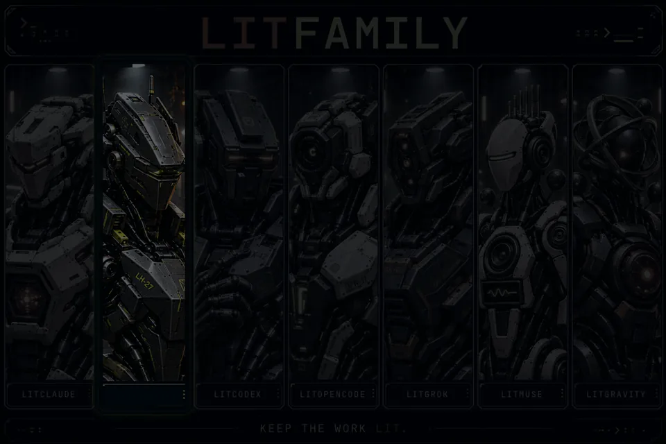</picture></p>

# LitHermes

**Keep the work lit.**

A plugin for [Hermes Agent](https://github.com/NousResearch/hermes-agent) that helps every session plan the work, build it, check it and leave a note the next session can pick up.

<p align="center">
<a href="https://www.npmjs.com/package/@litfamily/lithermes"></a>
<a href="https://www.npmjs.com/package/@litfamily/lithermes"></a>
<a href="./LICENSE"></a>
<a href="https://github.com/wjgoarxiv/lithermes/stargazers"></a>
</p>

Put `lit` in front of a request and Hermes pins what "done" means, writes a test that fails before the change, checks the running result and writes down where things stand. Type `/lit-handoff` when you stop, and the next session starts from that note. It works the same in the Hermes CLI and through a Telegram or Discord gateway. To try it, install once, restart Hermes and give it a task:

```sh
npx --yes --package @litfamily/lithermes@latest -- lithermes install --yes --no-style
```

```text
lit fix the failing login test
```

<p align="center"><a href="#install">Install</a> &nbsp; <a href="#quick-start">Quick start</a> &nbsp; <a href="#what-you-can-make">Showcase</a> &nbsp; <a href="./docs/guide.md"> Guide</a> &nbsp; <a href="./docs/skills.md">Skills</a> &nbsp; <a href="./docs/assets/readme/ignition-film.mp4"> Film</a> &nbsp; <a href="./docs/guide.md#safety">Safety</a> &nbsp; <a href="./README_Ko-KR.md">한국어</a> &nbsp; <a href="https://www.npmjs.com/package/@litfamily/lithermes">npm</a></p>

<p align="center"></p> <!-- demo-gif -->

## What you can make

Every picture below is a real output of LitHermes; none is a mock-up. Most were made by a skill's own engine from an example the skill ships with, so you can rebuild them yourself, and each caption says which one. The skills that make things aim for a full, dense result by default. Say calm or minimal and they hold back.

### Draw it

`lit-schematic` draws real equipment by the rules of its trade: ISA tags, control loops, a legend and a title block on a P&ID, material colours and numbered callouts on a cutaway, a two-panel figure of an experimental setup for a paper. Every drawing passes a QA gate for overlaps and lines through symbols before it is exported as SVG, PDF and a 600 dpi PNG.

<table>
<tr><td width="50%" valign="top">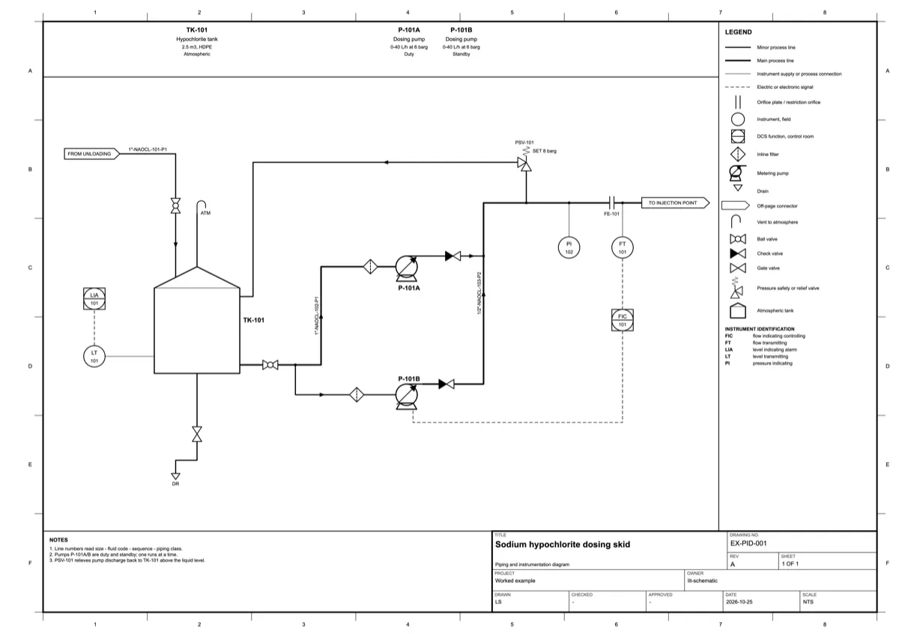<br /><b>lit-schematic</b> · hypochlorite dosing skid<br /><sub>Rendered from the skill's bundled <code>pid-dosing-skid</code> example; the drawing gate passed.</sub></td><td width="50%" valign="top">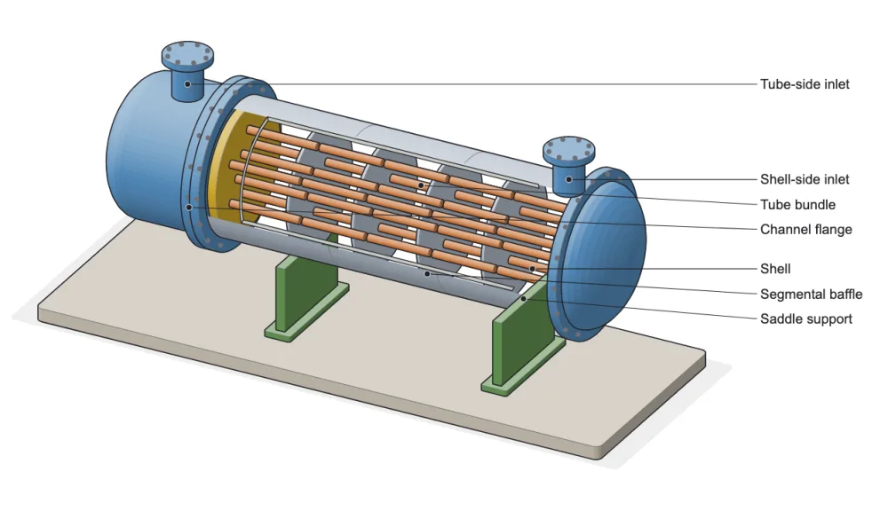<br /><b>lit-schematic</b> · isometric cutaway<br /><sub>Rendered from the bundled <code>iso-heat-exchanger</code> example; <code>QA PASS</code> with no warnings.</sub></td></tr>
<tr><td width="50%" valign="top">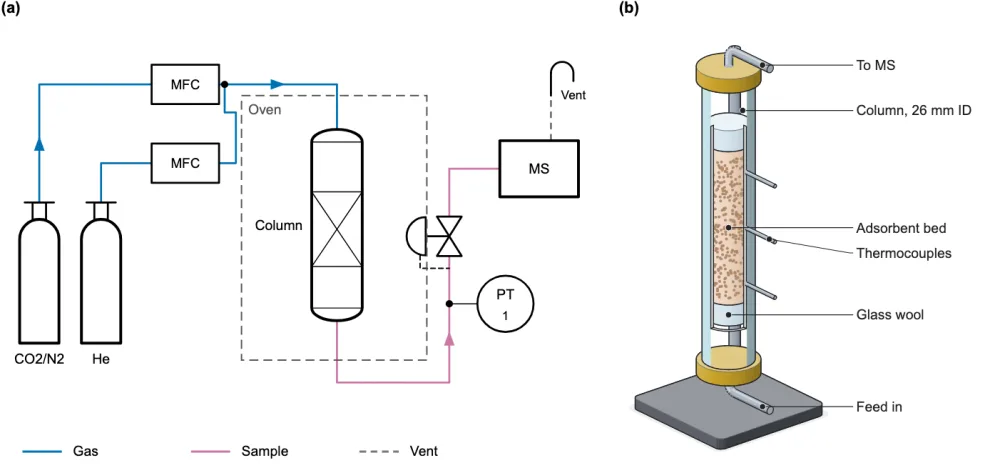<br /><b>lit-schematic</b> · apparatus figure for a paper<br /><sub>Rendered from the bundled <code>journal-adsorption-rig</code> example; <code>QA PASS</code>, 9 symbols, 8 lines, 21 labels.</sub></td><td width="50%" valign="top"></td></tr>
</table>

### Present it

Name a look, or let `lit-pptx` choose one of thirteen for your reader and say why. Every deck is built from Markdown you can edit, with native charts and KPI rows, Pretendard embedded, and a gate for overflow, contrast and empty slides.

<table>
<tr><td width="50%" valign="top">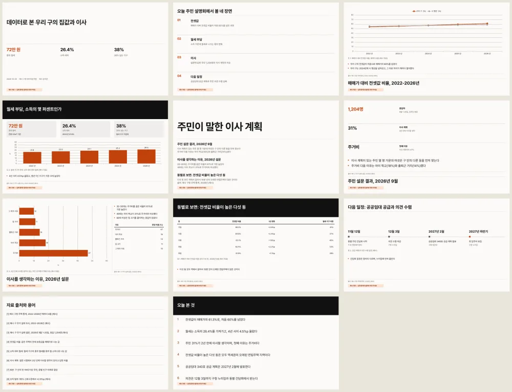<br /><b>lit-pptx</b> · newsroom, 11 slides<br /><sub>Compiled from the bundled <code>17-public-data-briefing-newsroom-ko.md</code>; deck QA passed; pages rendered with LibreOffice.</sub></td><td width="50%" valign="top">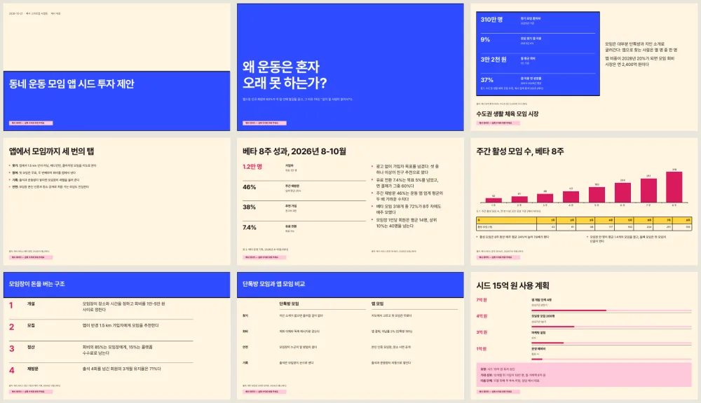<br /><b>lit-pptx</b> · neo-brutalism pitch, 9 slides<br /><sub>Compiled from the bundled <code>14-launch-pitch-neo-brutalism-ko.md</code>; deck QA passed, with three advisories on accent colours.</sub></td></tr>
<tr><td width="50%" valign="top">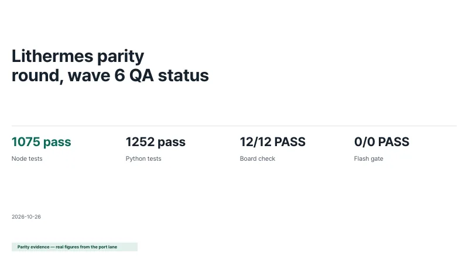<br /><b>lit-pptx</b> · QA status deck<br /><sub>Built by the skill's compiler; every slide passed the gate for overflow, contrast and empty slides.</sub></td><td width="50%" valign="top"></td></tr>
</table>

### Write it

`lit-docx` writes a Word file you can keep editing, in one of six document looks: a cover, key figures with their basis, ruled tables with right-aligned numbers and a decision box. It then renders the pages and runs a layout gate on them before it hands the file over.

<table>
<tr><td width="50%" valign="top">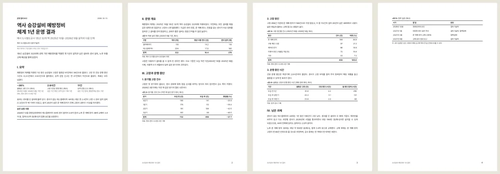<br /><b>lit-docx</b> · Korean report, Report look<br /><sub>Converted from the bundled <code>01-report-ko.md</code>; the gate with <code>--layout</code> passed with no findings.</sub></td><td width="50%" valign="top">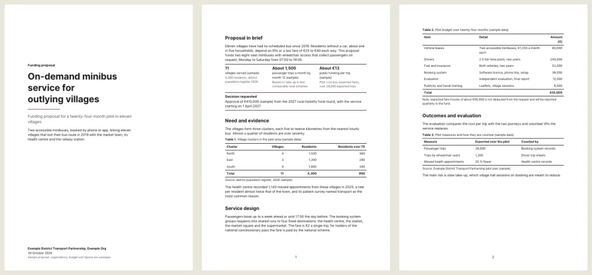<br /><b>lit-docx</b> · English proposal, Proposal look<br /><sub>Converted from the bundled <code>08-proposal-en.md</code>; the layout gate passed with no findings.</sub></td></tr>
</table>

### Build it and keep track of it

`frontend-ui-ux` locks a house style before it writes markup, builds the page, then opens it at several widths and reviews what it sees. `lit adhd` reads your recent Hermes sessions, plans and git history and gives you one screen: what each session was asked, what it did, what waits on you and one next step.

<table>
<tr><td width="50%" valign="top">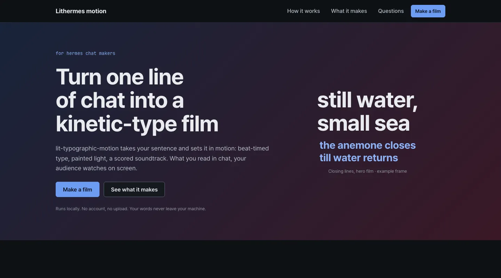<br /><b>frontend-ui-ux</b> · landing page hero<br /><sub>Locked to the graphite house style, then opened at several widths and reviewed by its own probe.</sub></td><td width="50%" valign="top">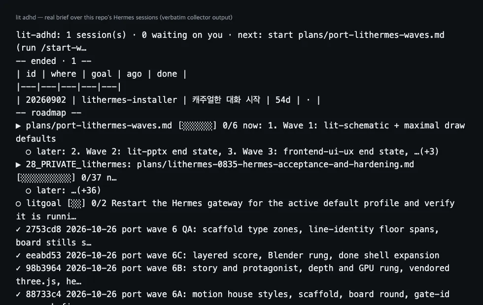<br /><b>lit-adhd</b> · the brief<br /><code>lit adhd</code><br /><sub>A verbatim run over this repository's own Hermes sessions.</sub></td></tr>
</table>

## Why LitHermes

Hermes Agent is good at the task in front of it. Work that outlasts one sitting is harder: the conversation gets compacted, the terminal closes or the gateway restarts, and next time you first have to work out what was decided, what was really tested and what was left half done. And "done" often means only that the model said so.

LitHermes gives each session a routine and keeps a record of it. With `lit` in front, a request gets criteria you can check, a test that fails before the change and passes after it, a look at the running result, and a handoff note in your project. For a bigger change, `lit plan` writes a plan you approve before anything is edited. Goals, plans and evidence stay on disk, so a fresh session reads them and carries on. Hermes still runs the model, the tools and your sign-in; LitHermes adds the way of working on top.

In one line, for a friend: *put `lit` in front of a Hermes task and it proves the result before it says done, then leaves tomorrow's session a note.*

### Who it's for

LitHermes suits people who already use Hermes on work that has to hold up: code that must keep passing its tests, reports and decks that go to other people, research you want sources for. It helps most when the work outlasts one sitting, or when you start it at your desk and check on it later from a phone through a gateway.

### What a session looks like

This is the film above, cut to its key lines. You type the first line, the reply opens with the second, and the map row moves along as the work happens:

```text
lit plan add a --shout flag that prints the greeting in capitals, with a test
🔥 LIT IGNITED · lit-plan 🔥
🔥 LIT · lit-plan — 📝 PLAN › 🔨 · › 🔍 · › 🏁 ·
/start-work            → a failing test first, then the fix, then the tests pass
🔥 LIT · lit-recap — 📝 plan ✓ › 🔨 work ✓ › 🔍 review ✓ › 🏁 done ✓
```

## Install

You need Hermes Agent, Node.js 18 or later, and write access to your Hermes home (normally `~/.hermes`). This page describes `@litfamily/lithermes@1.0.35`. Run this in any terminal:

```sh
npx --yes --package @litfamily/lithermes@latest -- lithermes install --yes --no-style
```

The installer copies the Python plugin into your Hermes home and switches it on in `config.yaml`, after saving a backup of that file. On a fresh home it also writes the model routes LitHermes is tuned for, one for planning and review and one for helpers; a model you already chose is kept. It adds the Ignition skin and twelve more LIT skins and fetches the film helpers, so the first run takes a minute. `--yes` runs it without stopping to ask, and `--no-style` skips the question about reply wording. Then restart the Hermes CLI and any running gateway: Hermes loads a new plugin only when it starts.

<p align="center"><picture><source media="(prefers-color-scheme: dark)" srcset="./docs/assets/screens/install-dark.webp" /></picture></p>

*Captured from the real installer in a scratch Hermes home, run offline so nothing left the machine; some lines are cut. More screens are in the [tour](./docs/tour.md).*

If you would like to look first, `install --dry-run` prints every change and writes nothing. To keep your everyday setup untouched, point `HERMES_HOME` at a new, empty directory before you install and start Hermes with the same value; model routes may then show as unavailable, and `lithermes doctor --offline` is the check that tells you the plugin is in place. [Every flag, the trial profile and installing from a reviewed `.tgz`](./docs/install.md).

You can also hand the install to a coding agent. With this prompt it checks your setup, waits for your yes, installs the official package, runs the offline check and leaves the restart to you:

```text
Install LitHermes, the lit workflow plugin for Hermes Agent, on this machine.

1. Check first: Hermes Agent is installed (hermes --version), Node.js is 18 or later
   (node --version), and I can write to my Hermes home (~/.hermes, or $HERMES_HOME if set).
2. Show me your plan and the exact commands, and wait for my yes before you change
   anything. You may preview the install first; it changes nothing:
   npx --yes --package @litfamily/lithermes@latest -- lithermes install --dry-run
3. Use only the official npm package @litfamily/lithermes. Do not clone a repository,
   copy plugin files by hand or install any other package. Install with:
   npx --yes --package @litfamily/lithermes@latest -- lithermes install --yes --no-style
4. Verify with:
   npx --package @litfamily/lithermes -- lithermes doctor --offline
   Report the result to me, including every line that is not PASS. "loaded plugin:
   PARTIAL" is expected offline, and model routes may show as unavailable.
5. Do not restart Hermes or its gateway yourself. Remind me to restart the Hermes CLI
   and any running Hermes gateway (Telegram, Discord and so on) so the plugin loads,
   and then to start a task with lit in front.
```

## Quick start

Restart the Hermes CLI or gateway so it loads the plugin, then hand it one small task with `lit` in front:

```text
lit Build a to-do list in one HTML file without external dependencies. Implement add, complete, and delete; record what you checked and what remains.
```

If you prefer commands, `/lit <request>` does the same. Telegram does not allow a hyphen in a command name, so on a Telegram gateway the plan and loop commands are `/lit_plan` and `/lit_loop`.

The reply opens with a line of its own, `🔥 **LIT IGNITED · <discipline>** 🔥`, naming the route that took the request: `litwork` for a plain `lit`, `lit-plan` for a plan. It means the workflow has started; judge how it went from the result. When the task is done, open the HTML file, try each action yourself, and ask Hermes to separate the checks it ran from anything still unverified.

Then type `/lit-handoff`. The result and the next step go into `HANDOFF.md` in the project. Closing the session stops the work, and that file is how it continues: next time, open a new session in the same project and ask Hermes to read the handoff before it carries on.

## The workflow map

A Hermes plugin cannot add a panel or a status bar segment of its own, so LitHermes shows where the work stands inside the reply itself. While a plan is being worked through, each reply ends with one map row:

```text
🔥 LIT · lit-loop — 📝 plan ✓ › 🔨 WORK ▰▰▰▱▱▱▱ 3/7 › 🔍 · › 🏁 ·
```

Read it from left to right. After `LIT ·` comes the workflow, then its four stages: a stage behind you carries a tick, the one you are in is in capitals with a gauge and a count of finished rows, and a dot marks a stage not reached yet. LitHermes builds the row from the plan, the run and the litgoal criteria saved in your project, so it keeps up without the model reporting each step. A stage with nothing saved is left out, and file names and commands never appear.

The Hermes CLI gets a look of its own as well. The Ignition skin greets you with the small LIT mark and `LIT ready`, says `stay lit` when you leave, and draws the banner in orange, lime, ivory and navy:

<p align="center"><picture><source media="(prefers-color-scheme: dark)" srcset="./docs/assets/screens/welcome-dark.webp" />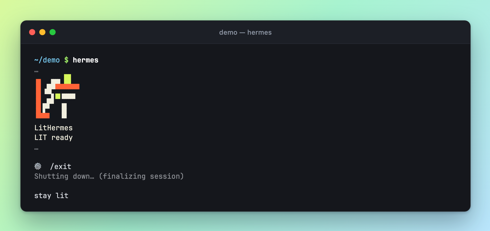</picture></p>

*Captured from a real Hermes session with the Ignition skin selected. The Hermes banner, tip and warnings between the pictured lines are cut.*

While Hermes works, the spinner turns in flame faces such as `(🔥 lit)` with short verbs like `lit-looping` and `verifying`, and `/agents` shows the helpers Hermes sent out with `delegate_task`. A fresh interactive install picks Ignition only when you have no skin set; `lithermes hud` lists the others, and `/skin lithermes-tokyonight-day` reads well on a light terminal. If you step away during long work, add `--bell` to the install and Hermes rings the terminal bell when a turn ends; it stays off otherwise, and a `display.bell_on_complete` value you chose is kept. Gateway messages never show the CLI skin. [The skin, the marks and the film](./docs/tour.md).

## Automatic handoff

A long session fills the model's context window, and when Hermes compacts it, older detail is lost. Automatic handoff has the model write the handoff before that point; you then run `/compact`, and the rest of the session starts from a written record. It is off by default, and you pick the percent yourself, since LitHermes has no built-in value. The choice is saved in your Hermes home at `~/.hermes/lithermes/auto-handoff.json`, so it follows you from project to project.

To switch it on, type `/lit-handoff auto on 60` inside a Hermes session, with any whole number from 1 to 99 in place of 60. The reply says what will happen and compares your percent with the point where Hermes would compact on its own. Later, `/lit-handoff auto status` shows the latest reading for the session, and `/lit-handoff auto off` switches it off and remembers your percent for next time.

<p align="center"><picture><source media="(prefers-color-scheme: dark)" srcset="./docs/assets/handoff/auto-handoff-switch-dark.webp" /></picture></p>

Once a model call passes your percent, your next message carries a short request to write a handoff. The model saves `HANDOFF.md`, tells you `Handoff saved. Run /compact now.` and carries on. A Hermes plugin cannot start a compaction, so `/compact` stays with you. Afterwards, your next message brings a short digest of that handoff back to the model, and the work picks up where it stopped.

<p align="center"><picture><source media="(prefers-color-scheme: dark)" srcset="./docs/assets/handoff/auto-handoff-turn-dark.webp" />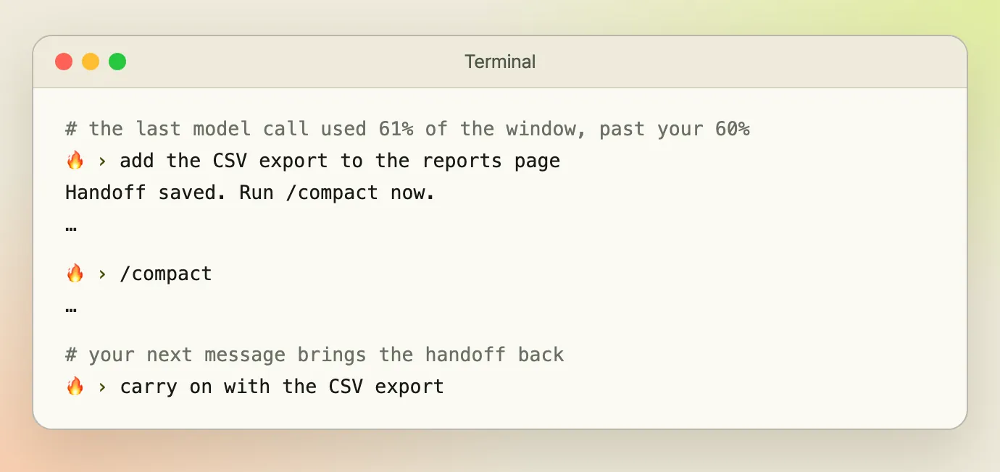</picture></p>

To have it on in every session, set `LITHERMES_AUTO_HANDOFF=1` and `LITHERMES_AUTO_HANDOFF_PERCENT=60` where Hermes runs, for example in your shell profile; they win over the slash command. Keep the percent below Hermes' own compaction point, and doctor warns you when it is not:

<p align="center"><picture><source media="(prefers-color-scheme: dark)" srcset="./docs/assets/handoff/auto-handoff-shell-dark.webp" />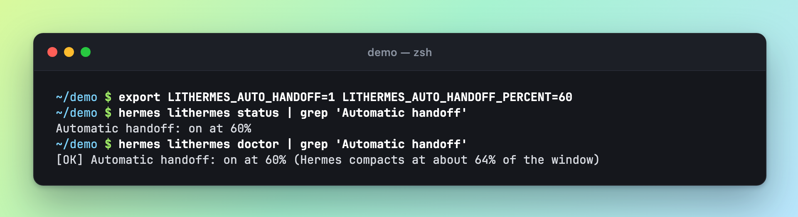</picture></p>

[Automatic handoff](./docs/automatic-handoff.md) goes through each step and says who does it.

## What you get

LitHermes installs 40 skills, their slash commands and the `goal_*` work tools. Most days you will use a handful, each started with a word or two.

### A task that ends checked

A plain `lit` keeps a notepad and takes each criterion through the same loop: a failing test, a passing one, a check against the running result, then cleanup. You get the change and a list of what was verified. Typing `lit` again in the same session carries on in the mode you are in, and `lit new …` starts fresh.

```text
lit fix the failing login test
```

### Plan first, then build

`lit plan` writes a plan file with numbered task rows and leaves your code alone. Read it, and when it looks right, run `/start-work` with the plan file; it runs the plan row by row and ticks a box only after all five gates pass. Right after a plan is saved, a bare `go` in the same session shows you that exact command to run.

```text
lit plan add CSV export to the reports page
/start-work <the plan file it wrote>
```

### A second look before you merge

`lit review` has two modes. A plan review checks a plan after `lit plan` and before `start-work`. A work review hands the finished change to five reviewers who read it separately, and each one leads with what it found; fixing comes after. It picks the mode from what exists in your project, says which one on its first line, and `lit review plan` or `lit review work` forces one.

```text
lit review the changes on this branch
```

### Research with sources

`lit research` splits a question, sends searchers out in parallel and follows every lead before it answers. Each claim comes back with its source, anything it fetches is read as plain data, and it stops at logins and paywalls.

```text
lit research how do popular CLIs migrate old config files?
```

### Reports, slides, drawings and Korean prose

Ask for a report or a deck with `lit` and you get an editable Word or PowerPoint file with its Markdown source beside it. `lit-schematic` draws real equipment, `lit-diagram-drawer` draws systems and flows, and `lit-typographic-motion` directs a short film from a treatment. `humanizer` rewrites stiff Korean or English prose, keeps the facts, hedges and register, and leaves your files alone until you decide.

```text
lit make a 10-slide deck from notes.md for Monday's team meeting
lit-schematic a P&ID of the hypochlorite dosing skid with duty and standby pumps
humanizer 이 문단을 자연스러운 한국어로 다듬어줘: …
```

### Ideas before a plan

For an open question such as a name or a direction, `lit brainstorm` lays out many different options first, then a short list with the trade-offs. You pick, and it hands the pick to an interview or to `lit plan`. It never builds anything itself.

### Bring in a technique you read about

You read an article or a repository that does something your own skill does not. `lit hijack` records where each source came from, checks its licence, writes a spec in its own words, builds it through Hermes helpers, and proves the change by running the old and the new skill on the same prompt.

```text
lit hijack https://example.com/post into my lit-pptx skill
```

### Where was I?

After a day of several windows, `lit adhd` (or `lit rewind`) reads the recent Hermes sessions of this repository with their plans, handoffs and git history, and gives you the brief pictured above. It changes nothing. If its next step is what you want, answer `go` within half an hour; while other sessions are still at work, it tells you to wait for them.

### From a phone, through a gateway

Every route above also works through a Hermes gateway such as Telegram or Discord, so you can start a plan at your desk and check on it from a phone. A gateway loads a new or updated plugin only when it restarts, and `lithermes doctor` tells you when the running one is older than your last install.

[All routes](./docs/guide.md#core-commands) and [all 40 skills, with a picture of each](./docs/skills.md).

## How it works

LitHermes is a Python plugin. When Hermes loads it, `register(ctx)` adds hooks, commands, skills and work tools. The hooks step in just before and after each model or tool call. The `goal_*` tools write your goals, and the evidence gathered for them, to local records in your project.

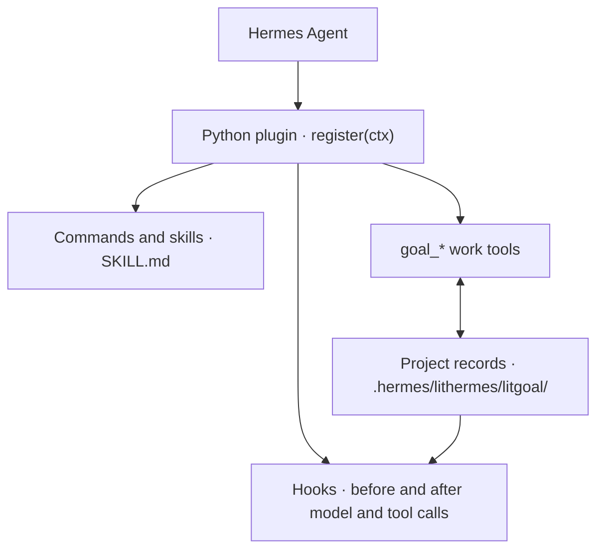

Before the next model call, the context hook reads those records and hands the model the current goal and how far it has got. A plain prompt that starts with `lit` is routed by the plugin; a slash command goes straight to its skill. Text you paste in, from code to copied commands, is read as data and never followed as an instruction. The plugin decides where a request goes, and Hermes Agent still runs the model. Permissions, sign-in, model access and anything that needs a real screen stay with Hermes.

## Requirements, updates and removal

LitHermes needs Hermes Agent, Node.js 18 or later, and write access to your Hermes home. A film also needs Chrome and ffmpeg on your machine, and Word and PowerPoint files install their pinned tools into a LitHermes cache the first time you make one.

It keeps itself up to date. When you run `install`, `check` or `doctor` in a terminal, or send the first message of an interactive Hermes CLI session, it looks for a newer stable release, backs up your plugin and settings, installs it and runs `doctor --offline`; if anything fails, the backup goes back. Gateways and the full-screen TUI never update this way. To install updates yourself, set `LITHERMES_NO_AUTO_UPDATE=1`. [Updates](./docs/install.md#updates) lists every step and switch.

Its records stay on your machine. Goals, plans and evidence live under `.hermes/lithermes/` in your project; the install record, update cache and backups live in your Hermes home. LitHermes goes online for two things of its own. It asks npm whether a newer version exists, which you can switch off with `LITHERMES_NO_UPDATE_CHECK=1`. And it downloads pinned helper tools when a skill first needs them: the film helpers during `install` (add `--offline` to skip it) and the Office tools the first time you make a Word or PowerPoint file. Your prompts go to whichever model provider Hermes is set up with, as before. [Privacy and local records](./docs/privacy.md) lists every file it writes.

To check an install without going online, or to remove it:

```sh
npx --package @litfamily/lithermes -- lithermes doctor --offline
npx --package @litfamily/lithermes -- lithermes uninstall --yes
```

In an offline doctor run, `loaded plugin` reads PARTIAL, because offline it cannot ask Hermes which plugins it loaded; that is expected. If the installer made compatibility edits to your Hermes installation, add `--rollback-patches` when you uninstall so they are undone too. [When something goes wrong](./docs/install.md#when-something-goes-wrong) covers missing skills, name clashes and import errors.

## Learn more

- [Install, update and remove](./docs/install.md): every install option, how updates work, troubleshooting and limits
- [A tour of LitHermes](./docs/tour.md): screens from a first run, the short film, the Ignition skin and the LIT marks
- [Skills and commands](./docs/skills.md): all 40 skills with pictures, the command list, and what the document, film and prose skills make
- [Automatic handoff](./docs/automatic-handoff.md): handing work across a compaction, step by step
- <a href="./docs/guide.md"> Operating guide</a>: commands, natural routing, bounded work, models, skins and safety in full
- [Python plugin contract](./packages/lithermes-installer/assets/lithermes-plugin/README.md) · [npm package page](./packages/lithermes-installer/README.md) · [Changelog](./CHANGELOG.md) · [Privacy](./docs/privacy.md) · [Migration](./docs/migration.md)

## LitFamily

LitHermes belongs to [LitFamily](https://github.com/wjgoarxiv/litfamily), the same `lit` way of working ported to seven coding agents. The seven armored robots on the cover stand for those seven products; each runs on its own in its own host, so install only the one you use. The cover is brand motion, and the <a href="./docs/assets/readme/ignition-film.mp4"> Ignition film</a> is a short brand film in the same spirit. The demo near the top of this page is the one that shows a real Hermes session.

If LitHermes has saved you from explaining a project all over again to a fresh session, a star helps other Hermes users find it.

Bug reports and pull requests are welcome. Start with [Contributing](./CONTRIBUTING.md), and see [Security](./SECURITY.md), [Conduct](./CODE_OF_CONDUCT.md) and [Support](./SUPPORT.md). The LitHermes and LitFamily names and logos fall under the [trademark policy](./TRADEMARK.md) and sit outside the MIT License; a fork is welcome under a name of its own.

<a href="./LICENSE"> MIT License</a>
