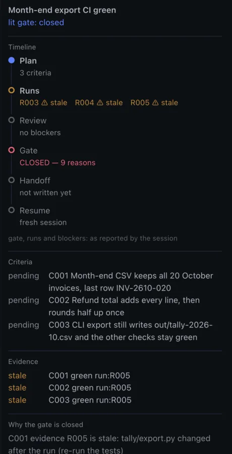

<p align="center"><picture><source media="(prefers-reduced-motion: reduce)" srcset="./docs/assets/cover-motion-still.webp" /></picture></p>

# LitHermes

**Keep the work lit.**

A plugin for [Hermes Agent](https://github.com/NousResearch/hermes-agent) that helps every session plan the work, build it, check it and leave a note the next session can pick up.

<p align="center">
<a href="https://www.npmjs.com/package/@litfamily/lithermes"></a>
<a href="https://www.npmjs.com/package/@litfamily/lithermes"></a>
<a href="./LICENSE"></a>
<a href="https://github.com/wjgoarxiv/lithermes/stargazers"></a>
</p>

Put `lit` in front of a request and Hermes pins what "done" means, writes a test that fails before the change, checks the running result and writes down where things stand. With `lit` on, you see this:
- **A "done" that has to be earned.** When a reply says it is done while the goal's checks are still open, it ends with `⛔ LIT: not done — <reason>` and the goal will not close. A `lit` session that says done without ever opening a goal gets the same line, with that reason.
- **Tests you can trust.** A green counts only when the plugin watched that test command finish with exit 0 and signed a receipt for it. Change the code afterwards and the receipt goes stale until the tests run again. Delete a test, drop an assertion or add a skip, and the goal stays closed until you accept the change yourself with `/lit-accept-tests <reason>`; the model has no way to do that.
- **A note for tomorrow.** When a session that held a goal closes, a handoff card is written under `.hermes/lithermes/handoff/`. The next session in that project offers the unfinished goal, and a bare `lit` picks it up.
- **A pane in Hermes Desktop.** The goal, whether its gate is open and a six-step timeline sit in a right-hand pane. It is Off by default: in Hermes Desktop 0.23 or later, switch LitHermes on under Capabilities > Plugins.<br /><br />

> [!TIP]
> Run the one line under [Install](#install), restart Hermes, then give it a task with `lit` in front as in [Quick start](#quick-start). It works the same in the Hermes CLI and through a Telegram or Discord gateway.

<p align="center"><a href="#install">Install</a> &nbsp; <a href="#quick-start">Quick start</a> &nbsp; <a href="#what-you-can-make">Showcase</a> &nbsp; <a href="./docs/guide.md"> Guide</a> &nbsp; <a href="./docs/skills.md">Skills</a> &nbsp; <a href="./docs/assets/readme/ignition-film.mp4"> Film</a> &nbsp; <a href="./docs/guide.md#safety">Safety</a> &nbsp; <a href="./README_Ko-KR.md">한국어</a> &nbsp; <a href="https://www.npmjs.com/package/@litfamily/lithermes">npm</a></p>

<p align="center"></p> <!-- demo-gif -->

## What you can make

The picture below is a real run of LitHermes. The skills that make things aim for a full, dense result by default; say calm or minimal and they hold back.

### Keep track of it

`lit adhd` reads your recent Hermes sessions, plans and git history and gives you one KPI board: the one thing to do now and exactly what to type, what is done, what is left, and what you must not forget.

<table>
<tr><td width="50%" valign="top"><br /><b>lit-adhd</b> · the brief<br /><code>lit adhd</code><br /><sub>A verbatim run over this repository's own Hermes sessions.</sub></td><td width="50%" valign="top"></td></tr>
</table>

### Drawings, decks, documents, interfaces and films

The nine skills that make those things are LitFamily extensions on the `wjgoarxiv-skills` shelf, so you add the ones you use beside LitHermes; [Extensions](#extensions) names them and shows how. [Skills and commands](./docs/skills.md#moved-to-wjgoarxiv-skills) has the list.

## Why LitHermes

Hermes Agent is good at the task in front of it. Work that outlasts one sitting is harder: the conversation gets compacted, the terminal closes or the gateway restarts, and next time you first have to work out what was decided, what was really tested and what was left half done. And "done" often means only that the model said so.

LitHermes gives each session a routine and keeps a record of it; for a bigger change, `lit plan` writes a plan you approve before anything is edited. Goals, plans and evidence stay on disk, so a fresh session reads them and carries on. Hermes still runs the model, the tools and your sign-in; LitHermes adds the way of working on top.

It suits people who already use Hermes on work that has to hold up: code that must keep passing its tests, reports and decks that go to other people, research you want sources for. It helps most when the work outlasts one sitting, or when you start it at your desk and check on it later from a phone through a gateway.

### What a session looks like

This is the film above, cut to its key lines. You type the first line, the reply opens with the second, and the map row moves along as the work happens:

```text
lit plan add a --shout flag that prints the greeting in capitals, with a test
🔥 LIT IGNITED · lit-plan 🔥
🔥 LIT · lit-plan — 📝 PLAN › 🔨 · › 🔍 · › 🏁 ·
/start-work            → a failing test first, then the fix, then the tests pass
🔥 LIT · lit-recap — 📝 plan ✓ › 🔨 work ✓ › 🔍 review ✓ › 🏁 done ✓
```

## Install

You need Hermes Agent, Node.js 18 or later, and write access to your Hermes home (normally `~/.hermes`). This page describes `@litfamily/lithermes@1.0.40`. Run this in any terminal:

```sh
npx --yes --package @litfamily/lithermes@latest -- lithermes install --yes --no-style
```

| Part | What the installer does |
| --- | --- |
| Plugin | Copies the Python plugin into your Hermes home and switches it on in `config.yaml`, after saving a backup of that file |
| Model routes | On a fresh home, writes one route for planning and review and one for helpers; a model you already chose is kept |
| Skins | Adds the Ignition skin and twelve more LIT skins |
| `--yes`, `--no-style` | Run it without stopping to ask, and skip the question about reply wording |

Then restart the Hermes CLI and any running gateway, because Hermes loads a new plugin only when it starts.

<p align="center"><picture><source media="(prefers-color-scheme: dark)" srcset="./docs/assets/screens/install-dark.webp" /></picture></p>

*Captured from the real installer in a scratch Hermes home, run offline so nothing left the machine; some lines are cut. More screens are in the [tour](./docs/tour.md).*

**Look before you install.** `install --dry-run` prints every change and writes nothing. To keep your everyday setup untouched, point `HERMES_HOME` at a new, empty directory before you install and start Hermes with the same value; model routes may then show as unavailable, and `lithermes doctor --offline` is the check that tells you the plugin is in place. [Every flag, the trial profile and installing from a reviewed `.tgz`](./docs/install.md).

**Hand it to a coding agent.** With [this prompt](./docs/install.md#hand-the-install-to-a-coding-agent), the agent checks your setup, waits for your yes, installs the official package, runs the offline check and leaves the restart to you.

## Extensions

LitHermes's core is complete and works on its own: planning, loops, goals, reviews, research, handoffs and prose cleanup all ship in this package. Nine skills that make files are LitFamily extensions, kept on the extension shelf [`wjgoarxiv-skills`](https://github.com/wjgoarxiv/wjgoarxiv-skills). Install the ones you use alongside LitHermes to get the full LitFamily experience:

| For | Extensions |
| --- | --- |
| Decks and documents | `lit-pptx`, `lit-docx` |
| Figures | `lit-diagram-drawer`, `lit-schematic`, `lit-scientific-visualization` |
| Design | `frontend-ui-ux`, `visual-qa` |
| Video covers | `lit-typographic-motion`, `readme-studio` |

Inside the package are 31 core skills, from `litwork` and `lit-plan` to `review-work`, `lit-handoff` and `lit-humanizer`, and every `lit` route runs on them; each of the nine extensions left only a stub with its name. The picture shows both parts, the five families on the shelf, and the four steps `lithermes extensions install` takes to bring one extension into your profile: check, move aside, copy, receipt.

<p align="center"><picture><source media="(prefers-color-scheme: dark)" srcset="./docs/assets/readme/diagrams/core-extensions.en.dark.png" /></picture></p>

**Install one with the command.** Each extension has a Hermes edition, one self-contained folder under `variants/lithermes/`. This line brings it into your profile, and a new Hermes session picks it up; without `--yes` it only prints the plan:

```sh
npx --package @litfamily/lithermes@latest -- lithermes extensions install lit-pptx --yes
```

| Step | What it does |
| --- | --- |
| Check | Looks through every folder Hermes reads skills from; stops and names the path if another `lit-pptx` sits there |
| Move aside | Moves an old `skills/lit-pptx/` whole into `extension-backups/` of the profile, outside every folder Hermes reads skills from |
| Copy and receipt | Copies the skill into the emptied folder and writes a small receipt, `.litfamily-extension.json` |

The command keeps a shallow copy of the shelf in its own cache folder, or uses your clone, given with `--from <path>`. `extensions list`, `check`, `update --yes`, `remove <id> --yes` and `prune-backups --yes` keep your copies in order, `lithermes doctor` prints the check's summary, and [Skills and commands](./docs/skills.md#moved-to-wjgoarxiv-skills) says what each verb does.

**Or copy it by hand.** The same steps work without the command: clone the shelf once (`git clone https://github.com/wjgoarxiv/wjgoarxiv-skills.git`), set `ID` to the skill you want and paste the other lines in bash or zsh:

```sh
H="${HERMES_HOME:-$HOME/.hermes}"; ID=lit-pptx; SRC="$PWD/wjgoarxiv-skills/variants/lithermes/$ID"
[ -e "$H/skills/${ID:?}" ] && echo "taken: $H/skills/$ID" || echo "free: $H/skills/$ID"; grep -rlE --include=SKILL.md "^name: *[\"']?${ID}[\"']? *\$" "$H/skills" .hermes/skills .agents/skills 2>/dev/null; grep -A3 -E '^ *(external_dirs|create_dir):' "$H/config.yaml" 2>/dev/null
if [ -e "$H/skills/${ID:?}" ]; then mkdir -p "$H/extension-backups" && B=$(mktemp -d "$H/extension-backups/$(date +%Y%m%d-%H%M%S)-XXXX") && mv "$H/skills/$ID" "$B/" && echo "moved aside: $B/$ID"; fi
if [ -e "$H/skills/${ID:?}" ]; then echo "stopped: $H/skills/$ID is still there"; else mkdir -p "$H/skills" && cp -R "$SRC" "$H/skills/$ID" && echo "copied: $H/skills/$ID"; fi
printf '{"id":"%s","source":"%s","variant":"lithermes","installed_at":"%s"}\n' "${ID:?}" "$(printf %s "$SRC" | sed 's/[\\"]/\\&/g')" "$(date -u +%Y-%m-%dT%H:%M:%SZ)" > "$H/skills/$ID/.litfamily-extension.json"
```

The copy sits beside LitHermes in the profile's `skills/` folder, so upgrades and uninstalls leave it and its receipt alone. To update by hand, pull the clone and paste the last five lines again; either way, each run keeps the copy it replaces in its own dated backup.

**Until you add one, its name still answers.** `/lit-pptx`, or `lit` with a request for a deck, tells you it is an extension and gives you the command above. The installer prints this note after an install or an upgrade, and the first Hermes reply after that shows it once more; when `extensions check` finds a second copy or a folder without a receipt in your profile, the note adds the line that runs it. After an upgrade from an older release, the note also names the tool caches the old film, deck and Word skills left behind (`lithermes/motion/` and `lithermes/office/` in your cache folder) and the update backups that still hold those skills, which you can delete if you do not install those extensions.

## Quick start

Restart the Hermes CLI or gateway so it loads the plugin, then hand it one small task with `lit` in front:

```text
lit Build a to-do list in one HTML file without external dependencies. Implement add, complete, and delete; record what you checked and what remains.
```

1. The reply opens with a line of its own, `🔥 **LIT IGNITED · <discipline>** 🔥`, naming the route that took the request: `litwork` for a plain `lit`, `lit-plan` for a plan. It means the workflow has started; judge how it went from the result.
2. When the task is done, open the HTML file, try each action yourself, and ask Hermes to separate the checks it ran from anything still unverified.
3. Type `/lit-handoff`. The result and the next step go into `HANDOFF.md` in the project.
4. Closing the session stops the work, and that file is how it continues: next time, open a new session in the same project and ask Hermes to read the handoff before it carries on.

If you prefer commands, `/lit <request>` does the same. Telegram does not allow a hyphen in a command name, so on a Telegram gateway the plan and loop commands are `/lit_plan` and `/lit_loop`.

## The workflow map

In the terminal a Hermes plugin cannot add a panel or a status bar segment of its own (the Desktop pane above is the exception), so LitHermes shows where the work stands inside the reply itself. While a plan is being worked through, each reply ends with one map row:

```text
🔥 LIT · lit-loop — 📝 plan ✓ › 🔨 WORK ▰▰▰▱▱▱▱ 3/7 › 🔍 · › 🏁 ·
```

| Part of the row | Meaning |
| --- | --- |
| `LIT · lit-loop` | The workflow |
| `plan ✓` · `WORK ▰▰▰▱▱▱▱ 3/7` · `🔍 ·` | A stage behind you carries a tick; the one you are in is in capitals with a gauge and a count of finished rows; a dot marks a stage not reached yet |

LitHermes builds the row from the plan, the run and the litgoal criteria saved in your project, so it keeps up without the model reporting each step. A stage with nothing saved is left out, and file names and commands never appear.

**The Ignition skin.** The Hermes CLI gets a look of its own: the skin greets you with the small LIT mark and `LIT ready`, says `stay lit` when you leave, and draws the banner in orange, lime, ivory and navy.

<p align="center"><picture><source media="(prefers-color-scheme: dark)" srcset="./docs/assets/screens/welcome-dark.webp" /></picture></p>

*Captured from a real Hermes session with the Ignition skin selected. The Hermes banner, tip and warnings between the pictured lines are cut.*

- **Spinner and helpers.** While Hermes works, the spinner turns in flame faces such as `(🔥 lit)` with short verbs like `lit-looping` and `verifying`, and `/agents` shows the helpers Hermes sent out with `delegate_task`.
- **Other skins.** A fresh interactive install picks Ignition only when you have no skin set; `lithermes hud` lists the others, and `/skin lithermes-tokyonight-day` reads well on a light terminal.
- **Bell.** If you step away during long work, add `--bell` to the install and Hermes rings the terminal bell when a turn ends; it stays off otherwise, and a `display.bell_on_complete` value you chose is kept.
- **Gateways.** Gateway messages never show the CLI skin. [The skin, the marks and the film](./docs/tour.md).

## Automatic handoff

A long session fills the model's context window, and when Hermes compacts it, older detail is lost. Automatic handoff has the model write the handoff before that point; you then run `/compact`, and the rest of the session starts from a written record. It is off by default, and you pick the percent yourself, since LitHermes has no built-in value.

| Type in a Hermes session | What happens |
| --- | --- |
| `/lit-handoff auto on 60` | Switches it on, with any whole number from 1 to 99 in place of 60; the reply says what will happen and compares your percent with the point where Hermes would compact on its own |
| `/lit-handoff auto status` | Shows the latest reading for the session |
| `/lit-handoff auto off` | Switches it off and remembers your percent for next time |

The choice is saved in your Hermes home at `~/.hermes/lithermes/auto-handoff.json`, so it follows you from project to project.

<p align="center"><picture><source media="(prefers-color-scheme: dark)" srcset="./docs/assets/handoff/auto-handoff-switch-dark.webp" /></picture></p>

Once a model call passes your percent, your next message carries a short request to write a handoff; the model saves `HANDOFF.md`, tells you `Handoff saved. Run /compact now.` and carries on. A Hermes plugin cannot start a compaction, so `/compact` stays with you. Afterwards, your next message brings a short digest of that handoff back to the model, and the work picks up where it stopped.

<p align="center"><picture><source media="(prefers-color-scheme: dark)" srcset="./docs/assets/handoff/auto-handoff-turn-dark.webp" /></picture></p>

To have it on in every session, set `LITHERMES_AUTO_HANDOFF=1` and `LITHERMES_AUTO_HANDOFF_PERCENT=60` where Hermes runs, for example in your shell profile; they win over the slash command. Keep the percent below Hermes' own compaction point, and doctor warns you when it is not:

<p align="center"><picture><source media="(prefers-color-scheme: dark)" srcset="./docs/assets/handoff/auto-handoff-shell-dark.webp" /></picture></p>

[Automatic handoff](./docs/automatic-handoff.md) goes through each step and says who does it.

## What you get

LitHermes installs 40 skills, their slash commands and the `goal_*` work tools. Most days you will use a handful, each started with a word or two; [Everyday routes](./docs/skills.md#everyday-routes) walks through each one.

| Start with | What you get |
| --- | --- |
| `lit fix the failing login test` | Each criterion taken from a failing test to a passing one and a check of the running result, then a list of what was verified |
| `lit plan add CSV export to the reports page` | A plan file and no code change; `/start-work <the plan file it wrote>` then runs it row by row |
| `lit review the changes on this branch` | A plan review, or five reviewers who read the finished change separately and lead with what they found |
| `lit research how do popular CLIs migrate old config files?` | An answer whose every claim carries its source; it stops at logins and paywalls |
| `humanizer 이 문단을 자연스러운 한국어로 다듬어줘: …` | Stiff Korean or English prose rewritten with facts, hedges and register kept, and your files left alone |
| `lit brainstorm <ask>` | Many options, then a short list with trade-offs; your pick goes to an interview or to `lit plan` |
| `lit hijack https://example.com/post into my lit-humanizer skill` | A technique you read about, licence-checked, rebuilt in your skill and proven on the same prompt |
| `lit adhd` | A read-only board of recent sessions: the one thing to do now, progress and reminders |

Every route also works through a Hermes gateway such as Telegram or Discord, so you can start a plan at your desk and check on it from a phone. A gateway loads a new or updated plugin only when it restarts, and `lithermes doctor` tells you when the running one is older than your last install.

[All routes](./docs/guide.md#core-commands) and [all 40 skills, with a picture of each](./docs/skills.md).

## How it works

LitHermes is a Python plugin. When Hermes loads it, `register(ctx)` adds hooks, commands, skills and work tools; the hooks step in just before and after each model or tool call. The `goal_*` tools write your goals, and the evidence gathered for them, to local records in your project.

<p align="center"><picture><source media="(prefers-color-scheme: dark)" srcset="./docs/assets/readme/diagrams/lit-route.en.dark.png" /></picture></p>

The picture follows one request from the moment you type it, through the route step, the `goal_*` tools and the gate, to the records in your project. [How it works, step by step](./docs/how-it-works.md) walks through each box and hook.

### The same route, drawn as a plant

The same route works as a small process plant, and the plant shows something the boxes above hide: work goes round. A failing reply goes back to the work unit as `LIT: not done` until the gate opens, and the stream table in the drawing says what each numbered line carries.

<p align="center"><picture><source media="(prefers-reduced-motion: reduce) and (prefers-color-scheme: dark)" srcset="./docs/assets/readme/schematic/lit-plant.en.dark.png" /><source media="(prefers-reduced-motion: reduce)" srcset="./docs/assets/readme/schematic/lit-plant.en.light.png" /><source media="(prefers-color-scheme: dark)" srcset="./docs/assets/readme/schematic/lit-plant-loop.en.dark.webp" /></picture></p>

The plugin decides where a request goes while Hermes Agent still runs the model. Text you paste in, from code to copied commands, is read as data and never followed as an instruction; [the walkthrough](./docs/how-it-works.md#the-plant) follows each stream.

## Requirements, updates and removal

LitHermes needs Hermes Agent 0.21.3 or later, Node.js 18 or later, and write access to your Hermes home. The skills that make films, decks and Word files moved to `wjgoarxiv-skills` with the tools they need, so LitHermes itself needs nothing more. Two places on your machine hold LitHermes, and they fill up at different times:

| Place | What it holds | When |
| --- | --- | --- |
| Hermes home | The plugin folder, the switch in `config.yaml` (after a backup), the skins, the install record, update cache and backups | The installer writes only here |
| Project `.hermes/lithermes/` | Goals, plans, evidence, signed run notes and handoff cards | Once you work in the project |
| Profile `skills/` | Extensions you copied, beside the plugin | Upgrades and uninstalls leave them alone |

<p align="center"><picture><source media="(prefers-color-scheme: dark)" srcset="./docs/assets/readme/diagrams/install-map.en.dark.png" /></picture></p>

It keeps itself up to date, following the bottom row of the picture. When you run `install`, `check` or `doctor` in a terminal, or send the first message of an interactive Hermes CLI session, it looks for a newer stable release, backs up your plugin and settings, installs it and runs `doctor --offline`; if anything fails, the backup goes back. Gateways and the full-screen TUI never update this way, and `LITHERMES_NO_AUTO_UPDATE=1` lets you install updates yourself; [Updates](./docs/install.md#updates) lists every step and switch.

**Its records stay on your machine.** LitHermes goes online for one thing of its own: it asks npm whether a newer version exists, which you can switch off with `LITHERMES_NO_UPDATE_CHECK=1` or skip for one run with `--offline`. Your prompts go to whichever model provider Hermes is set up with, as before. Four details are worth knowing:

- **Run notes** show that the plugin saw a command finish with that exit code; they do not show that the command tested anything useful.
- **The test watch** behind `/lit-accept-tests` keeps its counts in a project file that a model with a raw shell could empty.
- **Resume offers** read other sessions' goal files in the same project, but only goals this install sealed with its own key (kept in your Hermes home). `LITHERMES_GOAL_RESUME=0` turns that off.
- **Handoff cards** are written when Hermes closes the session, which can be well after your last message.

[Privacy and local records](./docs/privacy.md) lists every file it writes, and [what the plugin checks, reads and starts](./docs/privacy.md#what-the-plugin-checks-reads-and-starts) covers the rest: the run signature, the Desktop pane's read-only route, the processes it launches, the Hermes internals it reads and the one install-scan caution. To check an install without going online, or to remove it:

```sh
npx --package @litfamily/lithermes -- lithermes doctor --offline
npx --package @litfamily/lithermes -- lithermes uninstall --yes
```

In an offline doctor run, `loaded plugin` reads PARTIAL, because offline it cannot ask Hermes which plugins it loaded; that is expected. If the installer made compatibility edits to your Hermes installation, add `--rollback-patches` when you uninstall so they are undone too. [When something goes wrong](./docs/install.md#when-something-goes-wrong) covers missing skills, name clashes and import errors.

## Learn more

- [Install, update and remove](./docs/install.md): every install option, how updates work, troubleshooting and limits
- [A tour of LitHermes](./docs/tour.md): screens from a first run, the short film, the Ignition skin and the LIT marks
- [Skills and commands](./docs/skills.md): all 40 skills with pictures, the command list, and what the document, film and prose skills make
- [Automatic handoff](./docs/automatic-handoff.md): handing work across a compaction, step by step
- <a href="./docs/guide.md"> Operating guide</a>: commands, natural routing, bounded work, models, skins and safety in full
- [Python plugin contract](./packages/lithermes-installer/assets/lithermes-plugin/README.md) · [npm package page](./packages/lithermes-installer/README.md) · [Changelog](./CHANGELOG.md) · [Privacy](./docs/privacy.md) · [Migration](./docs/migration.md)

## LitFamily

LitHermes belongs to [LitFamily](https://github.com/wjgoarxiv/litfamily), the same `lit` way of working ported to seven coding agents. The seven armored robots on the cover stand for those seven products; each runs on its own in its own host, so install only the one you use. The cover is brand motion and the <a href="./docs/assets/readme/ignition-film.mp4"> Ignition film</a> a short brand film in the same spirit, while the demo near the top of this page shows a real Hermes session.

If LitHermes has saved you from explaining a project all over again to a fresh session, a star helps other Hermes users find it.

Bug reports and pull requests are welcome. Start with [Contributing](./CONTRIBUTING.md), and see [Security](./SECURITY.md), [Conduct](./CODE_OF_CONDUCT.md) and [Support](./SUPPORT.md). The LitHermes and LitFamily names and logos fall under the [trademark policy](./TRADEMARK.md) and sit outside the MIT License; a fork is welcome under a name of its own.

<a href="./LICENSE"> MIT License</a>
