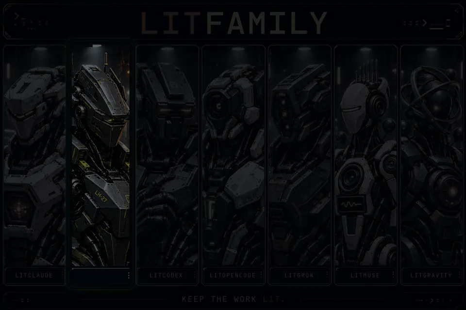
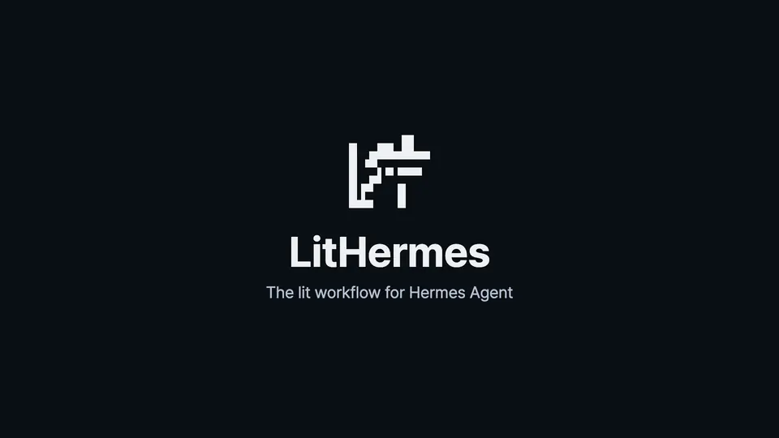
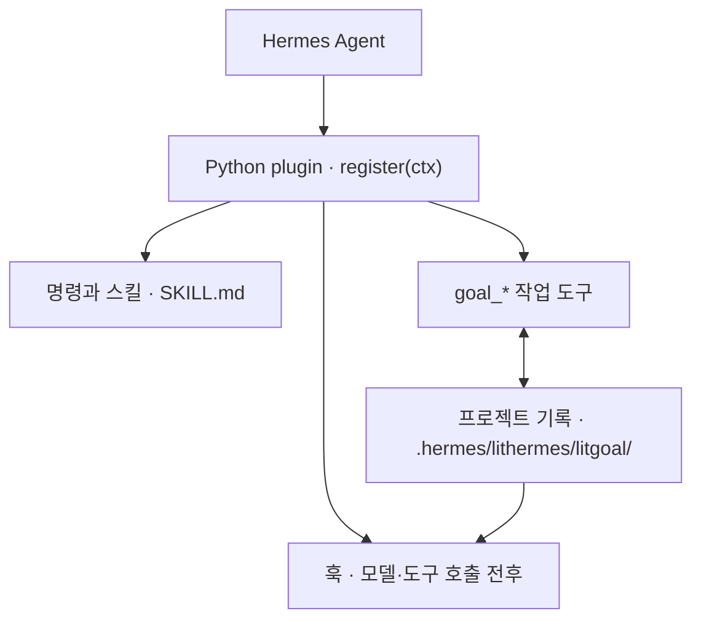

<p align="center"><picture><source media="(prefers-reduced-motion: reduce)" srcset="./docs/assets/cover-motion-still.webp" /></picture></p>

# LitHermes

**Keep the work lit.**

LitHermes는 [Hermes Agent](https://github.com/NousResearch/hermes-agent)용 플러그인입니다. 요청 앞에 `lit`을 붙이면 Hermes가 작업을 계획하고, 해내고, 한 일을 확인한 뒤, 다음 세션이 이어받을 수 있는 기록을 남깁니다.

<p align="center">
<a href="https://www.npmjs.com/package/@litfamily/lithermes"></a>
<a href="https://www.npmjs.com/package/@litfamily/lithermes"></a>
<a href="./LICENSE"></a>
<a href="https://github.com/wjgoarxiv/lithermes/stargazers"></a>
</p>

<p align="center"><a href="#설치">설치</a> · <a href="#첫-작업">첫 작업</a> · <a href="#할-수-있는-일">할 수 있는 일</a> · <a href="#더-알아보기">더 알아보기</a> · <a href="./README.md">English</a> · <a href="https://www.npmjs.com/package/@litfamily/lithermes">npm</a></p>

<p align="center"></p> <!-- demo-gif -->

<p align="center"><sub>LitHermes를 설치한 실제 Hermes 세션을 터미널에서 녹화했습니다. 기다리는 시간을 줄이고 프로젝트 폴더와 홈 폴더를 ~/greet와 ~로 표시했으며, 나머지 글자는 Hermes가 출력한 그대로입니다. 다른 화면은 <a href="./docs/tour.ko.md">둘러보기</a>에 있습니다.</sub></p>

## 왜 LitHermes인가요

Hermes Agent는 지금 시킨 일을 해냅니다. 곤란해지는 건 작업이 한 세션 안에 끝나지 않을 때입니다. 대화는 압축되고, 터미널은 닫히고, 다음에 다시 앉으면 무엇을 정했는지, 무엇을 정말로 확인했는지, 어디까지 하다 말았는지를 처음부터 되짚어야 합니다.

LitHermes는 그 작업에 기록을 붙여 줍니다. 요청에 `lit`을 붙이면 확인할 수 있는 기준, 바꾸기 전에는 실패하고 바꾼 뒤에는 통과하는 테스트, 실행 결과 확인, 프로젝트 안의 인계 기록이 함께 생깁니다. 목표와 계획과 근거가 디스크에 남으니, 다음 세션은 그 기록을 읽고 바로 이어갑니다.

```text
계획하기 → 만들기 → 확인하기 → 다음 작업에 건네기
```

## 빠른 시작

### 설치

Hermes Agent와 Node.js 18 이상, 그리고 Hermes 홈(기본 `~/.hermes`)에 쓸 권한이 필요합니다. 이 문서는 `@litfamily/lithermes@1.0.19` 기준입니다.

```sh
npx --yes --package @litfamily/lithermes@latest -- lithermes install --yes --no-style
```

이 명령은 플러그인을 Hermes 홈에 넣고, 플러그인이 불러와지도록 Hermes 설정을 고칩니다. 중간에 승인을 묻느라 멈추지 않습니다. `--no-style`은 답변 문체를 고르는 화면을 건너뜁니다. 평소 쓰는 환경을 건드리기 전에 먼저 써 보고 싶다면, 설치 전에 `HERMES_HOME`을 비어 있는 새 디렉터리로 지정하고 Hermes를 시작할 때도 같은 값을 쓰세요. 처음 설치할 때는 영상용 도구도 함께 받으므로 1분쯤 걸릴 수 있습니다. Hermes를 확인할 수 없으면 설치 보고서에 일부 모델 경로가 unavailable로 나올 수 있는데, 정말 봐야 할 것은 `lithermes doctor --offline` 결과입니다. 옵션 하나하나의 뜻, 시험용 프로필, 검토된 `.tgz`로 설치하는 방법은 [설치 문서](./docs/install.ko.md)에 있습니다.

### 첫 작업

플러그인을 불러오도록 Hermes CLI 또는 gateway를 다시 시작하세요. 그다음 요청 앞에 `lit`을 붙여 작업을 맡깁니다.

```text
lit 외부 의존성 없이 HTML 파일 하나로 할 일 목록을 만들어줘. 추가·완료·삭제를 구현하고 확인한 내용과 다음 행동을 남겨줘.
```

명령으로 부르고 싶다면 `/lit <요청>`을 쓰면 됩니다. Telegram gateway에서는 `/lit_loop`, `/lit_plan`을 쓰세요.

### 이렇게 보입니다

응답 첫 줄에 `🔥 **LIT IGNITED · <discipline>** 🔥`가 따로 한 줄로 나옵니다. 점 뒤의 이름은 요청을 받은 경로입니다. 그냥 `lit`이면 `litwork`, 계획이면 `lit-plan`입니다. 이 줄은 작업이 시작됐다는 표시일 뿐이고, 잘 됐는지는 결과를 보고 직접 판단하시면 됩니다.

작업이 끝나면 HTML 파일을 열어 각 동작을 직접 눌러 보세요. Hermes에는 실제로 확인한 내용과 아직 확인하지 못한 내용을 나눠 달라고 하세요. 그다음 `/lit-handoff`를 입력하면 결과와 다음 할 일이 프로젝트의 `HANDOFF.md`에 남습니다. 다음번에는 같은 프로젝트에서 새 세션을 열고, 이어가기 전에 그 인계 기록부터 읽어 달라고 하면 됩니다. 세션을 닫으면 작업도 멈추고, 다음 세션은 인계 기록을 읽고 이어갑니다.

긴 세션에서는 이 일을 자동으로 맡길 수도 있습니다. 자동 핸드오프는 기본값이 꺼짐입니다. `/lit-handoff auto on 60`(1에서 99 사이의 정수)을 켜 두면, 모델 호출이 컨텍스트 창의 그 비율을 넘었을 때 모델에게 인계 기록을 쓰라고 요청하고, 그다음 `/compact`는 직접 실행합니다. 단계마다 누가 무엇을 하는지는 [자동 핸드오프](./docs/automatic-handoff.ko.md)에 정리해 두었습니다.

## 할 수 있는 일

LitHermes는 스킬 36개를 설치합니다. 처음에는 아래 여섯 가지부터 써 보세요.

**확인까지 끝나는 작업.** 그냥 `lit`을 붙이면 노트를 펴 두고, 기준 하나마다 같은 순서를 밟습니다. 실패하는 테스트, 통과, 실행 결과 확인, 정리입니다. 바뀐 코드와 함께 무엇을 확인했는지 목록이 남습니다.

```text
lit 실패하는 로그인 테스트를 고쳐줘
```

**계획부터 세우고 만들기.** `lit plan`은 번호 붙은 작업 목록을 파일로 쓰고 코드는 건드리지 않습니다. 계획을 승인하면 `/start-work`가 한 줄씩 실행하고, 다섯 관문을 모두 통과해야 체크 표시를 붙입니다.

```text
lit plan 보고서 페이지에 CSV 내보내기 추가
```

**다섯 명이 따로 읽는 리뷰.** `lit review`는 같은 변경을 리뷰어 다섯에게 따로 읽힙니다. 리뷰어마다 찾은 문제부터 알려 줍니다.

```text
lit review 이 브랜치의 변경 사항
```

**출처가 붙는 조사.** `lit research`는 질문을 쪼개 여러 검색을 동시에 보내고, 실마리를 끝까지 따라간 뒤에 답합니다. 주장마다 출처가 붙고, 가져온 글은 자료로만 읽습니다.

```text
lit research 널리 쓰이는 CLI들은 오래된 설정 파일을 어떻게 옮길까?
```

**보고서, 발표자료, 다이어그램.** `lit`을 붙여 보고서나 발표자료를 부탁하면 편집할 수 있는 Word나 PowerPoint 파일과 그 Markdown 원본이 함께 나옵니다. 스킬이 읽을 사람에게 맞는 디자인을 골라 무엇을 왜 골랐는지 알려 주고, 완성된 파일을 점검한 뒤에 건넵니다. 다이어그램은 `lit-diagram-drawer`가 같은 방식으로 만듭니다.

```text
lit notes.md로 월요일 팀 회의용 슬라이드 10장 만들어줘
```

**한국어와 영어 글 다듬기.** `humanizer`는 딱딱한 모델 문장을 사람이 쓴 것처럼 고쳐 줍니다. 사실과 단서, 존댓말과 말투는 그대로 두고, before/after 비교를 보여 주며, 파일을 저절로 고치지 않습니다.

```text
humanizer 이 문단을 자연스러운 한국어로 다듬어줘: …
```

나머지 30개는 디버깅, 리팩터링, 브라우저 작업, 영상, 화면 만들기, 논문용 그림 등을 맡습니다. [스킬과 명령](./docs/skills.ko.md)에서 그림과 함께 하나씩 볼 수 있습니다. 어느 스킬이든 `lithermes:<이름>`으로 직접 불러올 수도 있습니다.

## 작동 방식

LitHermes는 Python 플러그인입니다. Hermes가 플러그인을 불러오면 `register(ctx)`가 훅, 명령, 스킬, 작업 도구를 등록합니다. 훅은 모델이나 도구를 호출하기 직전과 직후에 끼어듭니다. `goal_*` 도구는 목표와 그 목표를 위해 모은 확인 결과를 프로젝트 안의 로컬 기록에 적습니다.



다음 모델 호출 전에는 context 훅이 이 기록을 읽어, 지금 목표가 무엇이고 어디까지 왔는지 모델에게 건넵니다. 요청을 어디로 보낼지는 플러그인이 정하고, 모델은 여전히 Hermes Agent가 돌립니다. 권한 확인, 로그인, 모델 접근, 실제 화면이 필요한 검사는 모두 Hermes 쪽에서 처리합니다.

## 요구 사항, 업데이트, 삭제

Hermes Agent와 Node.js 18 이상, 그리고 Hermes 홈에 쓸 권한이 필요합니다.

LitHermes는 스스로 최신 상태를 유지합니다. 터미널에서 `install`, `check`, `doctor`를 실행하거나 대화형 Hermes CLI 세션에서 첫 메시지를 보낼 때 더 새로운 안정 버전이 있는지 확인합니다. 있으면 플러그인과 설정을 백업하고, 새 버전을 설치하고, `doctor --offline`을 실행하며, 중간에 무엇이든 실패하면 백업을 되돌려 놓습니다. 업데이트를 직접 설치하고 싶다면 `LITHERMES_NO_AUTO_UPDATE=1`을 설정하세요. 단계와 끄는 방법은 [업데이트](./docs/install.ko.md#업데이트)에 모두 적어 두었습니다.

LitHermes의 기록은 내 컴퓨터에 남습니다. 목표와 계획과 근거는 프로젝트의 `.hermes/lithermes/`에, 설치 기록과 업데이트 캐시와 백업은 Hermes 홈에 둡니다. LitHermes가 직접 네트워크를 쓰는 일은 npm 버전 확인(`LITHERMES_NO_UPDATE_CHECK=1`로 끌 수 있습니다)과 고정된 버전의 도구 내려받기입니다. 영상용 도구는 `install` 때 한 번 받고(`--offline`이면 건너뜁니다), Office용 도구는 Word나 PowerPoint 파일을 처음 만들 때 받습니다. 프롬프트는 여전히 Hermes에 설정한 모델 제공자에게 갑니다. LitHermes가 쓰는 파일은 [개인정보와 로컬 기록](./docs/privacy.md)에 모두 나와 있습니다.

온라인에 접속하지 않고 설치 상태를 점검하는 명령과 삭제 명령입니다.

```sh
npx --package @litfamily/lithermes -- lithermes doctor --offline
npx --package @litfamily/lithermes -- lithermes uninstall --yes
```

설치 프로그램이 Hermes 설치본에 호환성 수정을 했다면 삭제할 때 `--rollback-patches`를 붙이세요. 스킬이 보이지 않거나, 이름이 겹치거나, import 오류가 날 때는 [문제가 생겼을 때](./docs/install.ko.md#문제가-생겼을-때)를 보세요.

## 더 알아보기

- [설치, 업데이트, 삭제](./docs/install.ko.md): 설치 옵션 전부, 업데이트가 움직이는 방식, 문제 해결과 한계
- [LitHermes 둘러보기](./docs/tour.ko.md): 처음 실행했을 때의 화면, 짧은 영상, Ignition 스킨, LIT 마크
- [스킬과 명령](./docs/skills.ko.md): 그림이 붙은 스킬 36개 전체, 명령 목록, 문서·영상·글 스킬이 만드는 결과물
- [자동 핸드오프](./docs/automatic-handoff.ko.md): 압축을 사이에 두고 작업을 넘기는 과정을 단계별로
- [선택 기능: Jev 스킬 힌트](./docs/jev.ko.md): 켜면 해당하는 프롬프트를 외부 서비스로 보내는 선택 기능
- <a href="./docs/guide.ko.md"> 사용 안내</a>: 명령, 자연어 routing, 모델, 스킨, 안전 모델 전체
- <a href="./docs/assets/readme/ignition-film.mp4"> Ignition 영상</a> (MP4)
- [Python 플러그인 계약](./packages/lithermes-installer/assets/lithermes-plugin/README.md) · [npm 패키지 안내](./packages/lithermes-installer/README_Ko-KR.md) · [변경 기록](./CHANGELOG.md) · [개인정보](./docs/privacy.md) · [이전 안내](./docs/migration.md)

LitHermes는 같은 `lit` 작업 방식을 코딩 에이전트 다섯 곳에 옮긴 [LitFamily](https://github.com/wjgoarxiv/litfamily)의 하나입니다. 제품마다 따로 설치합니다.

## 기여

LitHermes 덕분에 새 세션에 프로젝트를 다시 설명하는 수고를 덜었다면, 스타를 하나 눌러 주세요. 다른 Hermes 사용자가 이 저장소를 찾는 데 도움이 됩니다.

버그 제보와 풀 리퀘스트를 환영합니다. [기여 안내](./CONTRIBUTING.md)부터 읽어 주시고, [보안](./SECURITY.md), [행동 강령](./CODE_OF_CONDUCT.md), [지원](./SUPPORT.md)도 참고하세요.

<a href="./LICENSE"> MIT License</a>
