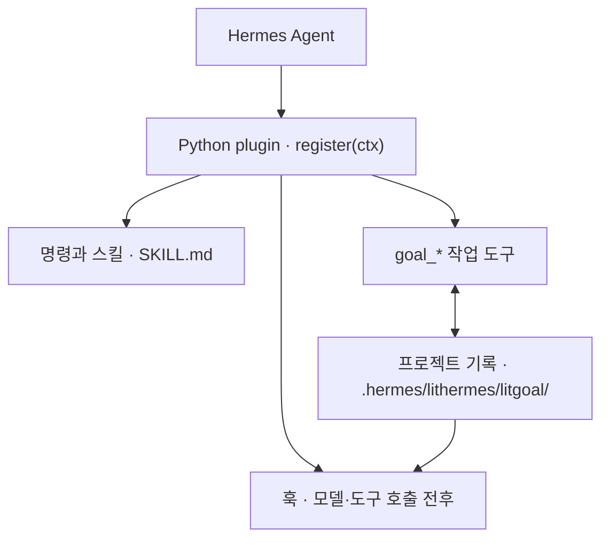

<p align="center"><picture><source media="(prefers-reduced-motion: reduce)" srcset="./docs/assets/cover-motion-still.webp" /></picture></p>

# LitHermes

**Keep the work lit.**

LitHermes는 [Hermes Agent](https://github.com/NousResearch/hermes-agent)용 플러그인입니다. 요청 앞에 `lit`을 붙이면 Hermes가 작업을 계획하고, 해내고, 결과를 확인한 뒤 어디까지 왔는지 적어 둡니다. 그래서 다음 세션이 그 기록을 읽고 멈춘 자리에서 이어 갈 수 있습니다.

<p align="center">
<a href="https://www.npmjs.com/package/@litfamily/lithermes"></a>
<a href="https://www.npmjs.com/package/@litfamily/lithermes"></a>
<a href="./LICENSE"></a>
<a href="https://github.com/wjgoarxiv/lithermes/stargazers"></a>
</p>

<p align="center"><a href="#설치">설치</a> · <a href="#첫-작업">첫 작업</a> · <a href="#할-수-있는-일">할 수 있는 일</a> · <a href="#더-알아보기">더 알아보기</a> · <a href="./README.md">English</a> · <a href="https://www.npmjs.com/package/@litfamily/lithermes">npm</a></p>

<p align="center"></p> <!-- demo-gif -->

## 왜 LitHermes인가요

Hermes Agent는 눈앞의 일은 잘 해냅니다. 곤란해지는 건 작업이 한자리에서 끝나지 않을 때입니다. 대화는 압축되고 터미널은 닫힙니다. 다음에 다시 앉으면 무엇을 정했는지, 무엇을 정말 확인했는지, 어디까지 하다 말았는지부터 되짚어야 하죠.

LitHermes는 그 작업의 기록을 대신 남겨 줍니다. 요청 앞에 `lit`을 붙이면 확인할 수 있는 기준, 고치기 전에는 실패하고 고친 뒤에는 통과하는 테스트, 실제 실행 결과 확인, 프로젝트 안의 인계 기록이 함께 남습니다. 목표와 계획과 근거가 디스크에 남으니, 새 세션은 그 기록을 읽고 바로 이어 갑니다.

두 세션에 걸치면 이런 모습입니다.

```text
lit 실패하는 로그인 테스트를 고쳐줘 → 실패하는 테스트, 수정, 통과, 확인한 내용 목록
/lit-handoff → 결과와 다음 할 일이 담긴 HANDOFF.md
(다음 날) 인계 기록 읽고 이어서 해줘 → 새 세션이 그 기록에서 이어 갑니다
```

결과를 믿고 쓸 수 있어야 하는 일에 Hermes를 쓰는 분께 잘 맞습니다. 테스트를 계속 통과해야 하는 코드, 다른 사람에게 건넬 보고서와 발표자료, 출처가 필요한 조사 같은 일이요. 시작할 때 `lit` 한 단어, 끝낼 때 `/lit-handoff` 한 번이면 다음 세션이 지난 세션에서 한 일을 알고 시작합니다.

## 빠른 시작

### 설치

Hermes Agent와 Node.js 18 이상, 그리고 Hermes 홈(기본 `~/.hermes`)에 쓸 권한이 필요합니다. 이 문서는 `@litfamily/lithermes@1.0.30` 기준입니다.

```sh
npx --yes --package @litfamily/lithermes@latest -- lithermes install --yes --no-style
```

이 명령은 플러그인을 Hermes 홈에 복사하고 Hermes 설정에서 켜 둡니다. `--yes`가 있어 중간에 승인을 묻지 않고 끝까지 진행하고, `--no-style`은 답변 문체를 묻는 단계를 건너뜁니다. 처음 설치할 때는 영상 제작용 도구도 함께 받아서 1분쯤 걸릴 수 있습니다.

평소 쓰는 환경을 건드리기 전에 먼저 써 보고 싶다면, 설치 전에 `HERMES_HOME`을 비어 있는 새 디렉터리로 지정하고 Hermes를 시작할 때도 같은 값을 쓰세요. Hermes를 확인할 수 없으면 설치 보고서에서 일부 모델 경로가 unavailable로 표시됩니다. 플러그인이 제대로 들어갔는지는 `lithermes doctor --offline`으로 확인하세요. 옵션 하나하나의 뜻, 시험용 프로필, 검토한 `.tgz`로 설치하는 방법은 [설치 문서](./docs/install.ko.md)에 있습니다.

아래 프롬프트를 붙여 넣어 코딩 에이전트에게 설치를 맡길 수도 있습니다. 에이전트가 환경을 확인하고, 계획을 보여 준 뒤 승인을 기다렸다가, 공식 npm 패키지를 설치하고 오프라인 점검 결과를 알려 줍니다. 재시작만은 직접 해 주세요. 실행 중인 Hermes gateway는 다시 시작해야 새 플러그인을 불러옵니다.

```text
이 컴퓨터에 Hermes Agent용 lit 워크플로 플러그인 LitHermes를 설치해줘.

1. 먼저 확인해줘: Hermes Agent가 설치되어 있는지(hermes --version), Node.js가 18 이상인지
   (node --version), 내 Hermes 홈(~/.hermes, HERMES_HOME이 설정되어 있으면 그 경로)에 쓸 수 있는지.
2. 무엇이든 바꾸기 전에 계획과 실행할 명령을 그대로 보여 주고 내 승인을 기다려줘.
   아무것도 바꾸지 않는 미리보기는 먼저 실행해도 돼:
   npx --yes --package @litfamily/lithermes@latest -- lithermes install --dry-run
3. 공식 npm 패키지 @litfamily/lithermes만 써줘. 저장소를 clone하거나, 플러그인 파일을
   손으로 복사하거나, 다른 패키지를 설치하지 마. 설치 명령:
   npx --yes --package @litfamily/lithermes@latest -- lithermes install --yes --no-style
4. 확인 명령:
   npx --package @litfamily/lithermes -- lithermes doctor --offline
   결과를 알려 주고, PASS가 아닌 줄은 빠짐없이 보여줘. 오프라인에서는 "loaded plugin:
   PARTIAL"이 정상이고, 모델 경로가 unavailable로 나올 수 있어.
5. Hermes나 gateway를 직접 다시 시작하지는 마. 플러그인이 불러와지도록 Hermes CLI와 실행 중인
   Hermes gateway(Telegram, Discord 등)를 다시 시작하라고 알려 주고, 그다음 요청 앞에 lit을
   붙여 작업을 시작하면 된다고 말해줘.
```

### 첫 작업

플러그인을 불러오도록 Hermes CLI 또는 gateway를 다시 시작한 뒤, 요청 앞에 `lit`을 붙여 작은 작업 하나를 맡겨 보세요.

```text
lit 외부 의존성 없이 HTML 파일 하나로 할 일 목록을 만들어줘. 추가·완료·삭제를 구현하고 확인한 내용과 다음 행동을 남겨줘.
```

명령이 편하다면 `/lit <요청>`도 똑같이 동작합니다. Telegram gateway에서는 `/lit_loop`, `/lit_plan`을 쓰세요.

### 이렇게 보입니다

응답 첫 줄에 `🔥 **LIT IGNITED · <discipline>** 🔥`가 따로 나옵니다. 점 뒤의 이름은 요청을 받은 경로입니다. 그냥 `lit`이면 `litwork`, 계획이면 `lit-plan`이에요. 이 줄이 보이면 lit 작업이 시작된 것이고, 잘 됐는지는 결과를 직접 보고 확인하세요.

계획에 따라 작업이 진행 중일 때는 응답 끝에 지금 어디쯤인지 보여 주는 줄이 하나 더 붙습니다. 예를 들면 `🔥 LIT · lit-loop — 📝 plan ✓ › 🔨 WORK ▰▰▰▱▱▱▱ 3/7 › 🔍 · › 🏁 ·`입니다. LitHermes는 프로젝트에 저장된 계획, 실행 기록, litgoal 기준을 읽어 이 줄을 만듭니다. 아직 기록이 없는 단계는 빼고, 파일 이름이나 명령은 넣지 않습니다.

작은 장치도 두 가지 따라옵니다. LitHermes 스킨을 쓰면 Hermes가 일하는 동안 스피너가 `(🔥 lit)` 같은 불꽃 얼굴로 돕니다. 턴이 끝날 때 터미널 벨을 울릴 수도 있는데, 이건 직접 켜야 합니다. 설치할 때 `--bell`을 붙이거나 설치 프로그램이 물을 때 yes라고 답하면 되고, 이미 정해 둔 `display.bell_on_complete` 값은 그대로 둡니다.

작업이 끝나면 HTML 파일을 열어 각 동작을 직접 눌러 보고, Hermes에게 실제로 확인한 내용과 아직 확인하지 못한 내용을 나눠 달라고 하세요. 그다음 `/lit-handoff`를 입력하면 결과와 다음 할 일이 프로젝트의 `HANDOFF.md`에 남습니다. 세션을 닫으면 작업도 멈추지만, 이 파일이 있어서 이어 갈 수 있습니다. 다음번에 같은 프로젝트에서 새 세션을 열고, 이어 가기 전에 인계 기록부터 읽어 달라고 하면 됩니다.

### 자동 핸드오프

긴 세션은 모델의 컨텍스트 창을 채웁니다. 창이 차면 Hermes가 대화를 압축하고, 오래된 세부 내용은 사라집니다. 자동 핸드오프는 그 전에 모델이 핸드오프를 쓰게 합니다. 저장이 끝나면 `/compact`를 실행하고, 세션의 나머지는 글로 남은 기록에서 출발합니다. 기본값이 꺼짐이고 기본 퍼센트도 따로 정해져 있지 않으니, 직접 고르면 됩니다. 고른 값은 Hermes 홈의 `~/.hermes/lithermes/auto-handoff.json`에 저장되어, 어느 프로젝트에서 작업하든 같은 설정을 씁니다.

켜려면 Hermes 세션 안에서 `/lit-handoff auto on 60`을 입력하세요. 60 자리에는 1에서 99 사이의 정수를 넣으면 됩니다. 답에는 앞으로 일어날 일과, 고른 퍼센트를 Hermes가 스스로 압축하는 시점과 비교한 결과가 나옵니다. 나중에 `/lit-handoff auto status`를 입력하면 이 세션의 최근 측정값이 나오고, `/lit-handoff auto off`는 기능을 끄되 퍼센트는 다음을 위해 기억해 둡니다.

<p align="center"><picture><source media="(prefers-color-scheme: dark)" srcset="./docs/assets/handoff/auto-handoff-switch-dark.webp" /></picture></p>

모델 호출이 정한 퍼센트를 넘기면, 다음 메시지에 핸드오프를 쓰라는 짧은 요청이 붙습니다. 모델은 lit-handoff 절차로 `HANDOFF.md`를 저장하고 `Handoff saved. Run /compact now.` 한 줄로 알린 뒤, 원래 요청한 일을 이어 갑니다. `/compact`는 편한 때에 실행하세요. 압축한 뒤 다음 메시지와 함께 그 핸드오프의 요약이 모델에게 다시 들어가고, 작업은 멈춘 곳에서 이어집니다.

<p align="center"><picture><source media="(prefers-color-scheme: dark)" srcset="./docs/assets/handoff/auto-handoff-turn-dark.webp" /></picture></p>

모든 세션에서 켜 두고 싶다면 Hermes를 실행하는 환경에 `LITHERMES_AUTO_HANDOFF=1`과 `LITHERMES_AUTO_HANDOFF_PERCENT=60`을 설정하세요. 셸 프로필에 넣어 두면 편하고, 이 값이 슬래시 명령보다 우선합니다. `hermes lithermes status`와 `hermes lithermes doctor`는 이 기능에 대해 한 줄씩 출력합니다. 퍼센트는 Hermes 자체 압축 시점보다 낮게 잡으세요. 그래야 Hermes가 압축하기 전에 핸드오프가 쓰입니다. 같거나 높으면 doctor가 경고해 줍니다.

<p align="center"><picture><source media="(prefers-color-scheme: dark)" srcset="./docs/assets/handoff/auto-handoff-shell-dark.webp" /></picture></p>

단계마다 누가 무엇을 하는지는 [자동 핸드오프](./docs/automatic-handoff.ko.md)에 정리해 두었습니다.

## 할 수 있는 일

LitHermes는 스킬 39개를 설치합니다. 처음에는 아래 여섯 가지부터 써 보세요.

### 확인까지 끝나는 작업

그냥 `lit`을 붙이면 노트를 펴 두고, 기준마다 실패하는 테스트, 통과, 실행 결과 확인, 정리 순서로 진행합니다. 바뀐 코드와 함께 무엇을 확인했는지 목록이 남습니다.

```text
lit 실패하는 로그인 테스트를 고쳐줘
```

### 계획부터 세우고 만들기

`lit plan`은 번호 붙은 작업 목록을 파일로 쓰고, 코드는 그대로 둡니다. 계획을 승인하면 `/start-work`가 한 줄씩 실행하고, 다섯 관문을 모두 통과해야 체크 표시를 붙입니다.

```text
lit plan 보고서 페이지에 CSV 내보내기 추가
```

### 다섯 명이 따로 읽는 리뷰

`lit review`에는 두 가지 방식이 있습니다. 계획 검토는 `lit plan` 뒤, `start-work` 앞에서 계획을 점검합니다. 작업 검토는 끝난 변경을 리뷰어 다섯이 각자 읽고, 리뷰어마다 찾은 문제부터 알려 줍니다. 프로젝트에 무엇이 있는지 보고 방식을 고르며, 첫 줄에 어느 쪽을 골랐는지 밝힙니다. `lit review plan`이나 `lit review work`로 직접 정할 수도 있습니다.

```text
lit review 이 브랜치의 변경 사항
```

### 출처가 붙는 조사

`lit research`는 질문을 쪼개 여러 검색을 동시에 보내고, 실마리를 끝까지 따라간 뒤에 답합니다. 주장마다 출처가 붙고, 가져온 글은 자료로만 읽습니다.

```text
lit research 널리 쓰이는 CLI들은 오래된 설정 파일을 어떻게 옮길까?
```

### 보고서, 발표자료, 다이어그램

`lit`을 붙여 보고서나 발표자료를 부탁하면 편집할 수 있는 Word나 PowerPoint 파일과 그 Markdown 원본이 함께 나옵니다. 스킬이 읽는 사람에게 맞는 디자인을 고르고 그렇게 고른 이유도 알려 주며, 완성된 파일을 점검한 뒤에 건넵니다. 다이어그램은 `lit-diagram-drawer`가 같은 방식으로 만듭니다.

```text
lit notes.md로 월요일 팀 회의용 슬라이드 10장 만들어줘
```

### 한국어와 영어 글 다듬기

`humanizer`는 딱딱한 모델 문장을 사람이 쓴 것처럼 고쳐 줍니다. 사실과 단서, 존댓말과 말투는 그대로 두고 before/after 비교를 보여 줍니다. 파일은 직접 결정하기 전까지 그대로 남습니다.

```text
humanizer 이 문단을 자연스러운 한국어로 다듬어줘: …
```

나머지 30개는 디버깅, 리팩터링, 브라우저 작업, 영상, 화면 만들기, 논문용 그림 등을 맡습니다. [스킬과 명령](./docs/skills.ko.md)에서 그림과 함께 하나씩 볼 수 있고, 어느 스킬이든 `lithermes:<이름>`으로 직접 불러올 수도 있습니다.

## 작동 방식

LitHermes는 Python 플러그인입니다. Hermes가 플러그인을 불러오면 `register(ctx)`가 훅, 명령, 스킬, 작업 도구를 등록합니다. 훅은 모델이나 도구를 호출하기 직전과 직후에 끼어듭니다. `goal_*` 도구는 목표와 그 목표를 위해 모은 확인 결과를 프로젝트 안의 로컬 기록에 적습니다.



다음 모델 호출 전에는 context 훅이 이 기록을 읽어, 지금 목표가 무엇이고 어디까지 왔는지 모델에게 건넵니다. 요청을 어디로 보낼지는 플러그인이 정하고, 모델은 여전히 Hermes Agent가 돌립니다. 권한 확인, 로그인, 모델 접근, 실제 화면이 필요한 검사는 모두 Hermes 쪽에서 처리합니다.

## 요구 사항, 업데이트, 삭제

Hermes Agent와 Node.js 18 이상, 그리고 Hermes 홈에 쓸 권한이 필요합니다.

LitHermes는 스스로 최신 상태를 유지합니다. 터미널에서 `install`, `check`, `doctor`를 실행하거나 대화형 Hermes CLI 세션에서 첫 메시지를 보낼 때 더 새로운 안정 버전이 있는지 확인합니다. 있으면 플러그인과 설정을 백업하고, 새 버전을 설치한 뒤 `doctor --offline`을 실행합니다. 중간에 무엇이든 실패하면 백업을 제자리에 돌려놓습니다. 업데이트를 직접 설치하고 싶다면 `LITHERMES_NO_AUTO_UPDATE=1`을 설정하세요. 단계와 끄는 방법은 [업데이트](./docs/install.ko.md#업데이트)에 모두 적어 두었습니다.

기록은 모두 내 컴퓨터에 남습니다. 목표와 계획과 근거는 프로젝트의 `.hermes/lithermes/`에, 설치 기록과 업데이트 캐시와 백업은 Hermes 홈에 있습니다. LitHermes가 스스로 인터넷을 쓰는 일은 두 가지입니다. 하나는 npm에 새 버전이 있는지 묻는 것으로, `LITHERMES_NO_UPDATE_CHECK=1`을 설정하면 끌 수 있습니다. 다른 하나는 스킬이 처음 필요로 할 때 버전이 고정된 도구를 받는 것입니다. 영상용 도구는 `install` 때 받고(`--offline`을 붙이면 건너뜁니다), Office용 도구는 Word나 PowerPoint 파일을 처음 만들 때 받습니다. 프롬프트는 전과 같이 Hermes에 설정한 모델 제공자에게 갑니다. LitHermes가 쓰는 파일은 [개인정보와 로컬 기록](./docs/privacy.md)에 모두 나와 있습니다.

온라인에 접속하지 않고 설치 상태를 점검하거나 삭제하는 명령입니다.

```sh
npx --package @litfamily/lithermes -- lithermes doctor --offline
npx --package @litfamily/lithermes -- lithermes uninstall --yes
```

설치 프로그램이 Hermes 설치본에 호환성 수정을 했다면, 삭제할 때 `--rollback-patches`를 붙여 그 수정까지 되돌리세요. 스킬이 보이지 않거나, 이름이 겹치거나, import 오류가 날 때는 [문제가 생겼을 때](./docs/install.ko.md#문제가-생겼을-때)를 보세요.

## 더 알아보기

- [설치, 업데이트, 삭제](./docs/install.ko.md): 설치 옵션 전부, 업데이트가 움직이는 방식, 문제 해결과 한계
- [LitHermes 둘러보기](./docs/tour.ko.md): 처음 실행했을 때의 화면, 짧은 영상, Ignition 스킨, LIT 마크
- [스킬과 명령](./docs/skills.ko.md): 그림이 붙은 스킬 39개 전체, 명령 목록, 문서·영상·글 스킬이 만드는 결과물
- [자동 핸드오프](./docs/automatic-handoff.ko.md): 압축을 사이에 두고 작업을 넘기는 과정을 단계별로
- <a href="./docs/guide.ko.md"> 사용 안내</a>: 명령, 자연어 routing, 모델, 스킨, 안전 모델 전체
- <a href="./docs/assets/readme/ignition-film.mp4"> Ignition 영상</a> (MP4)
- [Python 플러그인 계약](./packages/lithermes-installer/assets/lithermes-plugin/README.md) · [npm 패키지 안내](./packages/lithermes-installer/README_Ko-KR.md) · [변경 기록](./CHANGELOG.md) · [개인정보](./docs/privacy.md) · [이전 안내](./docs/migration.md)

LitHermes는 같은 `lit` 작업 방식을 코딩 에이전트 일곱 곳에 옮긴 [LitFamily](https://github.com/wjgoarxiv/litfamily)의 하나이고, 제품마다 따로 설치합니다.

## 기여

새 세션에 프로젝트를 처음부터 다시 설명하는 수고를 LitHermes가 덜어 주었다면, 스타를 하나 눌러 주세요. 다른 Hermes 사용자가 이 저장소를 찾는 데 도움이 됩니다.

버그 제보와 풀 리퀘스트를 환영합니다. [기여 안내](./CONTRIBUTING.md)부터 읽어 주시고, [보안](./SECURITY.md), [행동 강령](./CODE_OF_CONDUCT.md), [지원](./SUPPORT.md)도 참고하세요.

LitHermes와 LitFamily의 이름과 로고는 MIT License가 아니라 [상표 정책](./TRADEMARK.md)을 따릅니다.

<a href="./LICENSE"> MIT License</a>
