<p align="center"><picture><source media="(prefers-reduced-motion: reduce)" srcset="./docs/assets/cover-motion-still.webp" />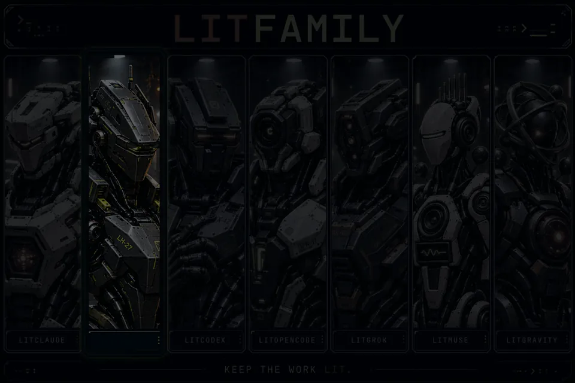</picture></p>

# LitHermes

**Keep the work lit.**

[Hermes Agent](https://github.com/NousResearch/hermes-agent)가 세션마다 일을 계획하고, 만들고, 확인하고, 다음 세션이 이어받을 메모까지 남기게 돕는 플러그인입니다.

<p align="center">
<a href="https://www.npmjs.com/package/@litfamily/lithermes"></a>
<a href="https://www.npmjs.com/package/@litfamily/lithermes"></a>
<a href="./LICENSE"></a>
<a href="https://github.com/wjgoarxiv/lithermes/stargazers"></a>
</p>

요청 앞에 `lit`을 붙이면 Hermes가 무엇을 "끝"으로 볼지 먼저 정하고, 고치기 전에 실패하는 테스트를 쓰고, 실제로 돌아가는 결과를 확인한 뒤 어디까지 왔는지 적어 둡니다. 일을 멈출 때 `/lit-handoff`를 입력하면 다음 세션은 그 메모에서 출발합니다. Hermes CLI에서도, Telegram이나 Discord gateway에서도 똑같이 동작합니다. 써 보려면 한 번 설치하고, Hermes를 다시 시작한 뒤 일을 맡겨 보세요.

```sh
npx --yes --package @litfamily/lithermes@latest -- lithermes install --yes --no-style
```

```text
lit 실패하는 로그인 테스트를 고쳐줘
```

<p align="center"><a href="#설치">설치</a> &nbsp; <a href="#빠른-시작">빠른 시작</a> &nbsp; <a href="#만들-수-있는-것">결과물</a> &nbsp; <a href="./docs/guide.ko.md"> 사용 안내</a> &nbsp; <a href="./docs/skills.ko.md">스킬</a> &nbsp; <a href="./docs/assets/readme/ignition-film.mp4"> 영상</a> &nbsp; <a href="./docs/guide.ko.md#안전-모델">안전</a> &nbsp; <a href="./README.md">English</a> &nbsp; <a href="https://www.npmjs.com/package/@litfamily/lithermes">npm</a></p>

<p align="center"></p> <!-- demo-gif -->

## 만들 수 있는 것

아래 그림은 모두 LitHermes가 실제로 만든 결과물이고, 꾸며 낸 시안은 하나도 없습니다. 대부분은 스킬이 함께 싣고 다니는 예제를 그 스킬의 엔진이 직접 렌더링한 것이라 누구든 다시 만들어 볼 수 있고, 어느 예제인지는 그림마다 적어 두었습니다. 무언가를 만드는 스킬은 기본적으로 꽉 찬 결과를 냅니다. 차분하게, 미니멀하게라고 말하면 덜어 냅니다.

### 그리기

`lit-schematic`은 실제 설비를 그 분야의 규칙대로 그립니다. P&ID에는 ISA 태그와 제어 루프, 범례와 표제란이 들어가고, 단면도에는 재질 색과 번호 붙은 설명선이, 논문용 그림에는 실험 장치를 두 패널로 나눈 구성이 들어갑니다. 모든 도면은 겹침과 기호를 지나가는 선을 잡는 QA 관문을 통과한 뒤 SVG, PDF, 600 dpi PNG로 나옵니다.

<table>
<tr><td width="50%" valign="top">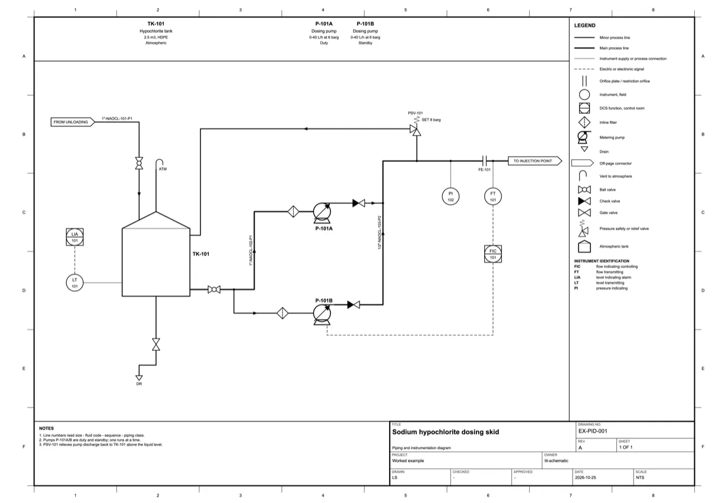<br /><b>lit-schematic</b> · 차아염소산 주입 스키드<br /><sub>스킬에 들어 있는 <code>pid-dosing-skid</code> 예제로 렌더링했고, 도면 관문을 통과했습니다.</sub></td><td width="50%" valign="top">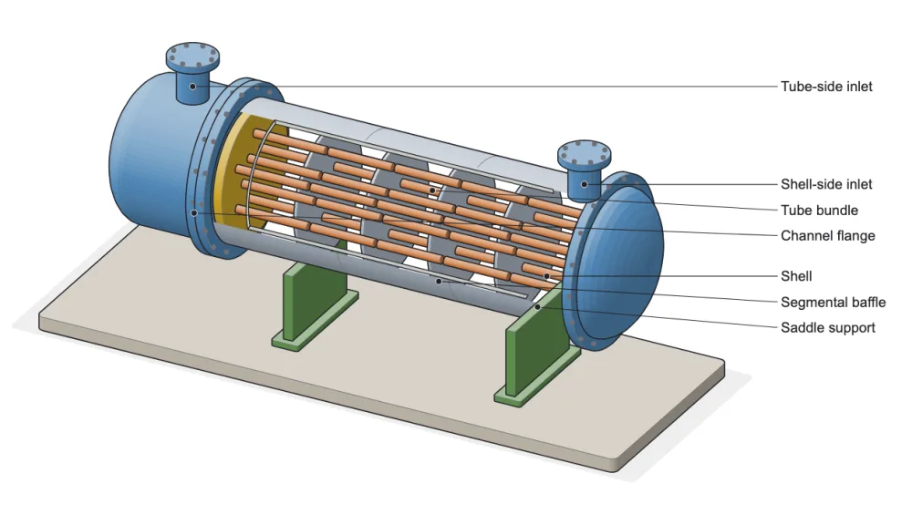<br /><b>lit-schematic</b> · 등각 단면도<br /><sub>들어 있는 <code>iso-heat-exchanger</code> 예제로 렌더링했고, 경고 없이 <code>QA PASS</code>가 나왔습니다.</sub></td></tr>
<tr><td width="50%" valign="top">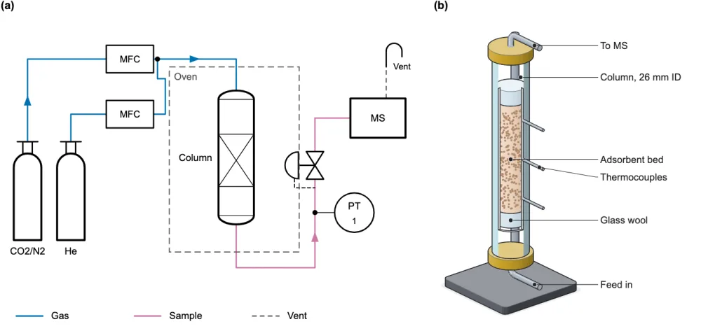<br /><b>lit-schematic</b> · 논문용 실험 장치 그림<br /><sub>들어 있는 <code>journal-adsorption-rig</code> 예제로 렌더링했고, 기호 9개, 선 8개, 라벨 21개로 <code>QA PASS</code>가 나왔습니다.</sub></td><td width="50%" valign="top"></td></tr>
</table>

### 발표하기

원하는 스타일을 말하거나, `lit-pptx`가 열세 가지 가운데 읽는 사람에게 맞는 것을 고르고 이유를 알려 주게 두면 됩니다. 덱은 모두 고칠 수 있는 Markdown에서 만들어지고, 네이티브 차트와 KPI 줄, 내장된 Pretendard를 갖추며, 넘침·대비·빈 슬라이드를 잡는 관문을 거칩니다.

<table>
<tr><td width="50%" valign="top">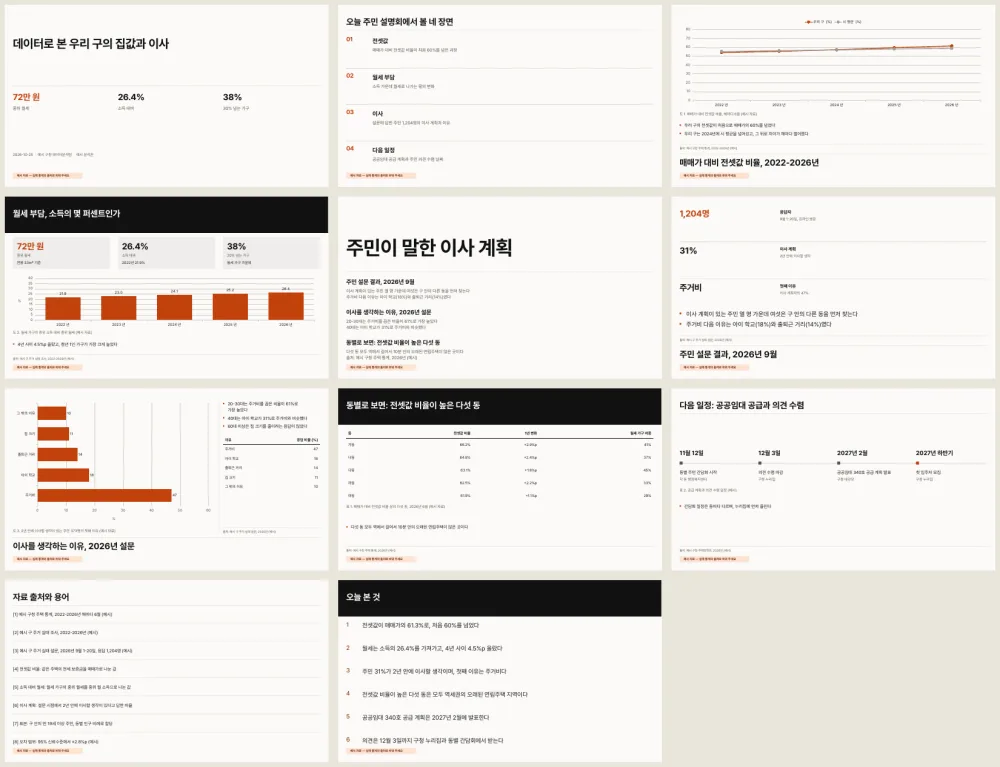<br /><b>lit-pptx</b> · 뉴스룸, 11장<br /><sub>들어 있는 <code>17-public-data-briefing-newsroom-ko.md</code>로 컴파일했고 덱 QA를 통과했습니다. 페이지는 LibreOffice로 렌더링했습니다.</sub></td><td width="50%" valign="top">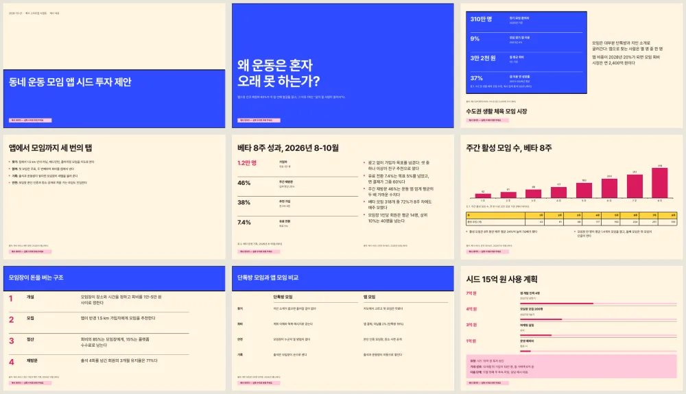<br /><b>lit-pptx</b> · 네오 브루탈리즘 피칭, 9장<br /><sub>들어 있는 <code>14-launch-pitch-neo-brutalism-ko.md</code>로 컴파일했고, 강조색에 관한 권고 세 건과 함께 덱 QA를 통과했습니다.</sub></td></tr>
<tr><td width="50%" valign="top">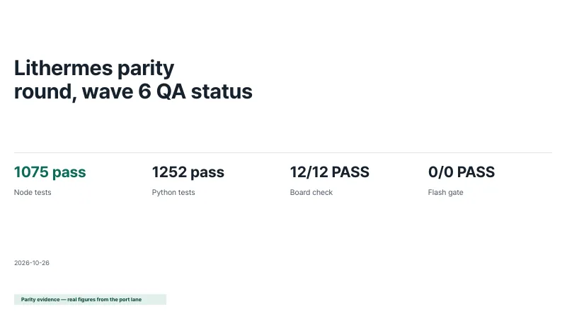<br /><b>lit-pptx</b> · QA 상태 보고 덱<br /><sub>스킬의 컴파일러로 만들었고, 모든 슬라이드가 넘침·대비·빈 슬라이드 관문을 통과했습니다.</sub></td><td width="50%" valign="top"></td></tr>
</table>

### 문서 쓰기

`lit-docx`는 계속 고쳐 쓸 수 있는 Word 파일을 여섯 가지 문서 형태 가운데 하나로 만듭니다. 표지, 근거가 붙은 핵심 수치, 숫자를 오른쪽에 맞춘 괘선 표, 결정 요청 상자가 들어가고, 건네기 전에 페이지를 렌더링해 레이아웃 관문을 돌립니다.

<table>
<tr><td width="50%" valign="top">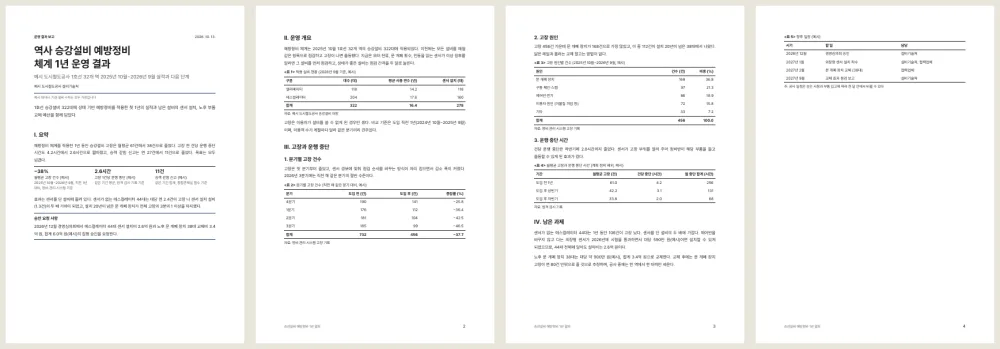<br /><b>lit-docx</b> · 한국어 보고서, Report 형태<br /><sub>들어 있는 <code>01-report-ko.md</code>를 변환했고, <code>--layout</code>을 붙인 관문에서 지적 사항 없이 통과했습니다.</sub></td><td width="50%" valign="top">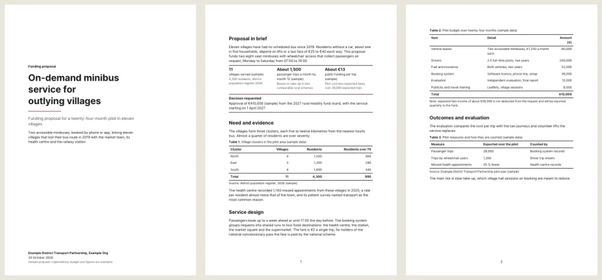<br /><b>lit-docx</b> · 영어 제안서, Proposal 형태<br /><sub>들어 있는 <code>08-proposal-en.md</code>를 변환했고, 레이아웃 관문에서 지적 사항 없이 통과했습니다.</sub></td></tr>
</table>

### 화면 만들기와 흐름 붙잡기

`frontend-ui-ux`는 마크업을 쓰기 전에 하우스 스타일부터 고정하고, 페이지를 만든 다음 여러 너비로 열어 보고 스스로 검토합니다. `lit adhd`는 최근 Hermes 세션과 계획, git 기록을 읽어 한 화면으로 정리합니다. 세션마다 무엇을 부탁받았고, 무엇을 했고, 무엇이 나를 기다리는지, 그리고 다음 한 걸음까지요.

<table>
<tr><td width="50%" valign="top">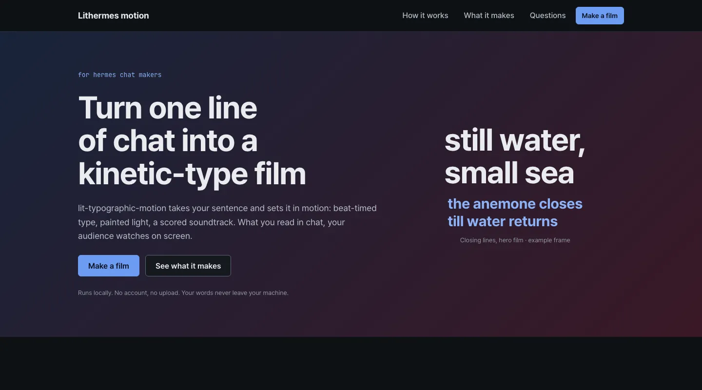<br /><b>frontend-ui-ux</b> · 랜딩 페이지 상단<br /><sub>그래파이트 하우스 스타일로 고정한 뒤, 여러 너비로 열어 자체 점검 도구로 검토했습니다.</sub></td><td width="50%" valign="top">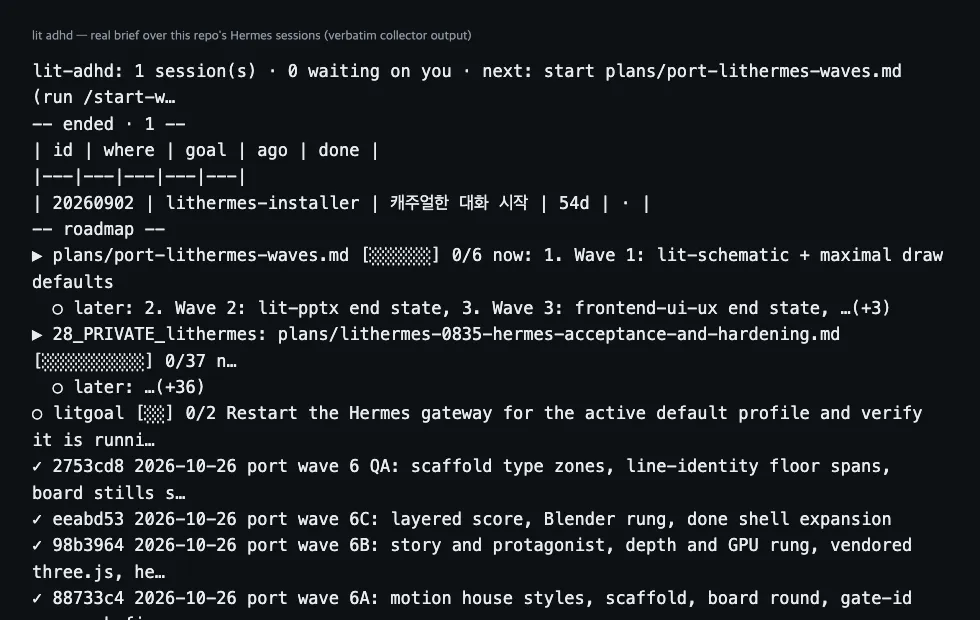<br /><b>lit-adhd</b> · 브리핑<br /><code>lit adhd</code><br /><sub>이 저장소의 실제 Hermes 세션을 대상으로 돌린 결과 그대로입니다.</sub></td></tr>
</table>

## 왜 LitHermes인가요

Hermes Agent는 눈앞의 일은 잘 해냅니다. 곤란해지는 건 일이 한자리에서 끝나지 않을 때입니다. 대화는 압축되고, 터미널은 닫히거나 gateway가 다시 시작되고, 다음에 앉으면 무엇을 정했는지, 무엇을 정말 확인했는지, 어디까지 하다 말았는지부터 되짚어야 하죠. 게다가 "다 됐습니다"가 모델의 말뿐인 경우도 많습니다.

LitHermes는 세션마다 따라갈 순서를 주고, 그 기록을 남깁니다. 요청 앞에 `lit`을 붙이면 확인할 수 있는 기준, 고치기 전에는 실패하고 고친 뒤에는 통과하는 테스트, 실제 실행 결과 확인, 프로젝트 안의 인계 기록이 함께 남습니다. 큰 변경은 `lit plan`으로 계획을 먼저 세우고, 승인한 뒤에 고칩니다. 목표와 계획과 근거가 디스크에 남으니 새 세션은 그 기록을 읽고 바로 이어 갑니다. 모델과 도구, 로그인은 여전히 Hermes가 맡고, LitHermes는 그 위에 일하는 방식을 더합니다.

친구에게 한 줄로 소개한다면 이렇습니다. *Hermes 작업 앞에 `lit`만 붙이면, 다 됐다고 하기 전에 결과부터 증명하고 내일 세션을 위한 메모까지 남겨 줘요.*

### 누구에게 맞나요

결과를 믿고 쓸 수 있어야 하는 일에 이미 Hermes를 쓰는 분께 맞습니다. 테스트를 계속 통과해야 하는 코드, 다른 사람에게 건넬 보고서와 발표자료, 출처가 필요한 조사 같은 일이요. 한자리에서 끝나지 않는 일, 책상에서 시작해 나중에 휴대폰으로 gateway를 통해 확인하는 일에서 특히 도움이 됩니다.

### 세션은 이렇게 흘러갑니다

위 영상을 핵심 줄만 남기면 이렇습니다. 첫 줄은 직접 입력하고, 답변은 둘째 줄로 시작하며, 지도 줄은 작업이 진행되는 대로 움직입니다.

```text
lit plan add a --shout flag that prints the greeting in capitals, with a test
🔥 LIT IGNITED · lit-plan 🔥
🔥 LIT · lit-plan — 📝 PLAN › 🔨 · › 🔍 · › 🏁 ·
/start-work            → 실패하는 테스트 먼저, 그다음 수정, 테스트 통과
🔥 LIT · lit-recap — 📝 plan ✓ › 🔨 work ✓ › 🔍 review ✓ › 🏁 done ✓
```

## 설치

Hermes Agent와 Node.js 18 이상, 그리고 Hermes 홈(기본 `~/.hermes`)에 쓸 권한이 필요합니다. 이 문서는 `@litfamily/lithermes@1.0.35` 기준입니다. 아무 터미널에서나 실행하세요.

```sh
npx --yes --package @litfamily/lithermes@latest -- lithermes install --yes --no-style
```

설치 프로그램은 Python 플러그인을 Hermes 홈에 복사하고, `config.yaml`을 백업한 뒤 그 파일에서 플러그인을 켭니다. 새 홈이라면 LitHermes에 맞춘 모델 경로도 씁니다. 계획과 리뷰용 하나, 도우미용 하나이고, 이미 골라 둔 모델은 그대로 둡니다. Ignition 스킨과 LIT 스킨 열두 개를 더하고 영상용 도구도 받아서 처음에는 1분쯤 걸립니다. `--yes`는 중간에 묻지 않고 끝까지 진행하게 하고, `--no-style`은 답변 문체를 묻는 단계를 건너뜁니다. 끝나면 Hermes CLI와 실행 중인 gateway를 다시 시작하세요. Hermes는 시작할 때만 새 플러그인을 불러옵니다.

<p align="center"><picture><source media="(prefers-color-scheme: dark)" srcset="./docs/assets/screens/install-dark.webp" /></picture></p>

*스크래치용 Hermes 홈에서 실제 설치 프로그램으로 얻은 출력입니다. 밖으로 아무것도 나가지 않도록 오프라인으로 실행했고, 일부 줄은 잘랐습니다. 다른 화면은 [둘러보기](./docs/tour.ko.md)에 있습니다.*

먼저 살펴보고 싶다면 `install --dry-run`이 바뀔 내용을 모두 보여 주고 아무것도 쓰지 않습니다. 평소 환경을 건드리지 않으려면 설치 전에 `HERMES_HOME`을 비어 있는 새 디렉터리로 지정하고, Hermes를 시작할 때도 같은 값을 쓰세요. 이때 모델 경로가 unavailable로 나올 수 있는데, 플러그인이 제대로 들어갔는지는 `lithermes doctor --offline`이 알려 줍니다. [옵션 하나하나, 시험용 프로필, 검토한 `.tgz`로 설치하기](./docs/install.ko.md).

코딩 에이전트에게 설치를 맡길 수도 있습니다. 아래 프롬프트를 주면 환경을 확인하고, 승인을 기다렸다가 공식 패키지를 설치하고, 오프라인 점검 결과를 알려 준 뒤 재시작은 사용자에게 남겨 둡니다.

```text
이 컴퓨터에 Hermes Agent용 lit 워크플로 플러그인 LitHermes를 설치해줘.

1. 먼저 확인해줘: Hermes Agent가 설치되어 있는지(hermes --version), Node.js가 18 이상인지
   (node --version), 내 Hermes 홈(~/.hermes, HERMES_HOME이 설정되어 있으면 그 경로)에 쓸 수 있는지.
2. 무엇이든 바꾸기 전에 계획과 실행할 명령을 그대로 보여 주고 내 승인을 기다려줘.
   아무것도 바꾸지 않는 미리보기는 먼저 실행해도 돼:
   npx --yes --package @litfamily/lithermes@latest -- lithermes install --dry-run
3. 공식 npm 패키지 @litfamily/lithermes만 써줘. 저장소를 clone하거나, 플러그인 파일을
   손으로 복사하거나, 다른 패키지를 설치하지 마. 설치 명령:
   npx --yes --package @litfamily/lithermes@latest -- lithermes install --yes --no-style
4. 확인 명령:
   npx --package @litfamily/lithermes -- lithermes doctor --offline
   결과를 알려 주고, PASS가 아닌 줄은 빠짐없이 보여줘. 오프라인에서는 "loaded plugin:
   PARTIAL"이 정상이고, 모델 경로가 unavailable로 나올 수 있어.
5. Hermes나 gateway를 직접 다시 시작하지는 마. 플러그인이 불러와지도록 Hermes CLI와 실행 중인
   Hermes gateway(Telegram, Discord 등)를 다시 시작하라고 알려 주고, 그다음 요청 앞에 lit을
   붙여 작업을 시작하면 된다고 말해줘.
```

## 빠른 시작

플러그인을 불러오도록 Hermes CLI나 gateway를 다시 시작한 뒤, 요청 앞에 `lit`을 붙여 작은 작업 하나를 맡겨 보세요.

```text
lit 외부 의존성 없이 HTML 파일 하나로 할 일 목록을 만들어줘. 추가·완료·삭제를 구현하고 확인한 내용과 다음 행동을 남겨줘.
```

명령이 편하다면 `/lit <요청>`도 똑같이 동작합니다. Telegram은 명령 이름에 하이픈을 받지 않아서, Telegram gateway에서는 계획과 루프 명령이 `/lit_plan`, `/lit_loop`입니다.

답변 첫 줄에 `🔥 **LIT IGNITED · <discipline>** 🔥`가 따로 나오고, 점 뒤에는 요청을 받은 경로가 적힙니다. 그냥 `lit`이면 `litwork`, 계획이면 `lit-plan`이에요. 이 줄은 작업이 시작됐다는 뜻이고, 잘 됐는지는 결과를 보고 판단하세요. 작업이 끝나면 HTML 파일을 열어 각 동작을 직접 눌러 보고, Hermes에게 실제로 확인한 것과 아직 확인하지 못한 것을 나눠 달라고 하세요.

그다음 `/lit-handoff`를 입력하면 결과와 다음 할 일이 프로젝트의 `HANDOFF.md`에 남습니다. 세션을 닫으면 작업도 멈추지만 이 파일이 있어 이어 갈 수 있습니다. 다음번에 같은 프로젝트에서 새 세션을 열고, 이어 가기 전에 인계 기록부터 읽어 달라고 하면 됩니다.

## 워크플로 지도

Hermes 플러그인은 패널이나 상태 표시줄 칸을 따로 더할 수 없어서, LitHermes는 지금 어디쯤인지를 답변 안에 보여 줍니다. 계획에 따라 작업하는 동안에는 답변마다 끝에 지도 한 줄이 붙습니다.

```text
🔥 LIT · lit-loop — 📝 plan ✓ › 🔨 WORK ▰▰▰▱▱▱▱ 3/7 › 🔍 · › 🏁 ·
```

왼쪽에서 오른쪽으로 읽습니다. `LIT ·` 뒤에 워크플로 이름이 오고, 이어서 네 단계가 나옵니다. 지나온 단계에는 체크가 붙고, 지금 단계는 대문자로 게이지와 끝낸 줄 수를 함께 보여 주며, 아직 닿지 않은 단계는 점으로 남습니다. LitHermes는 프로젝트에 저장된 계획, 실행 기록, litgoal 기준을 읽어 이 줄을 만들기 때문에, 모델이 단계마다 보고하지 않아도 따라옵니다. 저장된 것이 없는 단계는 빼고, 파일 이름이나 명령은 넣지 않습니다.

Hermes CLI의 겉모습도 달라집니다. Ignition 스킨은 시작할 때 작은 LIT 마크와 `LIT ready`로 맞이하고, 끝낼 때 `stay lit`이라고 인사하며, 배너를 주황·라임·아이보리·남색으로 그립니다.

<p align="center"><picture><source media="(prefers-color-scheme: dark)" srcset="./docs/assets/screens/welcome-dark.webp" />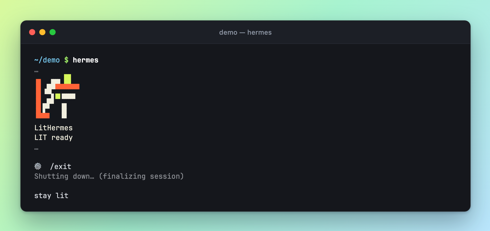</picture></p>

*Ignition 스킨을 고른 실제 Hermes 세션에서 얻은 출력입니다. 그림 속 줄 사이의 Hermes 배너, 팁, 경고는 잘랐습니다.*

Hermes가 일하는 동안 스피너는 `(🔥 lit)` 같은 불꽃 얼굴로 돌며 `lit-looping`, `verifying` 같은 짧은 말로 하는 일을 알려 주고, `/agents`를 입력하면 Hermes가 `delegate_task`로 보낸 도우미들을 볼 수 있습니다. 처음 대화형으로 설치할 때 스킨이 정해져 있지 않으면 Ignition이 골라지고, 다른 스킨은 `lithermes hud`로 볼 수 있으며, 밝은 터미널에서는 `/skin lithermes-tokyonight-day`가 잘 읽힙니다. 긴 작업 중에 자리를 비운다면 설치할 때 `--bell`을 붙이세요. 턴이 끝날 때 터미널 벨이 울립니다. 붙이지 않으면 꺼져 있고, 이미 정해 둔 `display.bell_on_complete` 값은 그대로 둡니다. gateway 메시지에는 CLI 스킨이 나오지 않습니다. [스킨, 마크, 영상](./docs/tour.ko.md).

## 자동 핸드오프

긴 세션은 모델의 컨텍스트 창을 채우고, Hermes가 대화를 압축하면 오래된 세부 내용은 사라집니다. 자동 핸드오프는 그 전에 모델이 핸드오프를 쓰게 합니다. 그다음 `/compact`를 실행하면 세션의 나머지는 글로 남은 기록에서 출발합니다. 기본값이 꺼짐이고 기본 퍼센트도 따로 정해져 있지 않으니, 직접 고르면 됩니다. 고른 값은 Hermes 홈의 `~/.hermes/lithermes/auto-handoff.json`에 저장되어, 어느 프로젝트에서 작업하든 같은 설정을 씁니다.

켜려면 Hermes 세션 안에서 `/lit-handoff auto on 60`을 입력하세요. 60 자리에는 1에서 99 사이의 정수를 넣으면 됩니다. 답에는 앞으로 일어날 일과, 고른 퍼센트를 Hermes가 스스로 압축하는 시점과 비교한 결과가 나옵니다. 나중에 `/lit-handoff auto status`를 입력하면 이 세션의 최근 측정값이 나오고, `/lit-handoff auto off`는 기능을 끄되 퍼센트는 다음을 위해 기억해 둡니다.

<p align="center"><picture><source media="(prefers-color-scheme: dark)" srcset="./docs/assets/handoff/auto-handoff-switch-dark.webp" /></picture></p>

모델 호출이 정한 퍼센트를 넘기면, 다음 메시지에 핸드오프를 쓰라는 짧은 요청이 붙습니다. 모델은 `HANDOFF.md`를 저장하고 `Handoff saved. Run /compact now.` 한 줄로 알린 뒤 하던 일을 이어 갑니다. Hermes 플러그인은 압축을 시작할 수 없어서 `/compact`는 사용자가 실행합니다. 압축한 뒤에는 다음 메시지와 함께 그 핸드오프의 요약이 모델에게 다시 들어가고, 작업은 멈춘 곳에서 이어집니다.

<p align="center"><picture><source media="(prefers-color-scheme: dark)" srcset="./docs/assets/handoff/auto-handoff-turn-dark.webp" />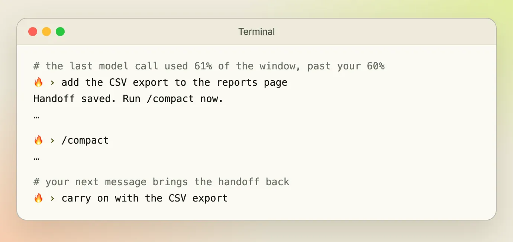</picture></p>

모든 세션에서 켜 두려면 Hermes가 실행되는 환경, 예를 들어 셸 프로필에 `LITHERMES_AUTO_HANDOFF=1`과 `LITHERMES_AUTO_HANDOFF_PERCENT=60`을 넣으세요. 이 값이 슬래시 명령보다 우선합니다. 퍼센트는 Hermes 자체 압축 시점보다 낮게 잡고, 그렇지 않으면 doctor가 경고해 줍니다.

<p align="center"><picture><source media="(prefers-color-scheme: dark)" srcset="./docs/assets/handoff/auto-handoff-shell-dark.webp" />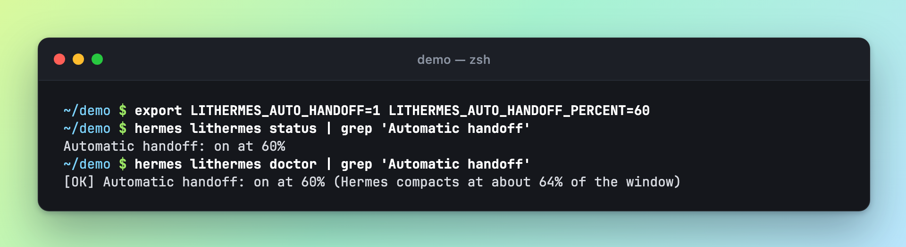</picture></p>

단계마다 누가 무엇을 하는지는 [자동 핸드오프](./docs/automatic-handoff.ko.md)에 정리해 두었습니다.

## 할 수 있는 일

LitHermes는 스킬 40개와 그 슬래시 명령, `goal_*` 작업 도구를 설치합니다. 평소에는 그중 몇 가지만 쓰게 되고, 하나하나 한두 단어로 시작합니다.

### 확인까지 끝나는 작업

그냥 `lit`을 붙이면 노트를 펴 두고, 기준마다 실패하는 테스트, 통과, 실행 결과 확인, 정리 순서로 진행합니다. 바뀐 코드와 함께 무엇을 확인했는지 목록이 남습니다. 같은 세션에서 `lit`을 다시 입력하면 지금 모드를 이어 가고, `lit new …`는 새로 시작합니다.

```text
lit 실패하는 로그인 테스트를 고쳐줘
```

### 계획부터 세우고 만들기

`lit plan`은 번호 붙은 작업 목록을 파일로 쓰고, 코드는 그대로 둡니다. 읽어 보고 괜찮으면 그 계획 파일로 `/start-work`를 실행하세요. 한 줄씩 실행하고, 다섯 관문을 모두 통과해야 체크 표시를 붙입니다. 계획을 저장한 직후 같은 세션에서 `go`만 입력하면 실행할 명령을 그대로 보여 줍니다.

```text
lit plan 보고서 페이지에 CSV 내보내기 추가
/start-work <방금 쓴 계획 파일>
```

### 합치기 전에 한 번 더 보기

`lit review`에는 두 가지 방식이 있습니다. 계획 검토는 `lit plan` 뒤, `start-work` 앞에서 계획을 점검합니다. 작업 검토는 끝난 변경을 리뷰어 다섯이 각자 읽고, 리뷰어마다 찾은 문제부터 알려 줍니다. 고치는 일은 그다음입니다. 프로젝트에 무엇이 있는지 보고 방식을 고르며 첫 줄에 어느 쪽을 골랐는지 밝히고, `lit review plan`이나 `lit review work`로 직접 정할 수도 있습니다.

```text
lit review 이 브랜치의 변경 사항
```

### 출처가 붙는 조사

`lit research`는 질문을 쪼개 여러 검색을 동시에 보내고, 실마리를 끝까지 따라간 뒤에 답합니다. 주장마다 출처가 붙고, 가져온 글은 자료로만 읽으며, 로그인과 유료 벽 앞에서는 멈춥니다.

```text
lit research 널리 쓰이는 CLI들은 오래된 설정 파일을 어떻게 옮길까?
```

### 보고서, 발표자료, 도면, 한국어 글

`lit`을 붙여 보고서나 발표자료를 부탁하면 고칠 수 있는 Word나 PowerPoint 파일과 그 Markdown 원본이 함께 나옵니다. `lit-schematic`은 실제 설비를, `lit-diagram-drawer`는 시스템과 흐름을 그리고, `lit-typographic-motion`은 트리트먼트부터 써서 짧은 영상을 연출합니다. `humanizer`는 딱딱한 한국어나 영어 문장을 다듬으면서 사실과 단서, 존댓말과 말투를 지키고, 직접 결정하기 전까지 파일은 그대로 둡니다.

```text
lit notes.md로 월요일 팀 회의용 슬라이드 10장 만들어줘
lit-schematic 운전용·예비용 펌프가 있는 차아염소산 주입 스키드 P&ID
humanizer 이 문단을 자연스러운 한국어로 다듬어줘: …
```

### 계획 전에 아이디어부터

이름이나 방향처럼 답이 열린 질문에는 `lit brainstorm`이 먼저 서로 다른 선택지를 넓게 펼치고, 장단점을 붙인 짧은 목록으로 좁힙니다. 하나를 고르면 인터뷰나 `lit plan`으로 넘기고, 스스로 무언가를 만들지는 않습니다.

### 읽은 기법을 내 스킬로

내 스킬에는 없는 걸 해내는 글이나 저장소를 봤다면, `lit hijack`이 출처마다 어디서 왔는지 기록하고 라이선스를 확인한 뒤, 자기 말로 사양을 쓰고, Hermes 도우미로 만들어, 같은 프롬프트로 예전 스킬과 새 스킬을 돌려 차이를 증명합니다.

```text
lit hijack https://example.com/post 내 lit-pptx 스킬에
```

### 어디까지 했더라?

창을 여러 개 오간 하루 끝에 `lit adhd`(또는 `lit rewind`)를 입력하면, 이 저장소의 최근 Hermes 세션과 계획, 핸드오프, git 기록을 읽어 위 그림 같은 브리핑을 줍니다. 아무것도 바꾸지 않습니다. 제안한 다음 단계가 마음에 들면 30분 안에 `go`라고 답하세요. 다른 세션이 아직 일하고 있으면 먼저 기다리라고 알려 줍니다.

### gateway로, 휴대폰에서

위의 모든 경로는 Telegram이나 Discord 같은 Hermes gateway에서도 동작합니다. 책상에서 계획을 시작하고 휴대폰으로 확인할 수 있어요. gateway는 다시 시작해야 새로 설치하거나 업데이트한 플러그인을 불러오고, 실행 중인 gateway가 마지막 설치보다 오래됐으면 `lithermes doctor`가 알려 줍니다.

[모든 경로](./docs/guide.ko.md#핵심-명령)와 [그림이 붙은 스킬 40개 전체](./docs/skills.ko.md).

## 작동 방식

LitHermes는 Python 플러그인입니다. Hermes가 플러그인을 불러오면 `register(ctx)`가 훅, 명령, 스킬, 작업 도구를 등록합니다. 훅은 모델이나 도구를 호출하기 직전과 직후에 끼어듭니다. `goal_*` 도구는 목표와 그 목표를 위해 모은 확인 결과를 프로젝트 안의 로컬 기록에 적습니다.

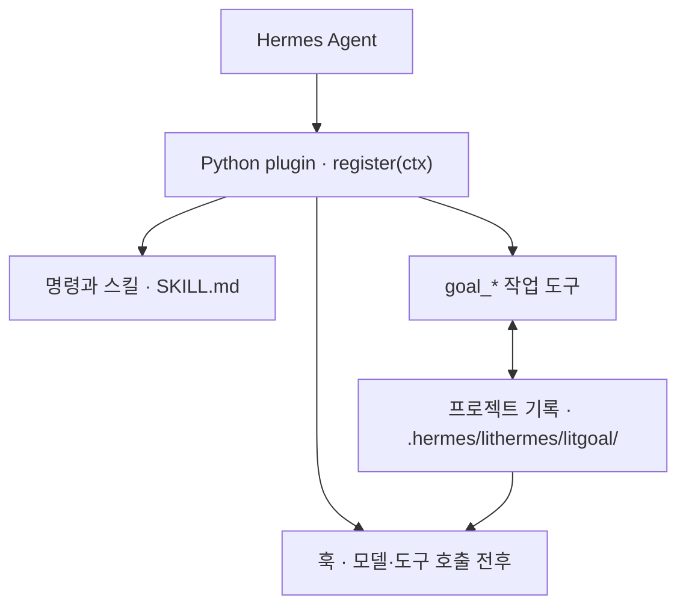

다음 모델 호출 전에는 context 훅이 이 기록을 읽어, 지금 목표가 무엇이고 어디까지 왔는지 모델에게 건넵니다. `lit`으로 시작하는 평범한 프롬프트는 플러그인이 경로를 정하고, 슬래시 명령은 바로 해당 스킬로 갑니다. 붙여 넣은 코드나 복사한 명령은 자료로만 읽고 지시로 따르지 않습니다. 모델은 여전히 Hermes Agent가 돌리고, 권한 확인, 로그인, 모델 접근, 실제 화면이 필요한 검사도 모두 Hermes 쪽에서 처리합니다.

## 요구 사항, 업데이트, 삭제

Hermes Agent와 Node.js 18 이상, 그리고 Hermes 홈에 쓸 권한이 필요합니다. 영상을 만들려면 Chrome과 ffmpeg도 있어야 하고, Word와 PowerPoint 파일은 처음 만들 때 버전이 고정된 도구를 LitHermes 캐시에 설치합니다.

LitHermes는 스스로 최신 상태를 유지합니다. 터미널에서 `install`, `check`, `doctor`를 실행하거나 대화형 Hermes CLI 세션에서 첫 메시지를 보낼 때 더 새로운 안정 버전을 찾고, 있으면 플러그인과 설정을 백업한 뒤 설치하고 `doctor --offline`을 실행합니다. 무엇이든 실패하면 백업을 되돌립니다. gateway와 전체 화면 TUI는 이 방식으로 업데이트되지 않습니다. 업데이트를 직접 설치하고 싶다면 `LITHERMES_NO_AUTO_UPDATE=1`을 설정하세요. 단계와 끄는 방법은 [업데이트](./docs/install.ko.md#업데이트)에 모두 적어 두었습니다.

기록은 모두 내 컴퓨터에 남습니다. 목표와 계획과 근거는 프로젝트의 `.hermes/lithermes/`에, 설치 기록과 업데이트 캐시와 백업은 Hermes 홈에 있습니다. LitHermes가 스스로 인터넷을 쓰는 일은 두 가지입니다. 하나는 npm에 새 버전이 있는지 묻는 것으로, `LITHERMES_NO_UPDATE_CHECK=1`을 설정하면 끌 수 있습니다. 다른 하나는 스킬이 처음 필요로 할 때 버전이 고정된 도구를 받는 것입니다. 영상용 도구는 `install` 때 받고(`--offline`을 붙이면 건너뜁니다), Office용 도구는 Word나 PowerPoint 파일을 처음 만들 때 받습니다. 프롬프트는 전과 같이 Hermes에 설정한 모델 제공자에게 갑니다. LitHermes가 쓰는 파일은 [개인정보와 로컬 기록](./docs/privacy.md)에 모두 나와 있습니다.

온라인에 접속하지 않고 설치 상태를 점검하거나 삭제하는 명령입니다.

```sh
npx --package @litfamily/lithermes -- lithermes doctor --offline
npx --package @litfamily/lithermes -- lithermes uninstall --yes
```

오프라인 doctor에서 `loaded plugin`이 PARTIAL로 나오는 건 정상입니다. 오프라인으로는 Hermes가 어떤 플러그인을 불러왔는지 물어볼 수 없기 때문입니다. 설치 프로그램이 Hermes 설치본에 호환성 수정을 했다면, 삭제할 때 `--rollback-patches`를 붙여 그 수정까지 되돌리세요. 스킬이 보이지 않거나, 이름이 겹치거나, import 오류가 날 때는 [문제가 생겼을 때](./docs/install.ko.md#문제가-생겼을-때)를 보세요.

## 더 알아보기

- [설치, 업데이트, 삭제](./docs/install.ko.md): 설치 옵션 전부, 업데이트가 움직이는 방식, 문제 해결과 한계
- [LitHermes 둘러보기](./docs/tour.ko.md): 처음 실행했을 때의 화면, 짧은 영상, Ignition 스킨, LIT 마크
- [스킬과 명령](./docs/skills.ko.md): 그림이 붙은 스킬 40개 전체, 명령 목록, 문서·영상·글 스킬이 만드는 결과물
- [자동 핸드오프](./docs/automatic-handoff.ko.md): 압축을 사이에 두고 작업을 넘기는 과정을 단계별로
- <a href="./docs/guide.ko.md"> 사용 안내</a>: 명령, 자연어 routing, bounded work, 모델, 스킨, 안전 모델 전체
- [Python 플러그인 계약](./packages/lithermes-installer/assets/lithermes-plugin/README.md) · [npm 패키지 안내](./packages/lithermes-installer/README_Ko-KR.md) · [변경 기록](./CHANGELOG.md) · [개인정보](./docs/privacy.md) · [이전 안내](./docs/migration.md)

## LitFamily

LitHermes는 같은 `lit` 작업 방식을 코딩 에이전트 일곱 곳에 옮긴 [LitFamily](https://github.com/wjgoarxiv/litfamily)의 하나입니다. 커버의 갑옷 로봇 일곱은 이 일곱 제품을 뜻합니다. 제품마다 자기 호스트에서 따로 돌아가니, 쓰는 것 하나만 설치하면 됩니다. 커버는 브랜드 모션이고, <a href="./docs/assets/readme/ignition-film.mp4"> Ignition 영상</a>도 같은 결의 짧은 브랜드 영상입니다. 실제 Hermes 세션을 보여 주는 건 이 페이지 위쪽의 데모입니다.

새 세션에 프로젝트를 처음부터 다시 설명하는 수고를 LitHermes가 덜어 주었다면, 스타를 하나 눌러 주세요. 다른 Hermes 사용자가 이 저장소를 찾는 데 도움이 됩니다.

버그 제보와 풀 리퀘스트를 환영합니다. [기여 안내](./CONTRIBUTING.md)부터 읽어 주시고, [보안](./SECURITY.md), [행동 강령](./CODE_OF_CONDUCT.md), [지원](./SUPPORT.md)도 참고하세요. LitHermes와 LitFamily의 이름과 로고는 [상표 정책](./TRADEMARK.md)을 따르고 MIT License에는 들어가지 않습니다. 포크는 자기 이름을 달고 얼마든지 만들어도 됩니다.

<a href="./LICENSE"> MIT License</a>
