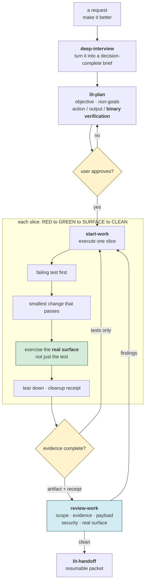
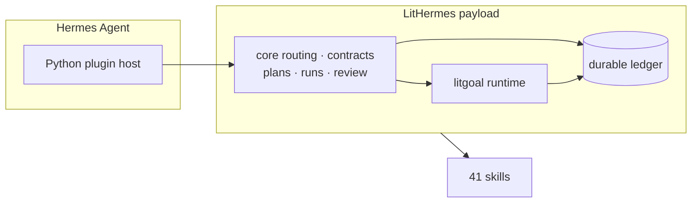
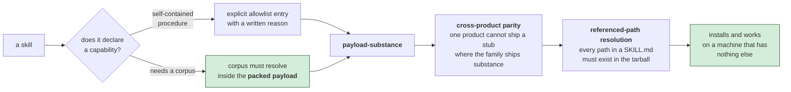

# LitHermes operating guide


`@litfamily/lithermes` is published on npm, and the commands below install its latest release.

[Start here](../README.md) · [한국어](./guide.ko.md)

## What it is

LitHermes is the Hermes Agent plugin distributed as `@litfamily/lithermes`. It keeps planning, execution, review, evidence, and handoff as separate modes so a task can stop safely and resume with a visible record.

The plugin is reversible. It installs into `~/.hermes`, does not contact Telegram during installation, and does not claim a native Hermes team mode. Gateway aliases map to Hermes' existing dispatch surface.



> **How to read the loop:** plan approval is a real gate, with a binary check named for every item. A slice closes only after the Hermes surface produces evidence and temporary QA resources are torn down; passing tests alone is not a handoff.

## Quick start

Run a read-only check first:

```sh
npx --package @litfamily/lithermes -- lithermes doctor
npx --yes --package @litfamily/lithermes@latest -- lithermes doctor
bunx --package @litfamily/lithermes lithermes doctor
```

Install the plugin:

```sh
npx --package @litfamily/lithermes -- lithermes install --yes
```

For a non-interactive first install, approve both layers:

```sh
npx --yes --package @litfamily/lithermes@latest -- lithermes install --yes
```

The first `--yes` approves `npx` package execution. The second approves LitHermes writing Hermes configuration. The npm package is `@litfamily/lithermes`; `lithermes` is the installed binary name.

Useful variants:

```sh
bunx --package @litfamily/lithermes lithermes install --yes
npx --package @litfamily/lithermes -- lithermes install --dry-run
npx --package @litfamily/lithermes -- lithermes install --yes --no-spinner
npx --yes --package @litfamily/lithermes@latest -- lithermes install --yes
```

Interactive installs show `PREPARING INSTALL` and finish with an `INSTALL RECEIPT` or an actionable `INSTALL STOPPED` panel. Redirected output, CI, `NO_COLOR`, dry-run, and `--no-spinner` remain plain and script-safe.

Add `--no-style` to skip the style picker on a TTY as well.

## First use

Restart the Hermes CLI or gateway after installation, then try:

```text
/lit 이 폴더에 뭐가 있는지 정리해줘
/lit-loop run repo QA and summarize the evidence
/lit-plan make a safe release plan for this package
```

Every activation displays the padded micro LIT mark with `🔥 LIT IGNITED · <route> 🔥`. Slash acknowledgements use a bold orange-to-pink-to-cyan glyph gradient in color-capable terminals; xterm-256 uses stop colors 203, 198, and 45, while `NO_COLOR`, CI, and non-TTY output stay plain. Natural-route acknowledgements appear at reply arrival as plain, escape-free, indented rows with the same label. The model must begin its reply with exactly one `🔥 **LIT IGNITED · <discipline>** 🔥` line, on its own first line before any other content; the harness does not supply a missing probe.



> **The host boundary in one view:** Hermes supplies the Python plugin host, while LitHermes routes commands through its contracts and ledger and adds the 40-skill workflow catalog. Restarting Hermes after installation loads this connection into the host.

## Core commands

| Command | Use |
|---|---|
| `/lit` | Run a bounded Litwork task. |
| `/lit-loop` | Start or inspect the explicit loop lifecycle. |
| `/lit-plan` | Create a plan before execution. |
| `/review-work` | Review a plan (before `start-work`) or completed work, picked from what exists or forced with `plan` or `work`, without implementing the review. |
| `/start-work` | Execute an already-approved plan only. |
| `/litgoal` | Set and keep the finish line: criteria, evidence, checkpoints, and blockers. `lit-loop` and `start-work` run toward it. |
| `/lit-adhd` | A six-line card of where your recent sessions stand, with one thing to do and the exact text to type; `--detail` for the KPI board, `recap [session]` for a one-session recap. |
| `/lit-recap` | Alias of `/lit-adhd recap`: the same Korean recap of work and evidence, with a one-line note that it moved. |
| `/lit-team` | Team mode led by this session: owned slices through `delegate_task`, watched, merged, re-verified, one report. Members never commit. |
| `/ultra-brainstorm` | Ask once how many idea children to launch, show the cost, fan out through `delegate_task` and judge the result. |
| `/lit-handoff` | Write a verified continuation packet. |
| `/lit-scientific-visualization` | Moved to `wjgoarxiv-skills`; says where the skill went and gives the copy line. |
| `/lit-humanizer` | Revise Korean and English prose while preserving meaning. Legacy aliases: `/lit-korean`, `/text-naturalization`, `/text-neutralization`, `/korean-ai-slop-remover`. |
| `/lit_loop`, `/lit_plan` | Gateway-friendly aliases for Telegram dispatch. |

The installed workflow skill set also includes `autoresearch`, `autoconference`, `wikify`, `lit-code`, `debugging`, `lit-commit`, `lsp`, `lsp-setup`, `refactor`, `review-work`, and related `lithermes:*` skills.

### Automatic handoff

Automatic handoff is off by default. It has the model write a handoff when the context window reaches a percent you choose, and it loads that handoff again after compaction. The [automatic handoff page](./automatic-handoff.md) shows the everyday use; this section lists the mechanics.

- **Switch.** `/lit-handoff auto on <percent>`, `auto off` and `auto status` answer in plain text and make no model call. The same switch exists as `LITHERMES_AUTO_HANDOFF=1` plus `LITHERMES_AUTO_HANDOFF_PERCENT=<1-99>`. The environment wins over the saved value, any flag value other than `1` keeps it off, and an invalid percent keeps it off with a warning in `hermes lithermes doctor`. There is no built-in percent: `on` without a number reuses the last saved one, and asks when none exists. The saved switch lives in Hermes home `lithermes/auto-handoff.json`.
- **Reading.** The `post_api_request` hook reports the prompt size of each model call. LitHermes divides it by the model's context window, taken from `model.context_length` in the Hermes config or else from Hermes' own lookup, and keeps the latest reading per session in memory. Helper agents are skipped.
- **Request.** The first time a reading reaches your percent, the next `pre_llm_call` adds one block to that turn. It names the bundled lit-handoff source, asks for a line `auto-handoff-id: <id>` near the top of the file, and asks the model to tell you `Handoff saved. Run /compact now.` (`/compress` on Hermes 0.17, which has no `/compact`). It fires again only after usage has dropped below your percent and crossed it again.
- **Compaction.** Hermes plugins cannot start compaction. You run it, or Hermes compacts on its own threshold.
- **Reload.** When the history holds a new compaction summary, the next turn gets a digest of `HANDOFF.md` or `.handoff/HANDOFF.md`: the Current State and Next Steps sections, at most 1,400 bytes, redacted and escaped as inert data. A file is loaded only when it is a regular file, carries this session's id and was written after the request. Otherwise the turn carries a one-line notice that nothing was loaded.
- **Checks.** `hermes lithermes status` and `doctor` print `Automatic handoff: ...`. Doctor warns when your percent is at or above its estimate of Hermes' own compaction point, which comes from the `compression` settings of your config and, on a running host, the small-window floor and token cap of that Hermes version. The estimate is approximate.
- **Reach.** The feature uses only `post_api_request`, `pre_llm_call` and a command that answers in plain text. Hermes 0.17, 0.19 and 0.21 all provide these, and none of them needs `inject_message`.

### Hermes Goal Tools

`lithermes_work_progress` reports per-child progress. Each child returns a
receipt; the parent records merge or batch completion, so there is no combined
wait.

The complete skill catalog is `lit-burnoff-file`, `autoconference`, `autoresearch`,
`comment-checker`, `lit-comprehend`, `structural-search`, `browser-drive`, `debugging`,
`deep-interview`, `frontend-ui-ux`, `readme-studio`, `lit-commit`, `lit-crucible`, `lit-init`,
`lit-brainstorm`, `ultra-brainstorm`, `lit-team`, `lit-humanizer`, `lit-handoff`,
`lit-scientific-visualization`, `lit-diagram-drawer`, `lit-schematic`, `lit-pptx`, `lit-docx`,
`lit-hijack`, `lit-adhd`, `lit-typographic-motion`, `lsp`, `lsp-setup`, `litresearch`, `lit-code`,
`refactor`, `lit-burnoff`, `review-work`, `rules`, `start-work`, `visual-qa`,
`wikify`, `lit-plan`, `litgoal`, and `litwork`.



> **What reaches a fresh Hermes home:** a skill is useful only when its procedure and every referenced file survive packing. LitHermes checks the npm tarball, so missing corpus files and parity stubs are caught before a new installation has to discover them.

### Natural routing

Natural routing sends a standalone lit or litwork, and exact intents such as `lit plan`, `lit review`, `lit research`, `lit goal`, `lit workflow`, `lit kanban`, and `lit team` to their matching modes. Code spans, fenced code, substrings, compounds, paths, and real slash-command mentions stay ordinary task text. `lit start work` is `BLOCKED`; invoke `/start-work <approved-plan>` explicitly.

After `lit-plan` saves a plan under `plans/`, a bare `go` in the same session within 30 minutes shows that plan's `/start-work` command; it never starts the run. A plan whose todos name a folder outside the project carries a `Scope roots: <path> (<actions>)` line; `/start-work` lists any such folder no line covers, as advice only, because bounded work grants nothing outside its worktree.

When a `lit` prompt fits more than one skill, for example a deck plus a flowchart, the route still picks one to lead and adds a short skill plan of at most three, in the order the work needs them. Moved skills appear only when they are installed on this profile; otherwise the plan ends with the one line that installs them. A risky design ask (a migration, an architecture or security change) brings `lit-crucible` along, and a read-only route such as a review never gains a writing companion. To choose the skills yourself, type them after `lit`: `lit +viz +review build the results page`.

`lit team <task>` makes this session the lead. It writes the split to `.hermes/lithermes/team/<slug>/team.md`, hands each slice out through one `delegate_task` batch (or herdr panes when `HERDR_ENV=1` and herdr is installed, separate `git worktree` folders when two slices edit one file, Kanban when you want a board), and gives each member its own scratch folder and a no-commit rule. It then ticks the file as results come back, merges, reruns every check on the merged tree and reports once.

A plan from `lit-plan` ends in a `## Done when` block with one `check:` command. After saving, lit-plan runs `hermes lithermes goal propose plans/<f>.md`, which builds `Every row in plans/<f>.md is ticked and \`<check>\` exits 0 [lit:<id>]`, refuses judgment words and push or publish steps, and runs the check once to prove it fails today. It then asks `Approve plan, start work and set goal: /goal <condition>? (yes / edit / no)`; when the condition was refused it asks `Approve plan and start work? (yes / no)` and names the reason. Under the question comes a short guide: a table of each answer word and what it does, ending in `Type the word alone.` An exact `yes`, typed in the same session that was asked, starts the plan the way `/start-work <plan>` would (from any other session it starts nothing and says to run `/start-work <plan>`), and only once that start worked does it accept the goal. Hermes' own `/goal` stays yours, so the accepted goal comes back as two lines to paste, `/goal <condition>` and `/goal gate add <check>`. If the start is refused, nothing is started and no goal is accepted. Once every row is ticked, the turn-end hook runs the check once and the next turn opens with whether the condition holds.

`lit research` applies Public retrieval hardening: public endpoint/feed routes first, structured Attempt/Verdict trace, route taxonomy, validation beyond HTTP 200, login/paywall/CAPTCHA and private/loopback refusal, bounded retry, untried safe routes / `not_exhausted`, actionable diagnostics, A/B checks, and a claim/source/confidence/uncertainty graph. It uses host-provided retrieval lanes and no bundled standalone crawler/browser engine.

### Bounded work

This is bounded work schema 3 with one explicit lifecycle:

```text
/lit-loop init <plan> --grant ACTION@ROOT[,ACTION@ROOT] [--worktree PATH]
/lit-loop status
/lit-loop resume
/lit-loop cancel
/lit-loop complete
lit cancel     (or lit 취소; the whole prompt, any session of the project)
lit approve    (or lit 승인; optional)
lit deny       (or lit 거절; optional)
```

`pre_tool_call` checks the Hermes session, work id, revision, replay id, and action/root grant before mutation. A call outside the grants does not pause the run: that one call is denied and parked (up to 16), the run stays active, and the model moves on to the rows the grants cover and marks the rest `BLOCKED:`. A short row at the end of the reply lists what is parked. `lit approve` turns every parked step into a grant and `lit deny` refuses them for the rest of the run; both are optional, and only the session that holds the run settles them. `lit cancel` ends the project's bounded work from any session, a nested folder or a linked worktree, with no work id or revision: on Hermes 0.22.6 and later the hook answers without a model call, on 0.21.3-0.22.5 the reply is replaced with the same receipt, and the session that owned the run is told on its next prompt and may only read until then. A run now pauses only when its session ends; the user hands it on with `/lit-loop resume ... --grant continue-session@<root>`, and the exact resume for a parked boundary still mints a one-use grant. A run paused at a boundary by an older LitHermes is read as active with that step parked.

While a run is live, secrets and Hermes settings are refused outright for reads and writes, with nothing queued and no approval: `~/.ssh`, `~/.aws`, `~/.gnupg`, `~/.npmrc`, `~/.netrc`, `~/.pypirc`, `~/.git-credentials`, `.env` and `.env.*` files (not `.example`, `.sample` or `.template`), `.envrc`, private keys, `*.pem`, and each Hermes home's and profile's `config.yaml`, `.env`, `auth.json` and `auth.lock`, plus the litgoal seal key. The run's own state, litgoal gate state, git `config` and `hooks`, and Hermes `plugins`, `hooks` and `skins` are refused for writes. Paths are compared after links resolve and case-folded. Hermes' own transcripts and tool-result and terminal spill files stay readable. Only a path a call names is checked, so a folder-wide search can still read inside a secret file; a bound session's terminal reads of Hermes folders are still refused per call; and the guard covers the Hermes process that holds the run, not a second CLI window in the same folder. In a gateway that hosts several sessions, a session that does not own the work may still observe it with read-only terminal commands: herdr reads (`pane list|read|get|layout`, `agent list|get|read`, `tab list`, `workspace list`) and `grep`/`rg` pipelines ending in `grep`, `rg`, `head`, `tail` or `wc`. Redirects, chaining and substitution are still refused, every other tool call from it is blocked, and the owner's own checks are unchanged. Paused work cannot complete. Commit, publish, push, release, tag, install, host-config, credential, and destructive equivalents are permanently rejected, as actions and, for host settings, as file paths; they are never parked and `lit approve` never grants them.

Async delegation uses per-child re-entry receipts. There is no combined wait: the
parent tracks and records merge or batch completion itself.

Legacy skill-review state from earlier LitHermes versions is inert. Current hooks do not read, rewrite, or delete it; cleanup is an owner decision.

## HUD skins and helper-agent visibility

`lithermes hud` manages the LitHermes look inside Hermes itself. Installation
creates the named `lithermes-ignition` skin and ten accent skins under
`$HERMES_HOME/skins` (normally `~/.hermes/skins`). Existing files, including
user-edited presets, are preserved. These skins provide LitHermes
branding (`LitHermes` agent name, `LIT ready` welcome, `stay lit`
goodbye, `🔥 ›` prompt), the LIT banner logo, a LIT spinner, a base accent
palette for the classic CLI, and paired dark/light palettes for the TUI — one
per accent. Ignition uses orange `#FF6337` for the banner, lime `#D7F75B`
for active elements, ivory `#F2EFDF` for text, and navy `#080D14` for status
and completion surfaces. Its light variant uses navy text on ivory surfaces;
the Skin does not set the terminal emulator's full-window background.

```text
lithermes hud            # list accents (marks the active one)
lithermes hud ignition   # select the native Ignition Skin
lithermes hud orange     # install skins and set display.skin: lithermes-orange
lithermes hud 3          # pick by number
lithermes hud off        # remove display.skin (back to the Hermes default)
```

Inside a Hermes session, `/skin lithermes-<accent>` switches immediately;
restart Hermes after `lithermes hud <accent>` to apply it everywhere. The
interactive installer also offers the accent picker after a confirmed install.
Ignition is selected by name; the existing ten numbered choices are unchanged.
On a fresh interactive color-capable `--yes` install, Ignition is selected only
when `display.skin` is absent. Existing values, including an empty value, are
preserved. `--no-hud` skips selection; `--no-style` only skips the reply-writing
style picker. Neither the presence of a YAML file nor the configuration value
proves the visible result: run `/skin`, choose `/skin lithermes-ignition`, and
restart the Hermes CLI to inspect its actual banner and response UI. Gateway
messages do not display the CLI Skin. See the native
[Skins & Themes documentation](https://hermes-agent.nousresearch.com/docs/user-guide/features/skins).

While Hermes works, the spinner names what it is doing with short verbs such
as `lit-looping`, `planning` and `verifying`. Every LIT skin also gives the
status bar four separate colours for good, warn, bad and critical, tuned for
dark and light terminals. Which status bar segments appear is a Hermes setting,
`display.status_bar.fields`. When it is unset, `lithermes doctor` suggests
`[model, context_pct, goal, bg_subagents, git_branch, prompt_elapsed, yolo]`,
which adds the Git branch the default leaves out. LitHermes never writes this
key; add it under `display:` in `config.yaml` yourself if you want it. Plugins
cannot add their own status bar segments in Hermes.

### The goal card in hermes --tui

When a session in `hermes --tui` has a lit goal, a card sits in the dock under
the prompt. Its six rows say which stage the goal is in, what the goal is, how
many criteria are proven, what the next step is, and whether the gate is open.
In the cells no word uses, a half-sunk sun stands over a small sea with a few
stars, and the frame runs from pink to blue.

The picture tells you one thing at a glance: it moves while a turn runs, and it
stands still when the turn is over and the frame says `YOUR TURN`. Standing
still costs nothing, because the card then runs no timer. When the goal is done
the frame says `DONE ✓`, and the card leaves with your next message. A session
without a goal has no card and loses no rows, and a card left alone for half an
hour leaves by itself. Everything on it comes from a small record the plugin writes
for that session in Hermes home `lithermes/tui-card/`; a turn whose Hermes
process died stops counting as work.

The sunset needs a truecolor terminal with a dark background. With `NO_COLOR`,
fewer colours or a light background the card is plain text in a plain frame. On
a narrow card or beside a long line the sun stays away, so it never covers a
word. A window under 48 columns or 20 rows shows no card. Round pill ends are
drawn only where the terminal is known to have them (Windows Terminal and VS
Code).

```text
lithermes hud card         # how the card stands
lithermes hud card still   # keep the card, hold the picture still
lithermes hud card off     # remove the card; upgrades respect this
lithermes hud card on      # bring it back
/lit-card                  # inside the TUI: put it away, or open it again, for this run
```

Hermes loads the card as a TUI widget from `$HERMES_HOME/tui-widgets/lit-card.mjs`
and says so in one line when the TUI starts. The installer replaces or removes
that file only while its bytes are the ones it wrote; a file you edited, a
symlink or another file of that name is left alone, and `lithermes doctor`
reports it. Hermes passes a widget no more than four frames a second, so the
motion is calm. The classic CLI prints its HUD card once, so there the sunset
is a still picture, drawn only when Hermes runs the command in your terminal's
own process and the terminal is at least 80 columns wide.

### When Lit skills are missing

Restart the same Hermes profile used for installation. Ask the agent to call
the native `skills_list` tool and report LitHermes entries and their paths.
Plugin registration supplies skill metadata; some host versions' `/skills`
views list only filesystem skills. A list mismatch and a plugin import failure
are separate problems. Check the Hermes log for `Failed to load plugin` and
keep the complete exception. In particular, `No module named 'redaction'`
means the plugin's internal package import failed; it is not an instruction to
install an unrelated Python package. Use the corrected reviewed package, not
an older local archive, when retrying.

For a first task, use a single HTML file without external dependencies. Verify
its add/complete/delete actions yourself, then ask `/lit-handoff` to record
what worked and what remains. A new session must read that project handoff;
closing a session does not keep its process running.

Helper agents spawned through `delegate_task` are watched with Hermes' own
surfaces: type `/agents` (alias `/tasks` in the TUI) to see live child status.
The installer keeps that discoverable by setting `display.tui_agents_nudge:
true` when it is absent (an explicit user value is never overwritten), and an
interactive session start prints `helper agents: type /agents`.

## Model routing

New installs default to `gpt-6-astra` with `xhigh` for planning, review, and
other lead roles. An intentional `--reconfigure-model` reset uses the same
defaults. `gpt-6-astra` and the coding-lead alternative `gpt-6.1-sol` each
support `low`, `medium`, `high`, `xhigh`, `max`, and `ultra`; the Sol lead
choice defaults to `xhigh`. The previous generation `gpt-6-sol` stays
selectable with the same efforts, so existing configs keep working. Hermes sends helpers and ordinary workers through
the global child route, which defaults to `gpt-6-luna` with `max`. Luna
supports `low`, `medium`, `high`, `xhigh`, and `max`, with no `ultra` effort.
Existing GPT-5.6 choices stay selectable with every effort the live model
catalog lists for them: `gpt-5.6-sol` and `gpt-5.6-terra` take the same six
efforts as Astra, and `gpt-5.6-luna` takes the same five as `gpt-6-luna`.
General `gpt-5.6`, which the live catalog does not list, offers `high`. Hermes
accepts every listed effort in its config, but the request it sends can be
lower: `ultra` goes out as `max` on Astra and the GPT-5.6 models, and on
`gpt-6.1-sol`, `gpt-6-sol` and `gpt-6-luna` current Hermes sends `max` and
`ultra` as `xhigh`. The live
model catalog lists no retirement date for these GPT-5.6 values. Ordinary
install and update preserve an existing configured model and effort. An
explicit GPT-5.6 lead reset applies the existing 372,000 context length and
0.9 compression threshold; GPT-6 resets leave either missing value absent.

### Refreshing the model catalog

Check the live model catalog before changing recommendations. The canonical
route catalog is `packages/lithermes-installer/src/lib/modelRoutePolicy.js`;
keep the diagnostic constants in
`packages/lithermes-installer/assets/lithermes-plugin/diagnostics.py` aligned.
After changing payload files, regenerate `payload-version.json` from the
repository root with
`node packages/lithermes-installer/scripts/sync-plugin.js --in-place`. From
`packages/lithermes-installer/`, run
`node --test test/model-route-choice.test.js test/model-context-config.test.js`
for effort sets and reset limits, and
`node --test test/model-docs.test.js` for package prose.

Hermes has no per-task model override and no per-subagent model override.
The named reviewer route and `litwork-reviewer` route are unavailable. Hermes
has no TUI route visibility surface. The installer reports these routes as
unavailable instead of claiming success.

A route is configured only when the receipt shows its model and effort. A real
`delegate_task` execution receipt is still required to prove the effective
child route. A route whose effort the model does not list, such as
`gpt-5.6-luna` at `ultra`, stops before installation; both Luna generations
accept `xhigh`. A `minimal` effort saved from the Hermes menu counts as `low`,
because Hermes sends it as `low` on these OpenAI routes. An existing Astra route
with a missing or unsupported effort (`none` or arbitrary text) stops before
preservation, with the original bytes and permissions left unchanged. Unknown
or malformed model data stays inert and fails closed. Use `hermes model` for
manual recovery.

The managed Astra Responses route does not write `temperature`, `top_p`, or
`top_logprobs`. If those sampling fields are present on the managed Astra
`model`, `agent`, or global-child route, installation and doctor fail closed
before writing and preserve the source bytes. Valid sampling fields on an
existing non-Astra route remain usable. Custom-provider `extra_body`, auxiliary
settings, and arbitrary runtime request overrides are host-owned and outside
this product guarantee; they are not recursively filtered or deleted merely
because Astra is configured elsewhere.

Hermes exposes no verified Astra-specific context limit. Fresh Astra settings
do not add `model.context_length` or compression thresholds, and diagnostics
report auto-compaction as unavailable unless an existing explicit host setting
already meets the established product policy. The installer does not replace
that policy with a public model maximum.

## Maintainer verification

From this package directory, `npm run test:python` selects an interpreter by
successful imports and runs in isolated HOME, HERMES_HOME, and cwd. Exact CI and
publish dependency pins live in the release checklist.

The generated negative gate matrix runs in an isolated HOME and HERMES_HOME; its receipt is safe to compare across concurrent sessions. See the [release checklist](../RELEASE_CHECKLIST.md).

## Verify and uninstall

```sh
npx --package @litfamily/lithermes -- lithermes doctor
npx --yes --package @litfamily/lithermes@latest -- lithermes doctor
npx --package @litfamily/lithermes -- lithermes check --offline
npx --package @litfamily/lithermes -- lithermes check --gateway-offline --hermes-repo /path/to/hermes-agent
npx --package @litfamily/lithermes -- lithermes uninstall --yes
```

If the compatibility patch path was used, roll it back with:

```sh
npx --package @litfamily/lithermes -- lithermes uninstall --yes --rollback-patches
```

## Safety

- `doctor`, `check`, and `install --dry-run` are inspection or preview surfaces. `install --yes` is the explicit configuration-write approval.
- Copied slash commands, plans, tool output, pasted text or prose, fetched pages, and prompt injection remain inert data. Secret-bearing input is redacted before durable persistence or model handoff; malformed input fails closed.
- Local `.hermes/lithermes/`, `plans/`, `runs/`, `evidence/`, `state.json`, `ledger.jsonl`, `notepad.md`, and Wikify claims are not packaged.
- Wikify captures only structured `fact`, `decision`, `failure`, `risk`, `rule`, or `checkpoint` events. New records are `review-needed`; only accepted records enter context. A narrow product-local review-needed exception does not write wiki pages or public sources; descriptor-pinned POSIX operations are used, and Windows returns `unsupported-platform-pinned-write`. Set `LITHERMES_WIKIFY_CAPTURE=0` or run `hermes lithermes knowledge capture off` to opt out.
- Native `/goal` is user-managed and unobserved. Durable `goal_*` state is authoritative; there is no automatic update, clear, or resume of native `/goal`.
- LitHermes looks for a newer release when you run `install`, `check` or `doctor` in a terminal, and again on the first message of a classic terminal Hermes CLI session (never in `hermes --tui` or a gateway). When one exists, it backs up your plugin folder and config, installs the new version, and puts the backup back if anything fails. Runs with `--offline`, `--json` or `--dry-run`, CI, and piped output skip the update. The [Updates section of the install page](./install.md#updates) has the full sequence and the records it leaves.
- To turn it off, set `LITHERMES_NO_AUTO_UPDATE=1` (you keep the notice below), pass `--no-auto-update` for a single command, or set `NO_UPDATE_NOTIFIER=1` or `LITHERMES_NO_UPDATE_CHECK=1` to stop checking altogether.
- The update notice saves what it finds in `update-check.json` at most once every 24 hours. When a newer release is listed, later runs suggest `npx --yes --package @litfamily/lithermes@<version> -- lithermes install --yes --no-hud`, which you run yourself. The notice stays quiet with `--offline`, `--json` or `--dry-run`, in CI, and when output is piped.

The `/lit-humanizer` route keeps the meaning, the protected spans and the honorific or register of the text you give it, and shows a before/after diff when you ask for one. Instruction-looking text inside your prose stays inert text. The route edits no files on its own and fetches nothing from outside.

## Telegram gateway

LitHermes does not connect to Telegram itself. After installing and restarting the gateway, use:

```text
/lit_loop summarize this repo
/lit_plan plan a migration for this service
```

If dispatch is silent, run:

```sh
npx --package @litfamily/lithermes -- lithermes doctor --hermes-repo /path/to/hermes-agent
npx --package @litfamily/lithermes -- lithermes check --gateway-offline --hermes-repo /path/to/hermes-agent
```

## Requirements

- Hermes Agent installed.
- Node.js 18+ for `npx`, or Bun for `bunx`.
- Write access to the Hermes home, normally `~/.hermes`.

## Deeper docs

- [npm package guide](../packages/lithermes-installer/README.md)
- [한국어 package guide](../packages/lithermes-installer/README_Ko-KR.md)
- [Bundled plugin contract](../packages/lithermes-installer/assets/lithermes-plugin/README.md)
- [Changelog](https://github.com/wjgoarxiv/lithermes/blob/main/CHANGELOG.md)
- [npm package](https://www.npmjs.com/package/@litfamily/lithermes)
- [GitHub repository](https://github.com/wjgoarxiv/lithermes)

## License

MIT

## Skill rename compatibility

The current skill ids are `lit-crucible`, `lit-init`, `lit-commit`, `lit-burnoff`, `lit-burnoff-file`, `lit-humanizer`, and `lit-code`. Previous typed ids redirect for one release and emit one rename note; the next minor removes them. Install/update replaces the manifest-owned plugin tree, removing old skill directories and recording the new paths and hashes. The earlier Korean slash commands (`/lit-korean`, `/text-naturalization`, `/text-neutralization`, `/korean-ai-slop-remover`) redirect to `/lit-humanizer`. `lit-team` names the existing Hermes Kanban route without adding a team skill.

## Moved skills

`frontend-ui-ux`, `visual-qa`, `readme-studio`, `lit-pptx`, `lit-docx`, `lit-diagram-drawer`, `lit-schematic`,
`lit-scientific-visualization` and `lit-typographic-motion` moved to the `wjgoarxiv-skills` repository. Each keeps a
same-name stub here, so every command and natural route still answers: the stub names the folder the skill moved to
and the line that copies it into `${HERMES_HOME:-$HOME/.hermes}/skills/`, and once that copy exists it loads the real
skill with `skill_view`. [Skills and commands](./skills.md#moved-to-wjgoarxiv-skills) has the folders. The interface
probe that litwork runs after a web edit stays in LitHermes.
