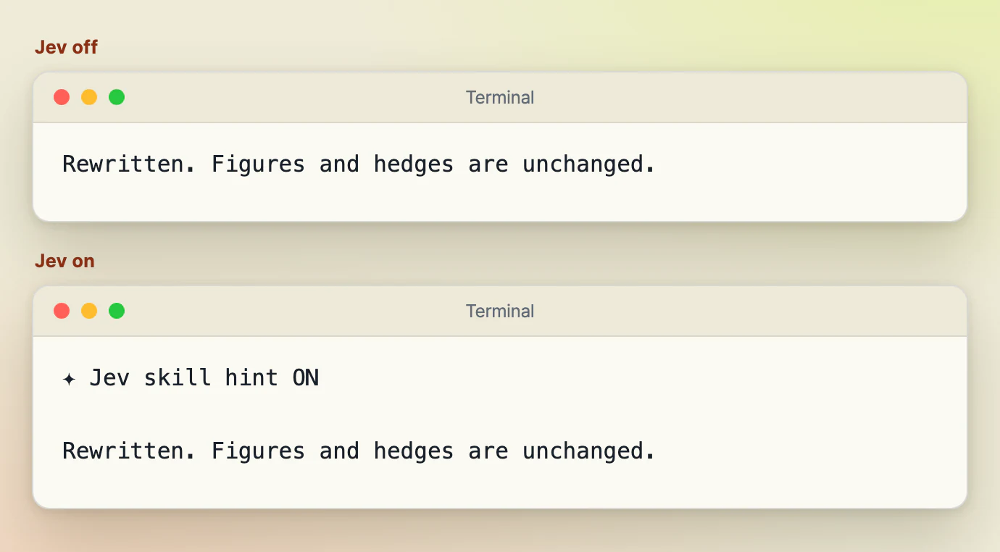
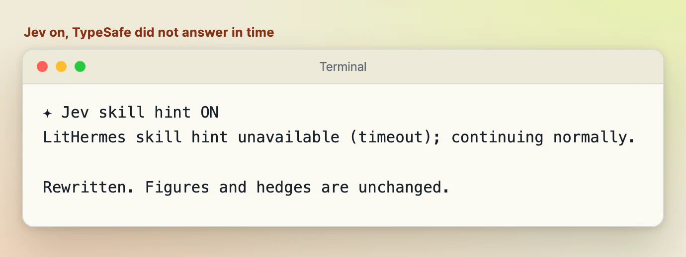
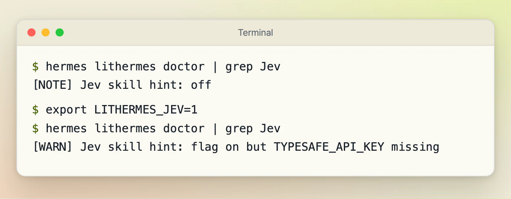
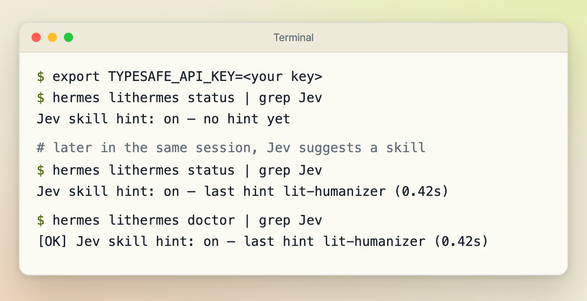

# Optional: Jev skill hint

[← Back to the README](../README.md) · [한국어](./jev.ko.md)

Sometimes a plain prompt would suit one of the bundled skills, but nothing in it says so. For those prompts, LitHermes can ask Jev, TypeSafe's hosted decision model, which skill fits. Jev's answer is added to that turn's context as one line of advice. It is only a suggestion: the Hermes model still decides whether to load the skill, and the hint cannot grant permissions or start tools. Slash commands, and prompts an existing LitHermes route already handles, are left alone.

It is off by default. To turn it on, set both variables, with your own TypeSafe key, in the environment Hermes runs in:

```sh
export LITHERMES_JEV=1
export TYPESAFE_API_KEY=<your key>
```

While it is on, each eligible prompt is sent to TypeSafe (typesafe.ai), truncated to 2,000 characters, with home paths, email addresses and token-shaped strings redacted. Anything in the prompt without a token shape is sent as written, such as hostnames, customer names, and passwords not written as `password=...`. In Hermes gateway mode, messages from other participants in a chat are eligible prompts too. Nothing else from the session is sent.

Because `TYPESAFE_API_KEY` is exported in the shell that starts Hermes, the agent's own tools can read it. Use a key dedicated to this feature, with a low spend limit. TypeSafe bills your account, at about $0.04 per million input tokens. Each request has a 1.5-second limit and no retry; on any failure the turn continues unchanged, with one short note per session.

While it is on, the first reply of each session starts with the plain line `✦ Jev skill hint ON`, so you can tell at a glance. You also see it in `hermes lithermes status` and `hermes lithermes doctor`. The last hint is kept per session, so run them inside a Hermes session, for example through the agent's terminal:

- `Jev skill hint: on — last hint lit-humanizer (0.43s)` names that session's last hinted skill and how long Jev took.
- `on — no hint yet` means no hint so far in that session.
- Outside any session the line reads `on — no session`. Otherwise it reads `off` or `flag on but TYPESAFE_API_KEY missing`.

To turn it off, unset `LITHERMES_JEV` or set it to any value other than `1`.

## What you will see

These four screens show what changes on your side. The text in them is what LitHermes prints; the skill name and the timing are examples.

**The first reply.** With Jev off, replies arrive as Hermes wrote them. With Jev on, the first reply of each session starts with one extra line, so you can tell at a glance that your prompts are going to Jev. It shows once per session, and the reply under it is unchanged.

<p align="center"><picture><source media="(prefers-color-scheme: dark)" srcset="./assets/jev/jev-first-reply-dark.webp" /></picture></p>

*Sample output. The first line is what LitHermes's own reply hook produced. The sentence under it is made-up sample text.*

**When Jev cannot answer in time.** If TypeSafe is slow or unreachable, the turn carries on without a hint. LitHermes adds one short note under the first line, once per session, so you know why no hint came.

<p align="center"><picture><source media="(prefers-color-scheme: dark)" srcset="./assets/jev/jev-first-reply-note-dark.webp" /></picture></p>

*Sample output from LitHermes's own reply hook, with a stand-in that plays a TypeSafe reply that never arrives. Nothing was sent anywhere.*

**Before it works.** `hermes lithermes doctor` includes a Jev line. While Jev is off, the line is a plain note. If you set the switch and forget the key, it turns into a warning that names the missing key, which is the quickest way to spot that.

<p align="center"><picture><source media="(prefers-color-scheme: dark)" srcset="./assets/jev/jev-status-before-dark.webp" /></picture></p>

*Captured from the real `hermes lithermes doctor` command in a scratch Hermes home.*

**Once it is on.** Inside a session, `status` first says that no hint has come yet. After Jev suggests a skill, the same line names that skill and how long Jev took, and `doctor` shows it with an OK tag.

<p align="center"><picture><source media="(prefers-color-scheme: dark)" srcset="./assets/jev/jev-status-on-dark.webp" /></picture></p>

*Captured from the real `hermes lithermes status` and `doctor` commands in a scratch Hermes home. A placeholder key and a stand-in for TypeSafe's answer were used, so the skill name and the 0.42 seconds are examples.*
