# 스킬과 명령

[← README로 돌아가기](../README_Ko-KR.md) · [English](./skills.md)

LitHermes가 설치하는 모든 스킬과 그 스킬을 시작하는 명령, 그리고 문서·다이어그램·영상·화면·글 다듬기 스킬이 만들어 내는 결과물을 정리했습니다.

## 전체 스킬

LitHermes에서 부를 수 있는 모든 스킬과 그 스킬을 시작하는 말입니다. 어느 스킬이든 `lithermes:<이름>`으로 직접 불러올 수도 있습니다.

<table>
<tr><th>이렇게 됩니다</th><th>스킬</th><th>얻는 것</th></tr>
<tr>
<td>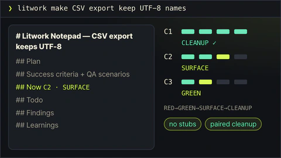</td>
<td><code>litwork</code><br /><sub><code>lit &lt;task&gt;</code> · <code>litwork &lt;task&gt;</code></sub></td>
<td>요청에 <code>lit</code>만 붙이세요. 노트를 펴 두고, 기준 하나마다 실패하는 테스트, 통과, 실물 확인, 정리 순서를 엄격하게 밟습니다.</td>
</tr>
<tr>
<td>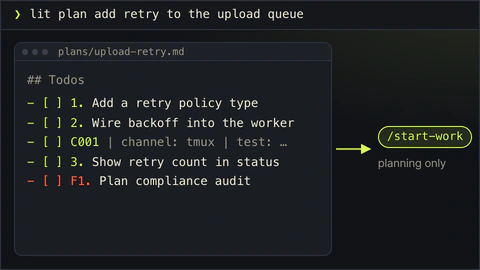</td>
<td><code>lit-plan</code><br /><sub><code>lit plan &lt;what&gt;</code> · <code>/lit-plan</code></sub></td>
<td><code>start-work</code>가 그대로 실행할 수 있는 번호 붙은 작업 목록이 파일로 나옵니다. 코드는 아직 건드리지 않습니다.</td>
</tr>
<tr>
<td>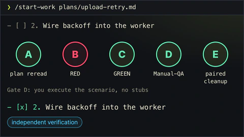</td>
<td><code>start-work</code><br /><sub><code>/start-work &lt;approved-plan&gt;</code></sub></td>
<td>계획을 한 줄씩 실행합니다. 다섯 관문을 모두 통과해야 체크 표시가 붙습니다.</td>
</tr>
<tr>
<td>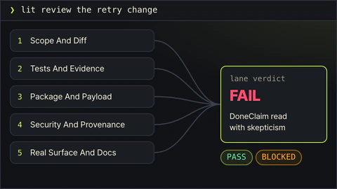</td>
<td><code>review-work</code><br /><sub><code>lit review [plan|work] &lt;scope&gt;</code> · <code>/review-work</code></sub></td>
<td>계획 검토는 <code>start-work</code> 전에 계획을 점검합니다. 작업 검토는 리뷰어 다섯이 끝난 변경을 각자 읽고, 찾은 문제부터 알려 줍니다. 있는 것을 보고 방식을 고르며 첫 줄에 어느 쪽인지 밝힙니다.</td>
</tr>
<tr>
<td>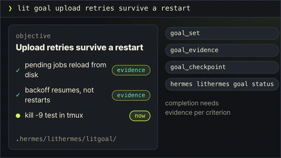</td>
<td><code>litgoal</code><br /><sub><code>lit goal &lt;outcome&gt;</code> · <code>/litgoal</code></sub></td>
<td>결승선을 정하고 지킵니다. 목표 하나와 확인 가능한 기준을 디스크에 남겨 다음 세션이 이어받을 수 있고, <code>lit-loop</code>와 <code>start-work</code>가 그 결승선을 향해 달립니다.</td>
</tr>
<tr>
<td>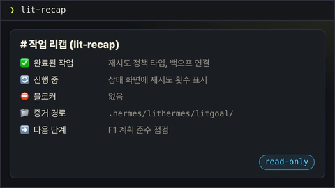</td>
<td><code>lit-recap</code><br /><sub><code>lit-recap</code></sub></td>
<td>읽기 전용 요약입니다. 끝난 일, 진행 중인 일, 막힌 곳, 증거 위치, 다음 단계를 보여줍니다.</td>
</tr>
<tr>
<td>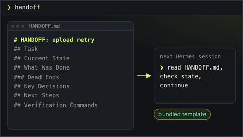</td>
<td><code>lit-handoff</code><br /><sub><code>handoff</code> · <code>/lit-handoff</code></sub></td>
<td><code>handoff</code>라고 치면 다음 세션이 읽고 이어갈 인수인계 파일이 생깁니다.</td>
</tr>
<tr>
<td></td>
<td><code>lit-brainstorm</code><br /><sub><code>lit brainstorm &lt;ask&gt;</code> · <code>lit ideation &lt;ask&gt;</code> · <code>lit idea &lt;ask&gt;</code></sub></td>
<td>이름이나 방향처럼 열린 요청에 씁니다. 서로 다른 선택지를 먼저 많이 내고, 장단점이 붙은 짧은 목록으로 좁힙니다. 고르면 그 선택을 <code>deep-interview</code>나 <code>lit-plan</code>으로 넘기며, 직접 만들지는 않습니다.</td>
</tr>
<tr>
<td>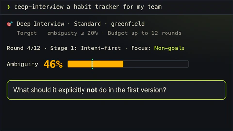</td>
<td><code>deep-interview</code><br /><sub><code>deep-interview &lt;idea&gt;</code> · <code>/deep-interview</code></sub></td>
<td>한 번에 한 질문씩 물어 아이디어를 만들 수 있을 만큼 분명하게 다듬습니다. 남은 모호함은 게이지로 보입니다.</td>
</tr>
<tr>
<td>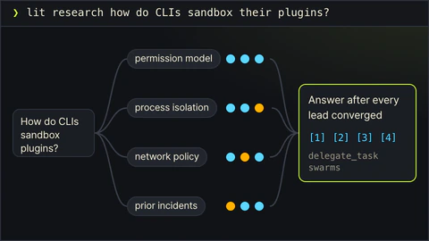</td>
<td><code>litresearch</code><br /><sub><code>lit research &lt;question&gt;</code></sub></td>
<td>조사 질문을 잘게 나누고 여러 검색을 동시에 돌려, 단서를 끝까지 따라간 뒤 출처와 함께 답합니다.</td>
</tr>
<tr>
<td>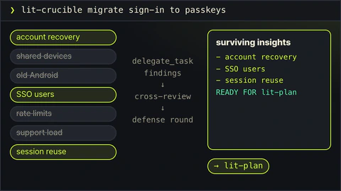</td>
<td><code>lit-crucible</code><br /><sub><code>lit-crucible &lt;brief&gt;</code></sub></td>
<td>계획 전에 요구사항을 반박해 봅니다. 반박을 견딘 위험만 계획으로 넘어갑니다.</td>
</tr>
<tr>
<td>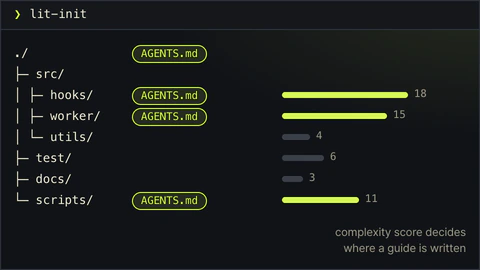</td>
<td><code>lit-init</code><br /><sub><code>lit-init</code></sub></td>
<td>저장소를 훑어 루트 AGENTS.md와, 필요한 폴더에만 짧은 안내서를 만듭니다.</td>
</tr>
<tr>
<td>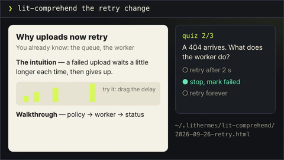</td>
<td><code>lit-comprehend</code><br /><sub><code>lit-comprehend</code> · <code>comprehend &lt;range&gt;</code></sub></td>
<td>에이전트가 쓴 작업을 이해하도록 돕는 설명 페이지입니다. 직관, 흐름 설명, 짧은 퀴즈 순서입니다.</td>
</tr>
<tr>
<td>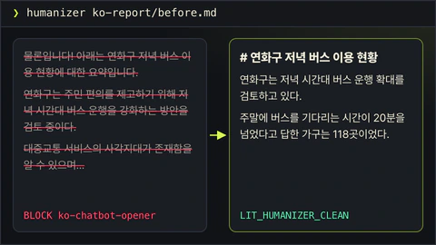</td>
<td><code>lit-humanizer</code><br /><sub><code>humanizer &lt;text&gt;</code> · <code>/lit-humanizer</code></sub></td>
<td>딱딱한 AI 문장을 한국어나 영어로 다시 씁니다. 사실과 단서는 남기고, 파일을 멋대로 고치지 않습니다.</td>
</tr>
<tr>
<td></td>
<td><code>lit-hijack</code><br /><sub><code>lit hijack &lt;brief&gt;</code> · <code>/lit-hijack</code></sub></td>
<td>공개 노하우의 클린룸 포팅입니다. 출처 기록과 함께 가져오고, 라이선스 게이트와 원천 없는 명세, 격리된 빌드와 parity 검증으로 옮깁니다.</td>
</tr>
<tr>
<td></td>
<td><code>lit-adhd</code><br /><sub><code>lit adhd</code> · <code>/lit-adhd</code></sub></td>
<td>여러 세션을 한 번에 브리핑합니다. 각 세션의 질문·작업·대기 상태와 로드맵 게이지, 다음 한 단계를 보여줍니다. 읽기 전용입니다.</td>
</tr>
<tr>
<td>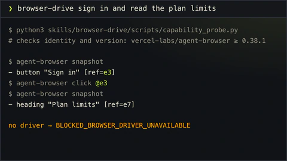</td>
<td><code>browser-drive</code><br /><sub><code>browser-drive &lt;task&gt;</code></sub></td>
<td>브라우저 드라이버를 먼저 확인한 뒤 실제 페이지를 조작합니다. 드라이버가 없으면 그렇다고 말합니다.</td>
</tr>
<tr>
<td>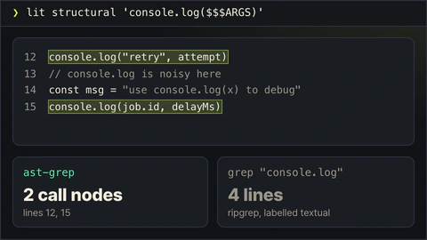</td>
<td><code>structural-search</code><br /><sub><code>lit structural &lt;pattern&gt;</code> · <code>structural-search &lt;pattern&gt;</code></sub></td>
<td>글자 대신 문법 구조로 코드를 찾고, 바꾸기 전에 결과를 미리 보여줍니다.</td>
</tr>
<tr>
<td>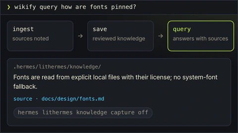</td>
<td><code>wikify</code><br /><sub><code>wikify &lt;mode&gt;</code> · <code>lit wikify &lt;mode&gt;</code></sub></td>
<td>검토를 거친 프로젝트 지식을 디스크에 두고, 나중 질문에 출처와 함께 답합니다.</td>
</tr>
<tr>
<td>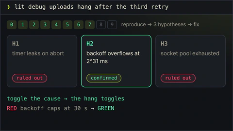</td>
<td><code>debugging</code><br /><sub><code>lit debug &lt;symptom&gt;</code> · <code>debugging &lt;symptom&gt;</code></sub></td>
<td>버그를 재현하고, 가설을 세 개 이상 세워 확인한 뒤, 확인된 원인만 고칩니다.</td>
</tr>
<tr>
<td>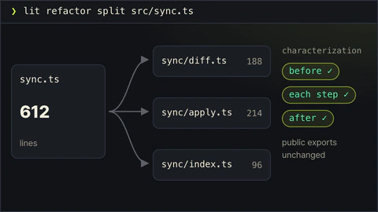</td>
<td><code>refactor</code><br /><sub><code>lit refactor &lt;target&gt;</code> · <code>refactor &lt;target&gt;</code></sub></td>
<td>동작을 테스트로 고정한 채 코드 구조를 바꿉니다. 단계마다 확인합니다.</td>
</tr>
<tr>
<td>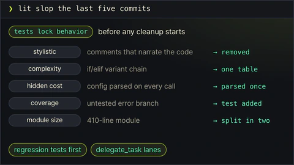</td>
<td><code>lit-burnoff</code><br /><sub><code>lit slop &lt;scope&gt;</code></sub></td>
<td>테스트로 동작을 먼저 묶어 두고, 변경분에 붙은 AI식 군더더기를 걷어냅니다.</td>
</tr>
<tr>
<td>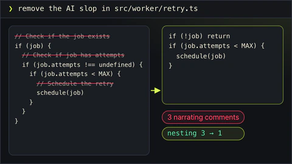</td>
<td><code>lit-burnoff-file</code><br /><sub><code>ask to clean one file</code></sub></td>
<td>파일 하나만 정리합니다. 설명조 주석과 과한 방어 코드를 줄이고 중첩을 펴줍니다.</td>
</tr>
<tr>
<td>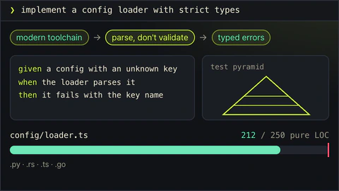</td>
<td><code>lit-code</code><br /><sub><code>ask for strict implementation</code></sub></td>
<td>엄격한 구현 규칙입니다. 테스트 먼저, 경계에서 타입 확인, 작은 파일.</td>
</tr>
<tr>
<td>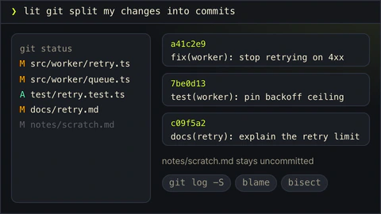</td>
<td><code>lit-commit</code><br /><sub><code>lit git &lt;task&gt;</code></sub></td>
<td>변경을 저장소 스타일에 맞는 작은 커밋으로 나눕니다. 관계없는 작업은 건드리지 않습니다.</td>
</tr>
<tr>
<td>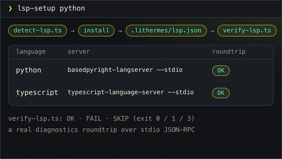</td>
<td><code>lsp-setup</code><br /><sub><code>lsp-setup &lt;language&gt;</code></sub></td>
<td>사용하는 언어의 언어 서버를 설치하고, 진단이 실제로 도는지 확인합니다.</td>
</tr>
<tr>
<td>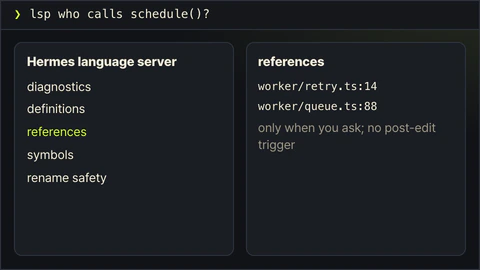</td>
<td><code>lsp</code><br /><sub><code>lsp &lt;request&gt;</code></sub></td>
<td>요청할 때 Hermes 언어 서버로 진단, 참조, 이름 바꾸기 안전성을 확인합니다.</td>
</tr>
<tr>
<td>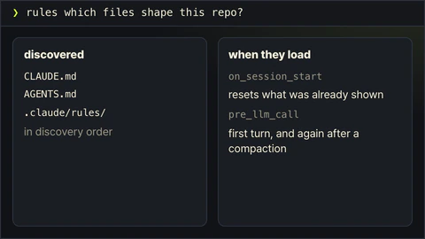</td>
<td><code>rules</code><br /><sub><code>rules &lt;question&gt;</code></sub></td>
<td>Hermes가 어떤 규칙 파일을 언제 읽는지 설명합니다.</td>
</tr>
<tr>
<td>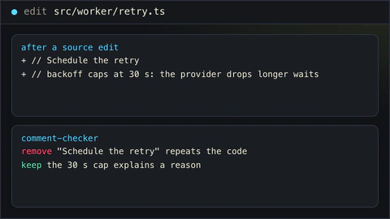</td>
<td><code>comment-checker</code><br /><sub><code>comment-checker</code></sub></td>
<td>수정으로 추가된 주석을 검토합니다. 이유는 남기고, 되풀이하는 주석은 뺍니다. 소스 파일을 고친 뒤에도 알아서 돕니다.</td>
</tr>
<tr>
<td>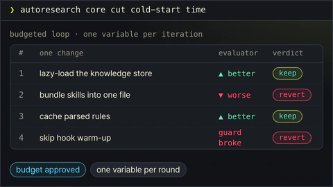</td>
<td><code>autoresearch</code><br /><sub><code>autoresearch &lt;mode&gt;</code></sub></td>
<td>승인된 예산 안에서 실험을 반복합니다. 한 번에 하나만 바꾸고, 결과에 따라 남기거나 되돌립니다.</td>
</tr>
<tr>
<td>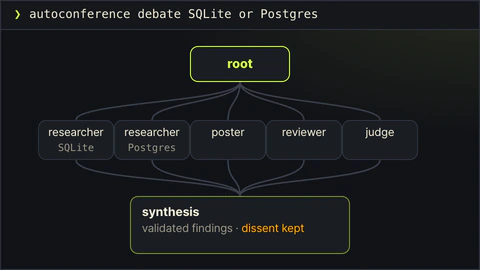</td>
<td><code>autoconference</code><br /><sub><code>autoconference &lt;mode&gt;</code></sub></td>
<td>예산을 정한 연구 회의입니다. 연구자와 리뷰어가 따로 일하고, 종합에는 반대 의견도 남깁니다.</td>
</tr>
</table>

## 자주 쓰는 경로

평소에 가장 많이 쓰는 경로입니다. 하나하나 한두 단어로 시작합니다. README는 이것을 표 하나로 줄였고, 여기에는 경로마다 자세한 설명을 담았습니다.

### 확인까지 끝나는 작업

그냥 `lit`을 붙이면 노트를 펴 두고, 기준마다 실패하는 테스트, 통과, 실행 결과 확인, 정리 순서로 진행합니다. 바뀐 코드와 함께 무엇을 확인했는지 목록이 남습니다. 같은 세션에서 `lit`을 다시 입력하면 지금 모드를 이어 가고, `lit new …`는 새로 시작합니다.

```text
lit 실패하는 로그인 테스트를 고쳐줘
```

### 계획부터 세우고 만들기

`lit plan`은 번호 붙은 작업 목록을 파일로 쓰고, 코드는 그대로 둡니다. 읽어 보고 괜찮으면 그 계획 파일로 `/start-work`를 실행하세요. 한 줄씩 실행하고, 다섯 관문을 모두 통과해야 체크 표시를 붙입니다. 계획을 저장한 직후 같은 세션에서 `go`만 입력하면 실행할 명령을 그대로 보여 줍니다.

```text
lit plan 보고서 페이지에 CSV 내보내기 추가
/start-work <방금 쓴 계획 파일>
```

### 합치기 전에 한 번 더 보기

`lit review`에는 두 가지 방식이 있습니다. 계획 검토는 `lit plan` 뒤, `start-work` 앞에서 계획을 점검합니다. 작업 검토는 끝난 변경을 리뷰어 다섯이 각자 읽고, 리뷰어마다 찾은 문제부터 알려 줍니다. 고치는 일은 그다음입니다. 프로젝트에 무엇이 있는지 보고 방식을 고르며 첫 줄에 어느 쪽을 골랐는지 밝히고, `lit review plan`이나 `lit review work`로 직접 정할 수도 있습니다.

```text
lit review 이 브랜치의 변경 사항
```

### 출처가 붙는 조사

`lit research`는 질문을 쪼개 여러 검색을 동시에 보내고, 실마리를 끝까지 따라간 뒤에 답합니다. 주장마다 출처가 붙고, 가져온 글은 자료로만 읽으며, 로그인과 유료 벽 앞에서는 멈춥니다.

```text
lit research 널리 쓰이는 CLI들은 오래된 설정 파일을 어떻게 옮길까?
```

### 한국어와 영어 글

`humanizer`는 딱딱한 한국어나 영어 문장을 다듬으면서 사실과 단서, 존댓말과 말투를 지키고, 직접 결정하기 전까지 파일은 그대로 둡니다.

```text
humanizer 이 문단을 자연스러운 한국어로 다듬어줘: …
```

### 계획 전에 아이디어부터

이름이나 방향처럼 답이 열린 질문에는 `lit brainstorm`이 먼저 서로 다른 선택지를 넓게 펼치고, 장단점을 붙인 짧은 목록으로 좁힙니다. 하나를 고르면 인터뷰나 `lit plan`으로 넘기고, 스스로 무언가를 만들지는 않습니다.

### 읽은 기법을 내 스킬로

내 스킬에는 없는 걸 해내는 글이나 저장소를 봤다면, `lit hijack`이 출처마다 어디서 왔는지 기록하고 라이선스를 확인한 뒤, 자기 말로 사양을 쓰고, Hermes 도우미로 만들어, 같은 프롬프트로 예전 스킬과 새 스킬을 돌려 차이를 증명합니다.

```text
lit hijack https://example.com/post 내 lit-humanizer 스킬에
```

### 어디까지 했더라?

창을 여러 개 오간 하루 끝에 `lit adhd`(또는 `lit rewind`)를 입력하면, 이 저장소의 최근 Hermes 세션과 계획, 핸드오프, git 기록을 읽어 보드를 보여 줍니다. 🎯 지금 할 일과 그대로 입력할 말, 📊 끝남·진행 중·나를 기다림·남음 개수와 전체 진행 막대, 🏁 계획별 진행, ✅ 최근 끝낸 일, ⬜ 남은 일, 🔔 답을 기다리는 세션이나 커밋 안 된 변경, 일주일 넘게 멈춘 계획 같은 알림이 차례로 나옵니다. 아무것도 바꾸지 않습니다. 제안한 다음 단계가 마음에 들면 30분 안에 `go`라고 답하세요. 다른 세션이 아직 일하고 있으면 먼저 기다리라고 알려 줍니다. 세션별 브리핑(README 결과물 그림)은 `lit adhd 자세히`라고 하면 보드 아래에 함께 나옵니다.

### gateway로, 휴대폰에서

위의 모든 경로는 Telegram이나 Discord 같은 Hermes gateway에서도 동작합니다. 책상에서 계획을 시작하고 휴대폰으로 확인할 수 있어요. gateway는 다시 시작해야 새로 설치하거나 업데이트한 플러그인을 불러오고, 실행 중인 gateway가 마지막 설치보다 오래됐으면 `lithermes doctor`가 알려 줍니다.

## 명령

| 입력 | 하는 일 |
|---|---|
| `lit <요청>` 또는 `/lit` | 범위를 정한 작업을 시작하고 확인 결과를 남깁니다. |
| `handoff` 또는 `/lit-handoff` | 현재 작업과 다음 할 일을 다음 세션으로 넘깁니다. |
| `lit-plan` 또는 `/lit-plan` | 실행 전에 계획을 작성합니다. |
| `/start-work <승인된 계획>` | 승인한 계획을 실행합니다. |
| `/review-work [plan\|work]` | 계획이나 끝난 작업을 검토하고 발견 사항을 남깁니다. |
| `lit review [plan\|work] <대상>` | `start-work` 전에는 계획을, 끝난 뒤에는 작업을 검토합니다. |
| `lit brainstorm <요청>`, `lit ideation <요청>`, `lit idea <요청>` | 아이디어 세션을 엽니다. 선택지를 많이 내고, 짧은 목록으로 좁혀 고르게 합니다. |
| `litresearch` 또는 `lit research <질문>` | 출처 메모가 있는 조사 흐름을 사용합니다. |
| `/lit-loop` | 명시적 반복 작업을 시작하고 확인하고, 다시 잇거나 끝냅니다. |
| `/litgoal` | 결승선을 정하고 지킵니다. 기준과 근거, 체크포인트와 막힌 지점을 추적합니다. |
| `/lit-humanizer` | 의미를 지키며 한국어·영어 문장을 다듬습니다. 이전 별칭은 `/lit-korean`, `/text-naturalization`, `/text-neutralization`, `/korean-ai-slop-remover`입니다. |
| `/lit-diagram-drawer <brief>` | `wjgoarxiv-skills`로 옮겨 갔습니다. 스킬이 간 곳과 설치하는 줄을 알려 줍니다. |
| `/lit-schematic <brief>` | `wjgoarxiv-skills`로 옮겨 갔습니다. 스킬이 간 곳과 설치하는 줄을 알려 줍니다. |
| `/lit-pptx <brief>` | `wjgoarxiv-skills`로 옮겨 갔습니다. 스킬이 간 곳과 설치하는 줄을 알려 줍니다. |
| `/lit-docx <brief>` | `wjgoarxiv-skills`로 옮겨 갔습니다. 스킬이 간 곳과 설치하는 줄을 알려 줍니다. |
| `/lit-hijack <brief>` | 공개 노하우를 클린룸으로 포팅합니다. 출처 기록·라이선스 게이트·명세·빌드·검증을 거칩니다. |
| `/lit-adhd [--here] [--since 7d] [--max 12] [--detail]` | 최근 세션을 KPI 보드로 보여 줍니다. 지금 할 일, 끝낸 일과 남은 일 개수, 마일스톤, 알림이 나오고 `--detail`이면 세션별 브리핑이 붙습니다. 읽기 전용입니다. |
| `/lit-typographic-motion <brief>` | `wjgoarxiv-skills`로 옮겨 갔습니다. 스킬이 간 곳과 설치하는 줄을 알려 줍니다. |

Telegram gateway에서는 `/lit_loop`와 `/lit_plan` 별칭을 씁니다. 전체 명령 예시와 훅 동작은 [운영 안내](./guide.ko.md)에 있습니다. 명령 뒤에 확인 줄이 뜨면 작업이 시작된 것입니다. 결과를 믿고 쓰기 전에는 화면 확인까지 포함해 직접 살펴보세요.

## 코드 밖의 결과물

### wjgoarxiv-skills로 옮겨 간 스킬

도면, 그래프, 발표자료, 문서, 화면 설계와 점검, 영상, README 표지는 LitHermes를 떠나 `wjgoarxiv-skills` 저장소로 옮겨 간 스킬 아홉 개가 만듭니다. 덕분에 설치가 가벼워지고, 쓰는 스킬만 골라 넣으면 됩니다.

| 스킬 | `wjgoarxiv-skills` 안의 Hermes판 폴더 |
| --- | --- |
| `lit-schematic` | `variants/lithermes/lit-schematic` |
| `lit-diagram-drawer` | `variants/lithermes/lit-diagram-drawer` |
| `lit-scientific-visualization` | `variants/lithermes/lit-scientific-visualization` |
| `lit-pptx` | `variants/lithermes/lit-pptx` |
| `lit-docx` | `variants/lithermes/lit-docx` |
| `frontend-ui-ux` | `variants/lithermes/frontend-ui-ux` |
| `visual-qa` | `variants/lithermes/visual-qa` |
| `lit-typographic-motion` | `variants/lithermes/lit-typographic-motion` |
| `readme-studio` | `variants/lithermes/readme-studio` |

그 스킬을 열던 경로는 모두 그대로 동작합니다. `lit-pptx`, `/lit-pptx`, 슬라이드를 말하는 맨 `lit` 요청은 모두 같은 이름의 짧은 스텁에 닿습니다. 진짜 스킬이 설치되어 있지 않으면 스텁은 옮겨 간 폴더와 설치 줄을 알려 주고 아무것도 만들지 않습니다. 설치되어 있으면 `skill_view`로 불러 넘겨줍니다.

설치 프로그램의 `lithermes extensions`가 이 일을 대신 맡습니다. 무언가를 쓰는 동사는 `--yes`를 붙이기 전까지 계획만 보여 주고, 쓰는 곳도 프로필의 `skills/<id>/`, 그 `extension-backups/`, 캐시 폴더(`$XDG_CACHE_HOME` 또는 `~/.cache`) 아래 `lithermes/extensions-src/`에 받아 두는 선반의 얕은 사본뿐입니다. 받아 둔 사본이 있으면 `--from <경로>`로 그것을 씁니다. git이 없거나 네트워크가 끊겨 있으면 아무것도 바꾸기 전에 멈추고 `--from`을 쓰라고 알려 줍니다.

```sh
npx --package @litfamily/lithermes@latest -- lithermes extensions install lit-pptx --yes
```

| 동사 | 하는 일 |
| --- | --- |
| `list [--json]` | 아홉 개 각각이 설치 안 됨인지, 설치됨(영수증에 언제 어디서 왔는지 있음)인지, 사용자 관리(영수증 없는 폴더)인지 보여 주고, Hermes가 읽는 같은 이름의 다른 스킬이 있으면 그 경로도 보여 줍니다 |
| `check [--json]` | 읽기만 합니다. 같은 이름의 두 번째 복사본(`skills/` 안의 백업이나 분류 폴더에 있으면 Hermes가 둘 다 거부합니다), 영수증 없는 폴더, 원본이 사라진 영수증, 플러그인 폴더에 남은 옛 스킬 본문, 백업과 그 전체 크기를 고치는 줄과 함께 짚어 줍니다. 손볼 것이 있으면 1로 끝납니다 |
| `install <id>...`, `--family <이름>`, `--all` | Hermes가 읽는 폴더를 모두 살피고, 같은 이름의 다른 스킬이 있으면 경로를 알려 주며 멈춥니다. 그 복사본이 `skills/` 밖에 있으면 `--allow-shadow`로 경고와 함께 진행합니다. 예전 `skills/<id>/`를 `extension-backups/<날짜-시각>-XXXXXX/`로 통째로 옮기고, 비워진 자리에 Hermes판을 복사하고, 파일 해시까지 담은 영수증을 남깁니다 |
| `update [<id>...]` | 사본을 새로 받은 다음, 설치된 확장 가운데 원본과 파일이 다른 것만 다시 설치합니다. 나머지는 `current`라고 알려 줍니다. 영수증이 없는 폴더나 설치 뒤 파일이 바뀐 폴더는 건드리지 않습니다 |
| `remove <id>...` | 폴더를 백업으로 옮기고 아무것도 지우지 않습니다. 이 영수증이 없는 폴더는 경로를 알려 주며 거부합니다 |
| `prune-backups [--older-than <일수>]` | 백업과 크기를 보여 주고, `--yes`가 있을 때만, 그것도 `extension-backups/` 안에서만 지웁니다 |

`lithermes doctor`도 check 요약을 한 줄로 보여 주고, 업그레이드 뒤 설치 프로그램의 안내는 손볼 것이 있으면 check 줄을 덧붙입니다. 손으로 해도 단계는 같습니다. 설치 줄은 스킬 하나를 지금 쓰는 Hermes 프로필에 넣습니다(`HERMES_HOME`이 프로필을 고르고, 기본값은 `~/.hermes`입니다). `ID`를 정하고 bash나 zsh에 붙여 넣으세요. 먼저 Hermes가 읽을 다른 복사본을 읽기만 해서 보여 주고, 예전 `skills/<id>/`가 있으면 프로필의 `extension-backups/<날짜-시각>/`(Hermes가 스킬을 읽는 어느 폴더에도 속하지 않는 곳)로 통째로 옮긴 뒤, 비워진 자리에 복사하고 영수증 `.litfamily-extension.json`을 남깁니다.

```bash
H="${HERMES_HOME:-$HOME/.hermes}"; ID=lit-pptx; SRC="<path to your wjgoarxiv-skills clone>/variants/lithermes/$ID"
[ -e "$H/skills/${ID:?}" ] && echo "taken: $H/skills/$ID" || echo "free: $H/skills/$ID"; grep -rlE --include=SKILL.md "^name: *[\"']?${ID}[\"']? *\$" "$H/skills" .hermes/skills .agents/skills 2>/dev/null; grep -A3 -E '^ *(external_dirs|create_dir):' "$H/config.yaml" 2>/dev/null
if [ -e "$H/skills/${ID:?}" ]; then mkdir -p "$H/extension-backups" && B=$(mktemp -d "$H/extension-backups/$(date +%Y%m%d-%H%M%S)-XXXX") && mv "$H/skills/$ID" "$B/" && echo "moved aside: $B/$ID"; fi
if [ -e "$H/skills/${ID:?}" ]; then echo "stopped: $H/skills/$ID is still there"; else mkdir -p "$H/skills" && cp -R "$SRC" "$H/skills/$ID" && echo "copied: $H/skills/$ID"; fi
printf '{"id":"%s","source":"%s","variant":"lithermes","installed_at":"%s"}\n' "${ID:?}" "$(printf %s "$SRC" | sed 's/[\\"]/\\&/g')" "$(date -u +%Y-%m-%dT%H:%M:%SZ)" > "$H/skills/$ID/.litfamily-extension.json"
```

복사한 뒤에는 Hermes 세션을 새로 시작하세요. 업데이트는 같은 줄을 다시 붙여 넣으면 되고, 복사본을 빼려면 지우지 말고 같은 방식으로 백업에 옮기세요.

```bash
[ -e "$H/skills/${ID:?}" ] && mkdir -p "$H/extension-backups" && B=$(mktemp -d "$H/extension-backups/$(date +%Y%m%d-%H%M%S)-XXXX") && mv "$H/skills/$ID" "$B/" && echo "moved aside: $B/$ID"
```

이름이 같은 다른 복사본이 `skills/` 안 다른 곳에 있으면 새 복사본과 맞서서 Hermes가 둘 다 불러오지 않으니 그것도 옮기세요. 신뢰한 프로젝트의 `.hermes/skills`나 `.agents/skills`에 있는 복사본은 그 프로젝트 안에서 이기고, `external_dirs`에 있는 복사본은 프로필 복사본에 집니다. `variants/lithermes/<id>` 폴더는 Hermes에 맞춰 쓴, 그 자체로 완결된 폴더라서 스킬마다 폴더 하나면 됩니다. 복사본은 `plugins/lithermes/` 밖, 프로필의 `skills/` 폴더에 있으므로 LitHermes를 업그레이드하거나 지워도 그대로 남고, `lithermes doctor`는 이를 가림(shadow)이 아니라 옮겨 간 스킬의 복사본으로 보여 줍니다. `hermes lithermes doctor`가 스텁 아홉 개를 확인해 줍니다. litwork가 웹 화면을 고칠 때마다 돌리는 화면 측정 도구는 LitHermes의 `skills/frontend-ui-ux/scripts/`에 그대로 남아 있습니다.

### 글 다듬기

`lit-humanizer` 스킬은 `lithermes:lit-humanizer`로 쓸 수 있습니다. 사실과 의도를 지키면서 한국어와 영어 초안을 다듬습니다.

이 스킬에는 Hermes가 사람이 읽을 글을 쓸 때 옆에서 살피는 감지기가 딸려 있습니다. Hermes가 `write_file`이나 `patch`로 글을 저장하면, 감지기가 바뀐 부분을 먼저 읽습니다. SVG를 포함해 지원하는 형식이면 모두 해당됩니다. 심각한 문제(차단 등급)가 보이면 파일이 저장되기 전에 쓰기를 멈출 수 있고, 가벼운 문제(주의 등급)는 검토해 볼 의견으로 돌려줍니다.

Office 파일과 PDF는 만들어진 뒤에 검사합니다. DOCX나 PPTX는 파일 쓰기 이벤트나 스크립트 결과에 저장 경로가 나오면 그때 읽습니다. PDF도 같은 방식이지만 `pdftotext`가 설치되어 있어야 읽을 수 있습니다. 이때는 파일이 이미 저장된 뒤라 막지는 못하고, Hermes에 원본을 고쳐 다시 만들라고 알려 줍니다. 감지기는 어느 경우든 표현만 살펴보고, 누가 쓴 글인지는 알 방법이 없습니다.
