# Skills and commands

[← Back to the README](../README.md) · [한국어](./skills.ko.md)

Every skill LitHermes installs, the commands that start them, and what the document, diagram, film, interface and prose skills produce.

## All skills

These are all the skills you can call in LitHermes, with the words that start each one. Any of them also loads by name as `lithermes:<name>`.

<table>
<tr><th>What it looks like</th><th>Skill</th><th>What you get</th></tr>
<tr>
<td>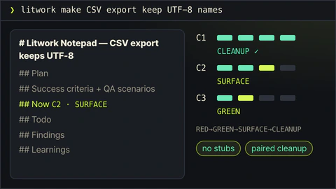</td>
<td><code>litwork</code> <code>lit &lt;task&gt;</code> · <code>litwork &lt;task&gt;</code></td>
<td>Add <code>lit</code> to a request. It keeps a notepad and takes each criterion through a strict loop: a failing test, a passing one, a check on the real thing, then cleanup.</td>
</tr>
<tr>
<td>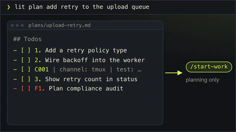</td>
<td><code>lit-plan</code> <code>lit plan &lt;what&gt;</code> · <code>/lit-plan</code></td>
<td>A plan file with numbered task rows that <code>start-work</code> can execute. Nothing is edited yet.</td>
</tr>
<tr>
<td>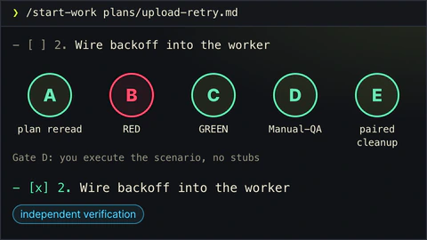</td>
<td><code>start-work</code> <code>/start-work &lt;approved-plan&gt;</code></td>
<td>Runs a plan row by row. A box is checked only after all five gates pass.</td>
</tr>
<tr>
<td>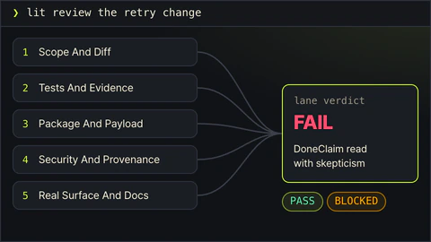</td>
<td><code>review-work</code> <code>lit review &lt;scope&gt;</code> · <code>/review-work</code></td>
<td>Five reviewers read the same change on their own, and each leads with what it found.</td>
</tr>
<tr>
<td>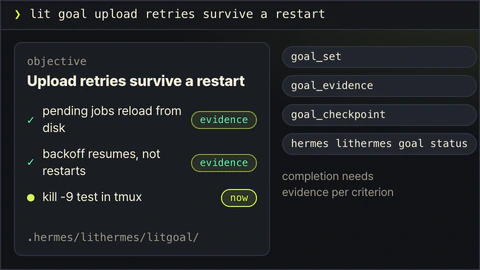</td>
<td><code>litgoal</code> <code>lit goal &lt;outcome&gt;</code> · <code>/litgoal</code></td>
<td>One objective with checkable criteria, kept on disk so the next session can pick it up.</td>
</tr>
<tr>
<td>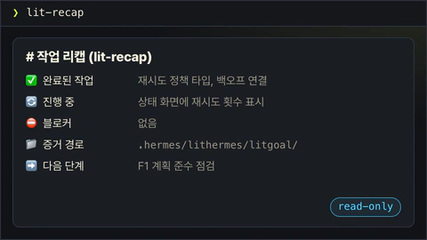</td>
<td><code>lit-recap</code> <code>lit-recap</code></td>
<td>A read-only summary: done, in progress, blocked, where the evidence is, what comes next.</td>
</tr>
<tr>
<td>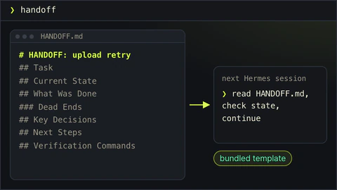</td>
<td><code>lit-handoff</code> <code>handoff</code> · <code>/lit-handoff</code></td>
<td>Type <code>handoff</code> to get a continuation file the next session can read and resume from.</td>
</tr>
<tr>
<td>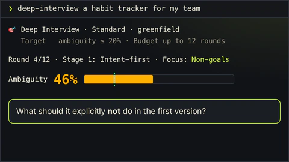</td>
<td><code>deep-interview</code> <code>deep-interview &lt;idea&gt;</code> · <code>/deep-interview</code></td>
<td>One question at a time until the idea is clear enough to build. A meter shows how much is still vague.</td>
</tr>
<tr>
<td>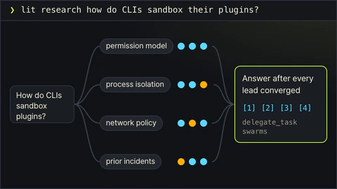</td>
<td><code>litresearch</code> <code>lit research &lt;question&gt;</code></td>
<td>Splits a research question, sends parallel searchers and follows every lead before answering with sources.</td>
</tr>
<tr>
<td>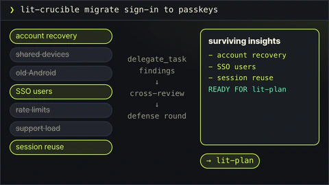</td>
<td><code>lit-crucible</code> <code>lit-crucible &lt;brief&gt;</code></td>
<td>Pressure-tests a brief before planning. Only the risks that survive critique reach the plan.</td>
</tr>
<tr>
<td>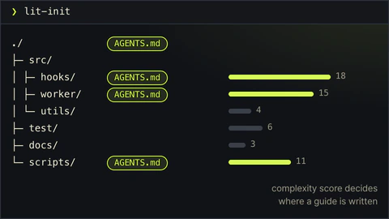</td>
<td><code>lit-init</code> <code>lit-init</code></td>
<td>Maps a repository into a root AGENTS.md and short guides for the folders that need one.</td>
</tr>
<tr>
<td>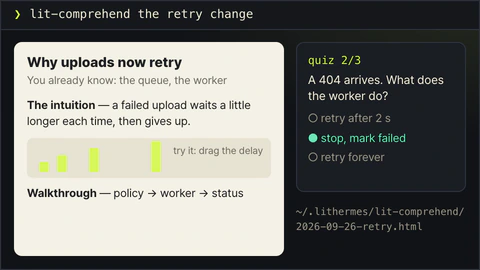</td>
<td><code>lit-comprehend</code> <code>lit-comprehend</code> · <code>comprehend &lt;range&gt;</code></td>
<td>An explainer page for agent-written work: intuition first, then the walkthrough, then a short quiz.</td>
</tr>
<tr>
<td>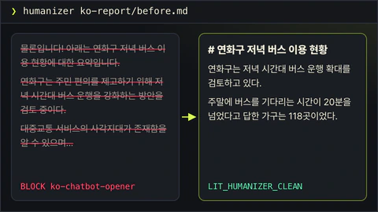</td>
<td><code>lit-humanizer</code> <code>humanizer &lt;text&gt;</code> · <code>/lit-humanizer</code></td>
<td>Rewrites stiff model prose in English or Korean. Facts and hedges stay, and no file is edited on its own.</td>
</tr>
<tr>
<td>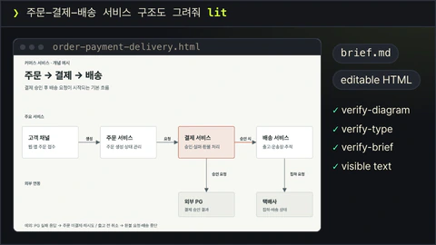</td>
<td><code>lit-diagram-drawer</code> <code>lit-diagram-drawer &lt;brief&gt;</code> · <code>/lit-diagram-drawer</code></td>
<td>A checked, editable diagram for slides and documents, with PNG and Office-safe SVG exports.</td>
</tr>
<tr>
<td>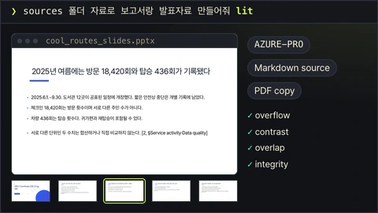</td>
<td><code>lit-pptx</code> <code>lit-pptx &lt;brief&gt;</code> · <code>/lit-pptx</code></td>
<td>Ask for slides with <code>lit</code> and get an editable PowerPoint deck and its Markdown source, AZURE-PRO with Pretendard by default. QA and integrity checks run on the finished file.</td>
</tr>
<tr>
<td>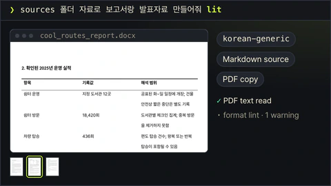</td>
<td><code>lit-docx</code> <code>lit-docx &lt;brief&gt;</code> · <code>/lit-docx</code></td>
<td>Ask for a report with <code>lit</code> and get a styled Word file and its Markdown source. Korean text uses the korean-generic profile; prose lint and a rendered-page check follow.</td>
</tr>
<tr>
<td>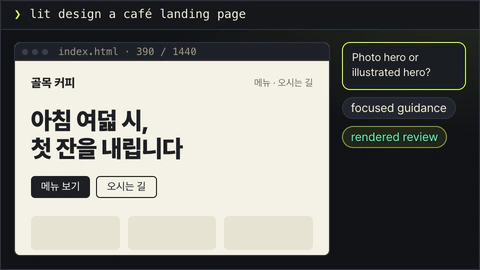</td>
<td><code>frontend-ui-ux</code> <code>lit design &lt;target&gt;</code> · <code>frontend-ui-ux &lt;target&gt;</code></td>
<td>Builds a working interface, then renders it with the installed measuring probe in seven views: four widths, dark, reduced motion and 200% zoom.</td>
</tr>
<tr>
<td>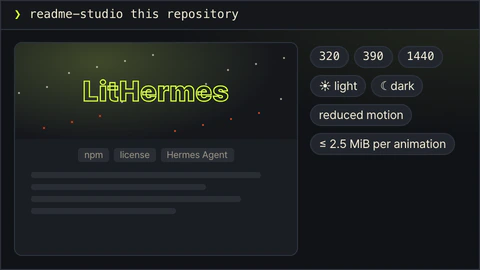</td>
<td><code>readme-studio</code> <code>readme-studio &lt;scope&gt;</code></td>
<td>A factual README with a moving cover, checked at phone and desktop widths in light and dark.</td>
</tr>
<tr>
<td>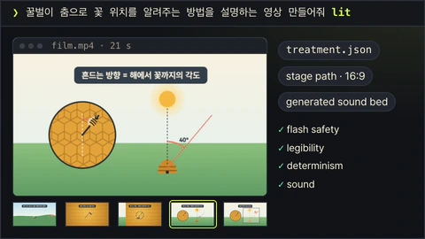</td>
<td><code>lit-typographic-motion</code> <code>lit-typographic-motion &lt;request&gt;</code> · <code>/lit-typographic-motion</code></td>
<td>Ask for a video with <code>lit</code>. A treatment comes first, then drawn scenes or moving type, a generated sound bed and a gate before the film is delivered.</td>
</tr>
<tr>
<td>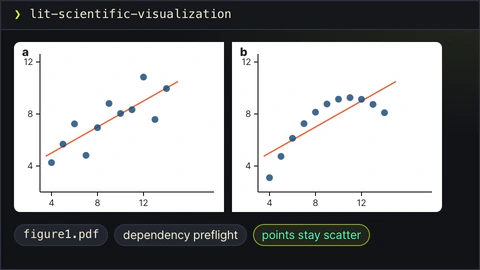</td>
<td><code>lit-scientific-visualization</code> <code>lit-scientific-visualization</code> · <code>/lit-scientific-visualization</code></td>
<td>A journal-sized figure with vector and 600 DPI exports. The chart type follows the data.</td>
</tr>
<tr>
<td>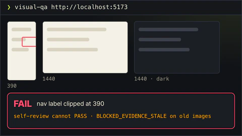</td>
<td><code>visual-qa</code> <code>visual-qa &lt;target&gt;</code></td>
<td>Checks a real screen at each viewport and returns an honest verdict, or names exactly what blocked it.</td>
</tr>
<tr>
<td>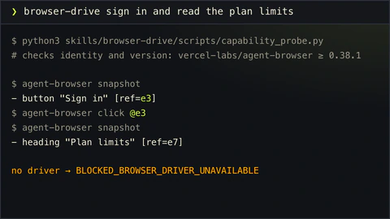</td>
<td><code>browser-drive</code> <code>browser-drive &lt;task&gt;</code></td>
<td>Drives a real page after verifying the browser driver. If there is none, it says so.</td>
</tr>
<tr>
<td>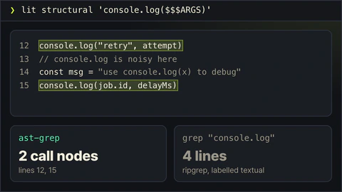</td>
<td><code>structural-search</code> <code>lit structural &lt;pattern&gt;</code> · <code>structural-search &lt;pattern&gt;</code></td>
<td>Finds code by the shape of its syntax instead of its exact text, and shows a rewrite before applying it.</td>
</tr>
<tr>
<td>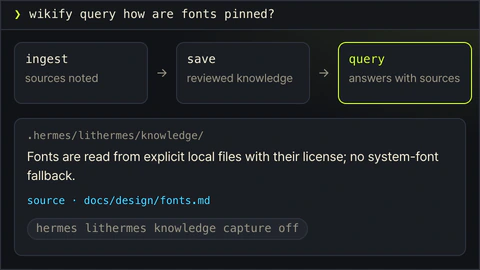</td>
<td><code>wikify</code> <code>wikify &lt;mode&gt;</code> · <code>lit wikify &lt;mode&gt;</code></td>
<td>Keeps reviewed project knowledge on disk and answers later questions from it, with sources.</td>
</tr>
<tr>
<td>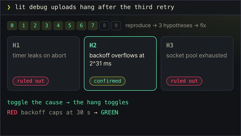</td>
<td><code>debugging</code> <code>lit debug &lt;symptom&gt;</code> · <code>debugging &lt;symptom&gt;</code></td>
<td>Reproduces the bug, tests at least three explanations, and fixes only the confirmed cause.</td>
</tr>
<tr>
<td>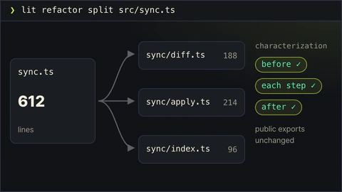</td>
<td><code>refactor</code> <code>lit refactor &lt;target&gt;</code> · <code>refactor &lt;target&gt;</code></td>
<td>Restructures code while tests pin its behavior before and after every step.</td>
</tr>
<tr>
<td>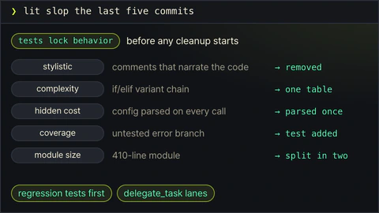</td>
<td><code>lit-burnoff</code> <code>lit slop &lt;scope&gt;</code></td>
<td>Cleans AI-written bloat out of a change set after tests lock what it does.</td>
</tr>
<tr>
<td>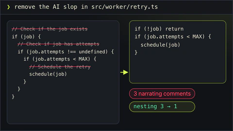</td>
<td><code>lit-burnoff-file</code> <code>ask to clean one file</code></td>
<td>The same cleanup for one file: fewer narrating comments, less defensive noise, flatter code.</td>
</tr>
<tr>
<td>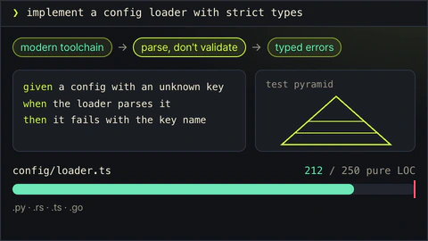</td>
<td><code>lit-code</code> <code>ask for strict implementation</code></td>
<td>Strict implementation rules: tests first, typed boundaries, small files.</td>
</tr>
<tr>
<td>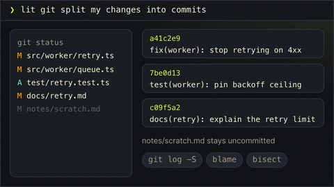</td>
<td><code>lit-commit</code> <code>lit git &lt;task&gt;</code></td>
<td>Splits your changes into atomic commits in the repo's own style and leaves unrelated work alone.</td>
</tr>
<tr>
<td>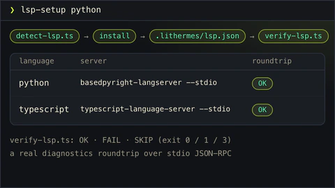</td>
<td><code>lsp-setup</code> <code>lsp-setup &lt;language&gt;</code></td>
<td>Sets up a language server for your language and proves diagnostics really work.</td>
</tr>
<tr>
<td>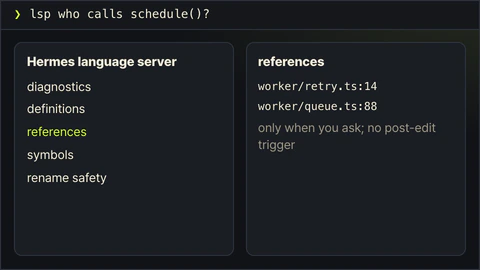</td>
<td><code>lsp</code> <code>lsp &lt;request&gt;</code></td>
<td>Uses Hermes' language server for diagnostics, references and rename checks when you ask.</td>
</tr>
<tr>
<td>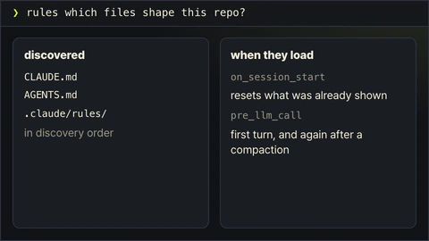</td>
<td><code>rules</code> <code>rules &lt;question&gt;</code></td>
<td>Explains which rule files Hermes loads, and when.</td>
</tr>
<tr>
<td>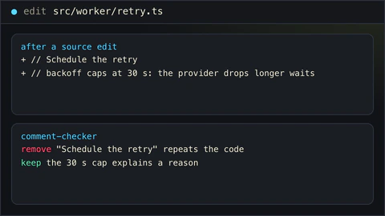</td>
<td><code>comment-checker</code> <code>comment-checker</code></td>
<td>Reviews the comments an edit added: reasons stay, narration goes. It also runs after source edits.</td>
</tr>
<tr>
<td>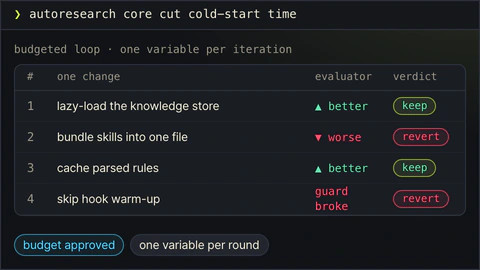</td>
<td><code>autoresearch</code> <code>autoresearch &lt;mode&gt;</code></td>
<td>An approved, budgeted experiment loop. Each round changes one thing and keeps or reverts it.</td>
</tr>
<tr>
<td>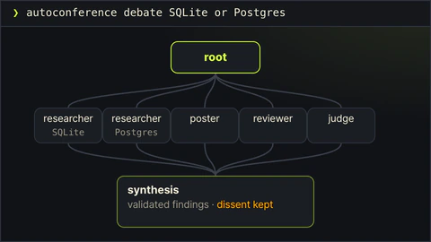</td>
<td><code>autoconference</code> <code>autoconference &lt;mode&gt;</code></td>
<td>A budgeted research conference: separate researchers, reviewers, and a synthesis that keeps disagreement.</td>
</tr>
</table>

## Commands

| Type | What it does |
|---|---|
| `lit <request>` or `/lit` | Start a bounded task and leave checked results. |
| `handoff` or `/lit-handoff` | Carry the current work and next step into another session. |
| `lit-plan` or `/lit-plan` | Write a plan before anything is executed. |
| `/start-work <approved-plan>` | Execute an approved plan. |
| `/review-work` | Review a plan or result and record findings. |
| `lit review <target>` | Review a plan or result. |
| `litresearch` or `lit research <question>` | Run the research workflow, with source notes. |
| `/lit-loop` | Start, inspect, resume or close an explicit loop. |
| `/litgoal` | Track criteria, evidence, checkpoints and blockers. |
| `/lit-humanizer` | Revise Korean and English prose while preserving meaning. Legacy aliases include `/lit-korean`, `/text-naturalization`, `/text-neutralization` and `/korean-ai-slop-remover`. |
| `/lit-diagram-drawer <brief>` | Create an accessible, Korean-ready diagram and check its content and geometry with the installed Python tools. |
| `/lit-pptx <brief>` | Create and check a PowerPoint deck with the bundled AZURE-PRO engine. |
| `/lit-docx <brief>` | Create, edit and audit a Word report with publisher profiles. |
| `/lit-typographic-motion <brief>` | Direct and gate an original film from a treatment, on the stage or the type path. |

On a Telegram gateway, use `/lit_loop` and `/lit_plan`. The [operating guide](./guide.md) has the full command examples and hook behavior. When the acknowledgement line shows after a command, the work has started. Check the result yourself, including any visual check, before you rely on it.

## Beyond code

### Reports and slides

Ask for a report or a presentation with a bare `lit`, and LitHermes hands it to its bundled Word and PowerPoint skills. You get a DOCX, a PPTX or both, with the Markdown source kept beside each file.

Before anything is written, the skill works out how the result should look and tells you. A quarterly review that people read at their desks wants tables and quiet type. A pitch on a projector wants one idea per slide, and a lecture wants its steps laid out in order. So the reply starts with a short direction card: the look that was chosen, why it suits your reader and your material, and the two looks that came next. A bare request gets no style question. If you would rather have one of the alternatives, name it and the file is rebuilt.

Decks have eight of these looks, called Ledger, Signal, Atlas, Chalk, Paper, Gazette, Studio and Night. Each brings its own colours, title placements, slide layouts and cover, section and closing pages, so two decks made from the same notes come out looking different. Slides are dense by default and set in Pretendard. A slide title names its topic and leaves the argument to the body, and every figure keeps its label, basis and source and is never blown up past title size.

Documents have six looks: Report, Brief, Manual, Proposal, Memo and Journal. What tells them apart is structure. A memo opens with its To and From lines and has no cover; a brief leads with its conclusion as numbered points; a proposal gets a typographic cover, one decision box and a budget table; a Korean report reads like an institute paper with numbered sections. The pages stay as restrained as a good printed report: near-black headings, one accent colour at most, ruled tables without fills, and Korean conventions such as `<표 1>` captions, a units line and dates written as 2026. 10. 5. If you name a journal profile (Elsevier, ACS, IEEE, Nature or korean-generic), that profile is used instead.

The first time you use either skill, its Office runtime installs the pinned versions of the tools it needs into a LitHermes cache. After building, it checks the finished file. A deck is checked for title and layout variety and for slides left half empty; a document is checked for page fill, split tables, stranded headings and the restraint rules on its rendered pages. To call a skill directly, type `/lit-docx <brief>` or `/lit-pptx <brief>`.

The installed skill IDs are `lit-pptx` and `lit-docx`; Hermes lists them as `lithermes:lit-pptx` and `lithermes:lit-docx`.

### Diagrams

For concept maps and technical diagrams, use `lit-diagram-drawer` (Hermes lists it as `lithermes:lit-diagram-drawer`). You can also just ask for a diagram and put a bare `lit` before or after the request; LitHermes picks this skill and tells Hermes where its installed entrypoint is. Product pages belong to `frontend-ui-ux`, and plots of measured scientific data to `lit-scientific-visualization`.

### Films

`lit-typographic-motion` is available as `lithermes:lit-typographic-motion` and `/lit-typographic-motion <brief>`. Ask for a film with a bare `lit` and it works like a director: it writes a treatment first. Then it renders a stage film (a model-authored HTML page captured frame by frame) or, when the words themselves are the film, a type film on its original WebGL2 engine. By default it adds a generated sound bed and labels it as generated.

A film needs Chrome and ffmpeg on your machine, plus a few pinned helper packages and fonts. Rendering never downloads anything by itself, so those helpers wait in a local cache until a film needs them. `lithermes install` tries to fill that cache for you. If that step was skipped (with `--offline`, say) or did not finish, the installer prints one line saying so, and you can fill the cache later with `lithermes motion-runtime install`, run outside the render session.

To see where things stand, run `lithermes motion-runtime status`. It reports Chrome, ffmpeg, WebGL2, whether rendering has fallen back to software, and the pinned fonts. When the film passes its final check, the skill delivers a 60 fps film (1920×1080, or 1080×1920 on the stage path), a compact preview, a poster, a reduced-motion still and a numeric QA report. The typographic-motion engine is adapted from mexicat/pdoom-video (MIT, Giacomo Magnanini), commit `ca251e3`.

### Interfaces and READMEs

`frontend-ui-ux` builds the interface you describe, after checking with you on the design choices that matter. Ask it only for a review or a plan, and it reads and reports without editing anything. `readme-studio` (listed in Hermes as `lithermes:readme-studio`) writes a factual README and a cover made on your own machine: outlined Pretendard/Meslo type, an editable source, and motion when it can be verified. When Hermes has no built-in image generator, the skill says so with `IMAGE_GENERATION_UNAVAILABLE` and can still compose images you give it. Neither skill logs in, installs anything globally or publishes.

### Rewriting prose

The `lit-humanizer` skill is available as `lithermes:lit-humanizer`. It helps you revise Korean and English drafts while keeping their facts and intended meaning.

The skill also comes with a detector that watches what Hermes writes for people to read. When Hermes saves text through `write_file` or `patch`, in any supported format including SVG, the detector reads the changed part first. A serious finding (block tier) can stop the write before the file is saved; a milder one (warning tier) comes back as advice to review.

Office files and PDFs are checked after they exist. A DOCX or PPTX is read once a file-write event or a script result reports where it was saved. A PDF is read the same way, but only if `pdftotext` is installed. By then the file is already saved, so these checks only advise: Hermes is asked to fix the source and rebuild. Either way, the detector reads wording only and has no way to tell who wrote the text.
