# Skills and commands

[← Back to the README](../README.md) · [한국어](./skills.ko.md)

Every skill LitHermes installs, the commands that start them, and what the document, diagram, film, interface and prose skills produce.

## All skills

These are all the skills you can call in LitHermes, with the words that start each one. Any of them also loads by name as `lithermes:<name>`.

<table>
<tr><th>What it looks like</th><th>Skill</th><th>What you get</th></tr>
<tr>
<td>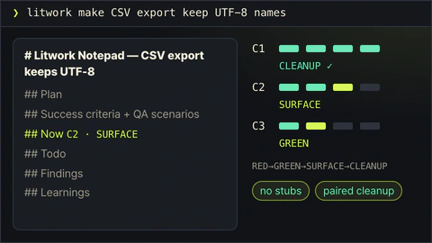</td>
<td><code>litwork</code><br /><sub><code>lit &lt;task&gt;</code> · <code>litwork &lt;task&gt;</code></sub></td>
<td>Add <code>lit</code> to a request. It keeps a notepad and takes each criterion through a strict loop: a failing test, a passing one, a check on the real thing, then cleanup.</td>
</tr>
<tr>
<td>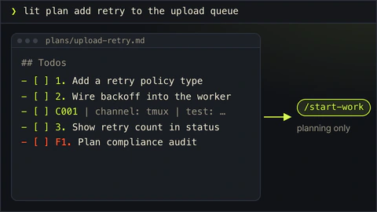</td>
<td><code>lit-plan</code><br /><sub><code>lit plan &lt;what&gt;</code> · <code>/lit-plan</code></sub></td>
<td>A plan file with numbered task rows that <code>start-work</code> can execute. Nothing is edited yet.</td>
</tr>
<tr>
<td>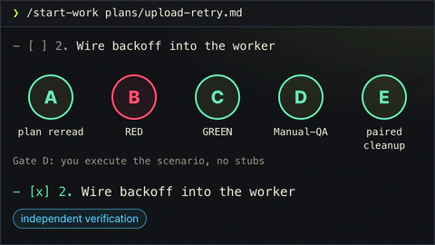</td>
<td><code>start-work</code><br /><sub><code>/start-work &lt;approved-plan&gt;</code></sub></td>
<td>Runs a plan row by row. A box is checked only after all five gates pass.</td>
</tr>
<tr>
<td>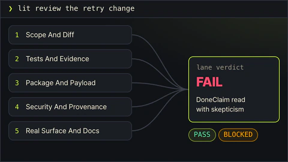</td>
<td><code>review-work</code><br /><sub><code>lit review [plan|work] &lt;scope&gt;</code> · <code>/review-work</code></sub></td>
<td>A plan review checks a plan before <code>start-work</code>. A work review has five reviewers read the finished change on their own, and each leads with what it found. It picks the mode from what exists and says which on its first line.</td>
</tr>
<tr>
<td>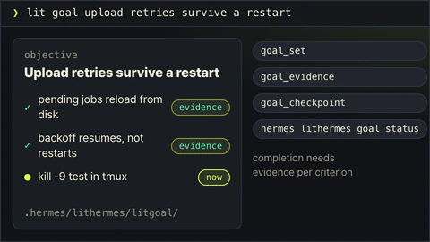</td>
<td><code>litgoal</code><br /><sub><code>lit goal &lt;outcome&gt;</code> · <code>/litgoal</code></sub></td>
<td>Sets and keeps the finish line: one objective with checkable criteria, kept on disk so the next session can pick it up. <code>lit-loop</code> and <code>start-work</code> run toward it.</td>
</tr>
<tr>
<td>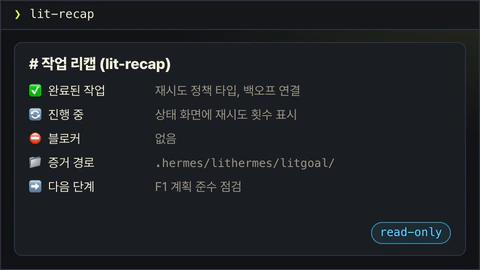</td>
<td><code>lit-recap</code><br /><sub><code>lit-recap</code></sub></td>
<td>A read-only summary: done, in progress, blocked, where the evidence is, what comes next.</td>
</tr>
<tr>
<td>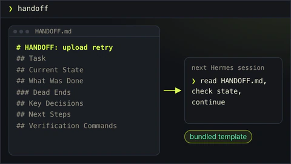</td>
<td><code>lit-handoff</code><br /><sub><code>handoff</code> · <code>/lit-handoff</code></sub></td>
<td>Type <code>handoff</code> to get a continuation file the next session can read and resume from.</td>
</tr>
<tr>
<td></td>
<td><code>lit-brainstorm</code><br /><sub><code>lit brainstorm &lt;ask&gt;</code> · <code>lit ideation &lt;ask&gt;</code> · <code>lit idea &lt;ask&gt;</code></sub></td>
<td>For an open ask like a name or a direction. Many different options first, then a short list with trade-offs. You pick, and it hands the pick to <code>deep-interview</code> or <code>lit-plan</code>. It never builds.</td>
</tr>
<tr>
<td>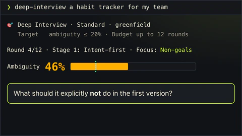</td>
<td><code>deep-interview</code><br /><sub><code>deep-interview &lt;idea&gt;</code> · <code>/deep-interview</code></sub></td>
<td>One question at a time until the idea is clear enough to build. A meter shows how much is still vague.</td>
</tr>
<tr>
<td>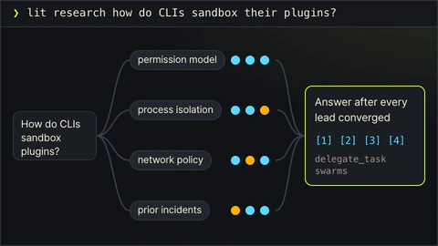</td>
<td><code>litresearch</code><br /><sub><code>lit research &lt;question&gt;</code></sub></td>
<td>Splits a research question, sends parallel searchers and follows every lead before answering with sources.</td>
</tr>
<tr>
<td>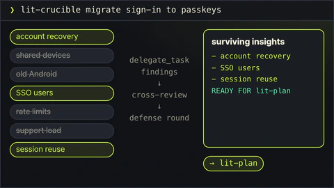</td>
<td><code>lit-crucible</code><br /><sub><code>lit-crucible &lt;brief&gt;</code></sub></td>
<td>Pressure-tests a brief before planning. Only the risks that survive critique reach the plan.</td>
</tr>
<tr>
<td>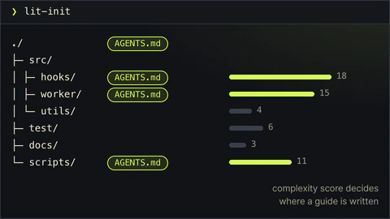</td>
<td><code>lit-init</code><br /><sub><code>lit-init</code></sub></td>
<td>Maps a repository into a root AGENTS.md and short guides for the folders that need one.</td>
</tr>
<tr>
<td>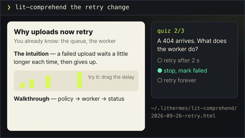</td>
<td><code>lit-comprehend</code><br /><sub><code>lit-comprehend</code> · <code>comprehend &lt;range&gt;</code></sub></td>
<td>An explainer page for agent-written work: intuition first, then the walkthrough, then a short quiz.</td>
</tr>
<tr>
<td>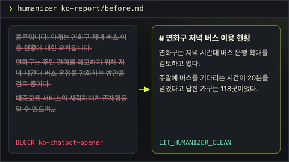</td>
<td><code>lit-humanizer</code><br /><sub><code>humanizer &lt;text&gt;</code> · <code>/lit-humanizer</code></sub></td>
<td>Rewrites stiff model prose in English or Korean. Facts and hedges stay, and no file is edited on its own.</td>
</tr>
<tr>
<td></td>
<td><code>lit-hijack</code><br /><sub><code>lit hijack &lt;brief&gt;</code> · <code>/lit-hijack</code></sub></td>
<td>A clean-room port of published know-how: capture with provenance, licence gate, source-free spec, fenced build and parity proof.</td>
</tr>
<tr>
<td></td>
<td><code>lit-adhd</code><br /><sub><code>lit adhd</code> · <code>/lit-adhd</code></sub></td>
<td>A cross-session brief: what each recent session was asked, did and waits on, roadmap gauges and one next step. Read-only.</td>
</tr>
<tr>
<td>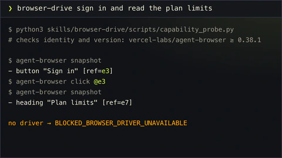</td>
<td><code>browser-drive</code><br /><sub><code>browser-drive &lt;task&gt;</code></sub></td>
<td>Drives a real page after verifying the browser driver. If there is none, it says so.</td>
</tr>
<tr>
<td>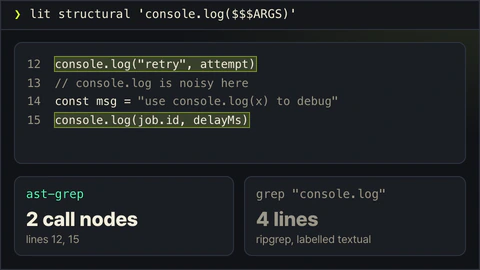</td>
<td><code>structural-search</code><br /><sub><code>lit structural &lt;pattern&gt;</code> · <code>structural-search &lt;pattern&gt;</code></sub></td>
<td>Finds code by the shape of its syntax instead of its exact text, and shows a rewrite before applying it.</td>
</tr>
<tr>
<td>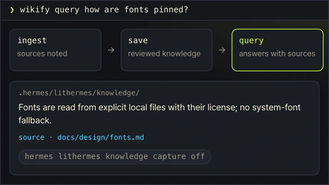</td>
<td><code>wikify</code><br /><sub><code>wikify &lt;mode&gt;</code> · <code>lit wikify &lt;mode&gt;</code></sub></td>
<td>Keeps reviewed project knowledge on disk and answers later questions from it, with sources.</td>
</tr>
<tr>
<td>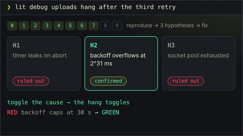</td>
<td><code>debugging</code><br /><sub><code>lit debug &lt;symptom&gt;</code> · <code>debugging &lt;symptom&gt;</code></sub></td>
<td>Reproduces the bug, tests at least three explanations, and fixes only the confirmed cause.</td>
</tr>
<tr>
<td>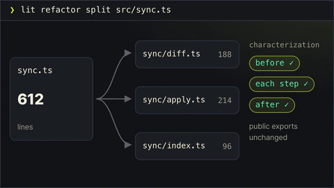</td>
<td><code>refactor</code><br /><sub><code>lit refactor &lt;target&gt;</code> · <code>refactor &lt;target&gt;</code></sub></td>
<td>Restructures code while tests pin its behavior before and after every step.</td>
</tr>
<tr>
<td>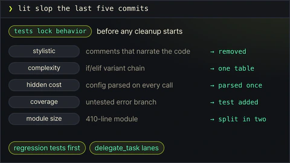</td>
<td><code>lit-burnoff</code><br /><sub><code>lit slop &lt;scope&gt;</code></sub></td>
<td>Cleans AI-written bloat out of a change set after tests lock what it does.</td>
</tr>
<tr>
<td>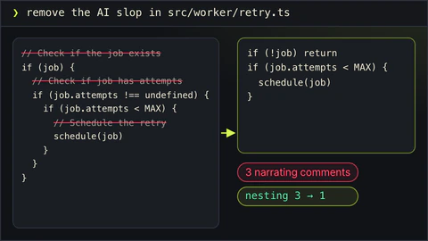</td>
<td><code>lit-burnoff-file</code><br /><sub><code>ask to clean one file</code></sub></td>
<td>The same cleanup for one file: fewer narrating comments, less defensive noise, flatter code.</td>
</tr>
<tr>
<td>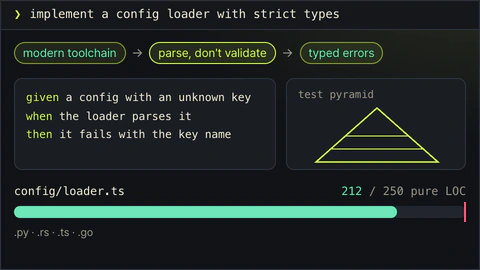</td>
<td><code>lit-code</code><br /><sub><code>ask for strict implementation</code></sub></td>
<td>Strict implementation rules: tests first, typed boundaries, small files.</td>
</tr>
<tr>
<td>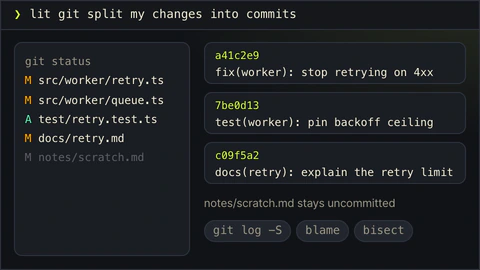</td>
<td><code>lit-commit</code><br /><sub><code>lit git &lt;task&gt;</code></sub></td>
<td>Splits your changes into atomic commits in the repo's own style and leaves unrelated work alone.</td>
</tr>
<tr>
<td>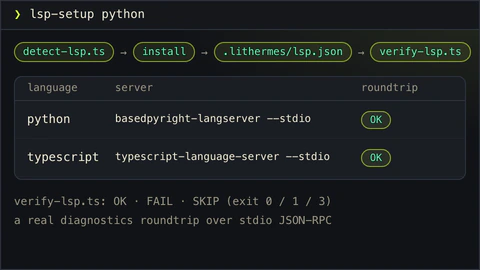</td>
<td><code>lsp-setup</code><br /><sub><code>lsp-setup &lt;language&gt;</code></sub></td>
<td>Sets up a language server for your language and proves diagnostics really work.</td>
</tr>
<tr>
<td>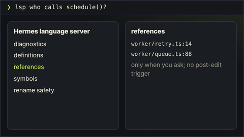</td>
<td><code>lsp</code><br /><sub><code>lsp &lt;request&gt;</code></sub></td>
<td>Uses Hermes' language server for diagnostics, references and rename checks when you ask.</td>
</tr>
<tr>
<td>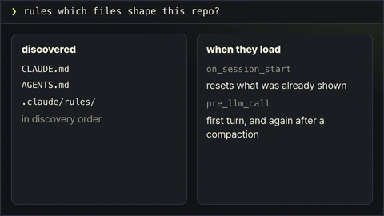</td>
<td><code>rules</code><br /><sub><code>rules &lt;question&gt;</code></sub></td>
<td>Explains which rule files Hermes loads, and when.</td>
</tr>
<tr>
<td>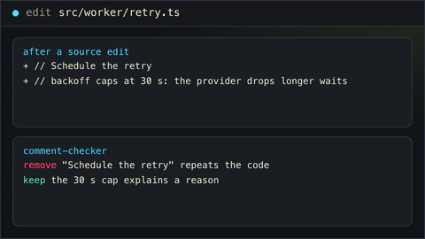</td>
<td><code>comment-checker</code><br /><sub><code>comment-checker</code></sub></td>
<td>Reviews the comments an edit added: reasons stay, narration goes. It also runs after source edits.</td>
</tr>
<tr>
<td>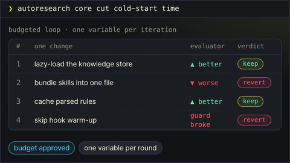</td>
<td><code>autoresearch</code><br /><sub><code>autoresearch &lt;mode&gt;</code></sub></td>
<td>An approved, budgeted experiment loop. Each round changes one thing and keeps or reverts it.</td>
</tr>
<tr>
<td>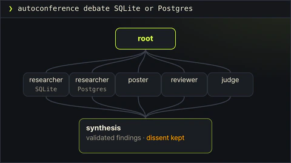</td>
<td><code>autoconference</code><br /><sub><code>autoconference &lt;mode&gt;</code></sub></td>
<td>A budgeted research conference: separate researchers, reviewers, and a synthesis that keeps disagreement.</td>
</tr>
</table>

## Commands

| Type | What it does |
|---|---|
| `lit <request>` or `/lit` | Start a bounded task and leave checked results. |
| `handoff` or `/lit-handoff` | Carry the current work and next step into another session. |
| `lit-plan` or `/lit-plan` | Write a plan before anything is executed. |
| `/start-work <approved-plan>` | Execute an approved plan. |
| `/review-work [plan\|work]` | Review a plan or finished work and record findings. |
| `lit review [plan\|work] <target>` | Review a plan before `start-work`, or finished work after it. |
| `lit brainstorm <ask>`, `lit ideation <ask>`, `lit idea <ask>` | Open an idea session: many options, a short list, your pick. |
| `litresearch` or `lit research <question>` | Run the research workflow, with source notes. |
| `/lit-loop` | Start, inspect, resume or close an explicit loop. |
| `/litgoal` | Set and keep the finish line: criteria, evidence, checkpoints and blockers. |
| `/lit-humanizer` | Revise Korean and English prose while preserving meaning. Legacy aliases include `/lit-korean`, `/text-naturalization`, `/text-neutralization` and `/korean-ai-slop-remover`. |
| `/lit-diagram-drawer <brief>` | Moved to `wjgoarxiv-skills`: says where the skill went and gives the line that installs it. |
| `/lit-schematic <brief>` | Moved to `wjgoarxiv-skills`: says where the skill went and gives the line that installs it. |
| `/lit-pptx <brief>` | Moved to `wjgoarxiv-skills`: says where the skill went and gives the line that installs it. |
| `/lit-docx <brief>` | Moved to `wjgoarxiv-skills`: says where the skill went and gives the line that installs it. |
| `/lit-hijack <brief>` | Port published know-how into your own skill, clean-room: capture, licence gate, spec, build, parity. |
| `/lit-adhd [--here] [--since 7d] [--max 12] [--detail]` | A KPI board of recent sessions: the one thing to do now, done and left counts, milestones, reminders; `--detail` adds the per-session brief. Read-only. |
| `/lit-typographic-motion <brief>` | Moved to `wjgoarxiv-skills`: says where the skill went and gives the line that installs it. |

On a Telegram gateway, use `/lit_loop` and `/lit_plan`. The [operating guide](./guide.md) has the full command examples and hook behavior. When the acknowledgement line shows after a command, the work has started. Check the result yourself, including any visual check, before you rely on it.

## Beyond code

### Moved to wjgoarxiv-skills

Drawings, plots, decks, documents, interface design and review, films and README covers come from nine skills that left LitHermes for the `wjgoarxiv-skills` repository. Keeping them out makes the install small, and you copy in only the ones you use.

| Skill | Hermes edition in `wjgoarxiv-skills` |
| --- | --- |
| `lit-schematic` | `variants/lithermes/lit-schematic` |
| `lit-diagram-drawer` | `variants/lithermes/lit-diagram-drawer` |
| `lit-scientific-visualization` | `variants/lithermes/lit-scientific-visualization` |
| `lit-pptx` | `variants/lithermes/lit-pptx` |
| `lit-docx` | `variants/lithermes/lit-docx` |
| `frontend-ui-ux` | `variants/lithermes/frontend-ui-ux` |
| `visual-qa` | `variants/lithermes/visual-qa` |
| `lit-typographic-motion` | `variants/lithermes/lit-typographic-motion` |
| `readme-studio` | `variants/lithermes/readme-studio` |

Every route that opened one of them still works. `lit-pptx`, `/lit-pptx` and a bare `lit` with slide wording all reach a short stub of the same name. When the real skill is not installed, the stub tells you which folder it moved to and gives you the copy line, and builds nothing. When it is installed, the stub loads it with `skill_view` and hands over. The copy line puts one skill into the active Hermes profile (`HERMES_HOME` picks the profile; the default is `~/.hermes`):

```bash
mkdir -p "${HERMES_HOME:-$HOME/.hermes}/skills"
cp -R "<path to your wjgoarxiv-skills clone>/variants/lithermes/<id>" "${HERMES_HOME:-$HOME/.hermes}/skills/"
```

Start a new Hermes session after copying. Each `variants/lithermes/<id>` folder is self-contained and written for Hermes, so one folder is all a skill needs. The copy sits in the profile's `skills/` folder, outside `plugins/lithermes/`, so a LitHermes upgrade or uninstall leaves it alone, and `lithermes doctor` lists it as a moved skill copy rather than a shadow. `hermes lithermes doctor` confirms the nine stubs. The interface probe that litwork runs on every web edit stays in LitHermes, under `skills/frontend-ui-ux/scripts/`.

### Rewriting prose

The `lit-humanizer` skill is available as `lithermes:lit-humanizer`. It helps you revise Korean and English drafts while keeping their facts and intended meaning.

The skill also comes with a detector that watches what Hermes writes for people to read. When Hermes saves text through `write_file` or `patch`, in any supported format including SVG, the detector reads the changed part first. A serious finding (block tier) can stop the write before the file is saved; a milder one (warning tier) comes back as advice to review.

Office files and PDFs are checked after they exist. A DOCX or PPTX is read once a file-write event or a script result reports where it was saved. A PDF is read the same way, but only if `pdftotext` is installed. By then the file is already saved, so these checks only advise: Hermes is asked to fix the source and rebuild. Either way, the detector reads wording only and has no way to tell who wrote the text.
