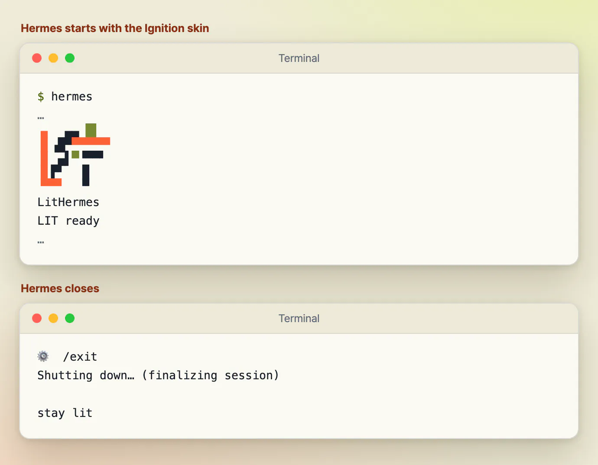
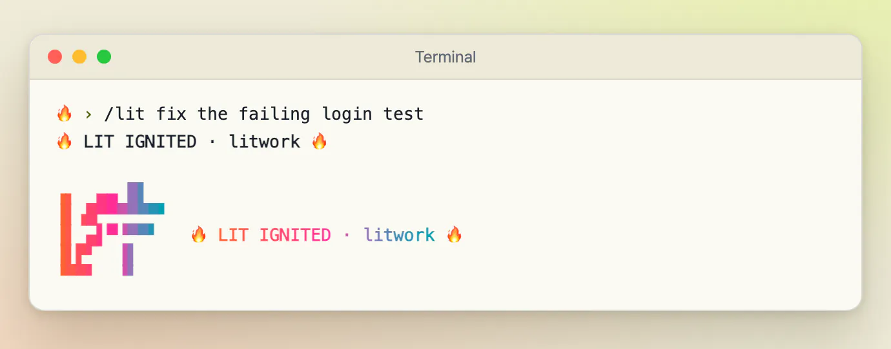
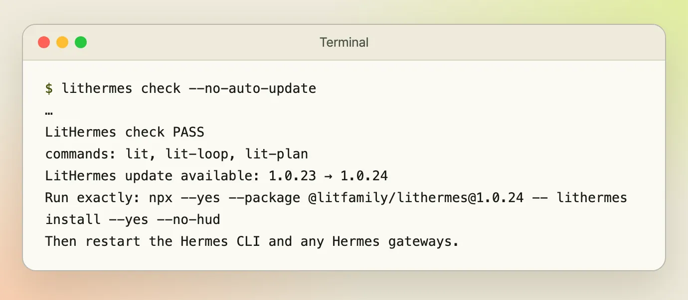
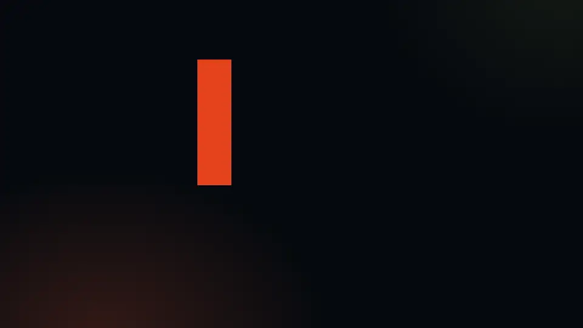
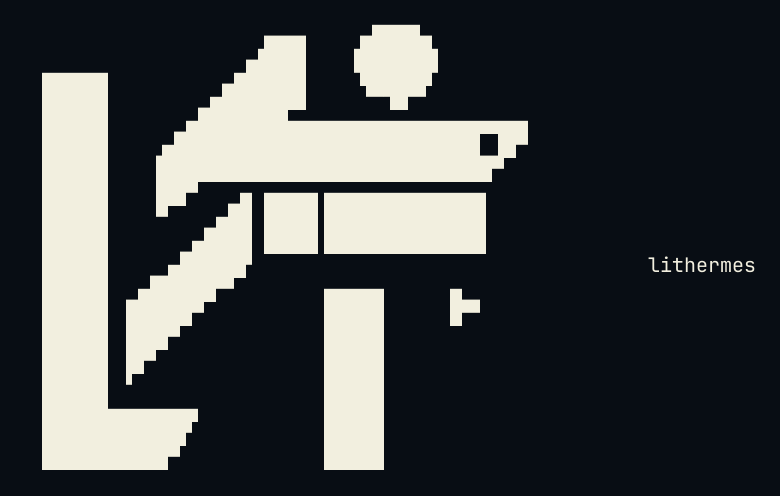

# LitHermes 둘러보기

[← README로 돌아가기](../README_Ko-KR.md) · [English](./tour.md)

LitHermes가 일하는 화면, 짧은 영상, Hermes CLI용 Ignition 스킨, LIT 마크를 모았습니다.

## 처음 실행하면 보이는 것

설치부터 첫 작업까지, LitHermes가 화면에 무엇을 보여 주는지 모았습니다. 그림 속 글자는 제품이 출력하는 문구 그대로입니다. 그림마다 붙은 설명에 실제 명령에서 얻은 것인지, 플러그인이 만드는 문구로 다시 구성한 것인지 적어 두었습니다.

**설치.** 설치 프로그램은 플러그인을 Hermes 홈에 복사하고, 새 홈이면 기본 모델 경로를 쓰고, 그 전에 설정 파일의 백업을 남깁니다. 백업 파일이 어디에 놓이는지 화면에서 바로 보입니다. 마지막에는 실행 중인 gateway를 다시 시작하라는 안내와, 영상 도구를 받았는지에 대한 한 줄이 나옵니다.

<p align="center"><picture><source media="(prefers-color-scheme: dark)" srcset="./assets/screens/install-dark.webp" /></picture></p>

*스크래치용 Hermes 홈에서 실제 설치 프로그램으로 얻은 출력입니다. 밖으로 아무것도 나가지 않고 Hermes 설치본도 건드리지 않도록 오프라인(자동 업데이트도 함께 꺼집니다)과 호환 패치 끄기 옵션을 더해 실행했습니다. 스크래치 홈에는 설치 프로그램이 Hermes를 확인할 때 읽는 소스 파일 세 개의 사본을 두었습니다. 배너와 모델 경로 줄은 잘랐고("…"), 스크래치 폴더는 ~/.hermes로 적었습니다.*

**점검.** 설치한 뒤나 뭔가 이상할 때 doctor를 실행하세요. 설치된 내용을 배포본과 견주어 영역마다 짧은 표시를 붙여 줍니다. 오프라인 옵션을 주면 내 컴퓨터 안에서만 돌고, 그렇게는 볼 수 없는 것, 곧 Hermes가 플러그인을 불러왔는지는 PARTIAL로 나옵니다.

<p align="center"><picture><source media="(prefers-color-scheme: dark)" srcset="./assets/screens/doctor-dark.webp" /></picture></p>

*같은 스크래치 홈에서 실제 doctor 명령으로 얻은 출력입니다. 결과 줄 가운데 열한 줄만 남기고 나머지("…")는 잘랐습니다. 자른 줄은 모델 경로와 영상 도구에 관한 내용입니다.*

**시작과 종료.** Ignition 스킨을 고르면 Hermes가 시작할 때 작은 LIT 마크와 LIT ready를 보여 주고, 끝낼 때 stay lit이라고 인사합니다. 스킨이 켜졌는지 바로 알 수 있습니다.

<p align="center"><picture><source media="(prefers-color-scheme: dark)" srcset="./assets/screens/welcome-dark.webp" /></picture></p>

*Ignition 스킨을 고른 실제 Hermes 세션에서 얻은 출력입니다. 그림 속 줄 사이에 있던 Hermes 배너, 팁, 경고는 잘랐습니다. 밝은 그림에서는 옅은 색을 어둡게 바꿔 밝은 창에서도 읽히게 했습니다.*

**작업 첫 줄.** 요청이 lit이나 /lit으로 시작하면 응답이 따로 한 줄로 열리고, 이어서 같은 문구가 옆에 붙은 작은 LIT 마크가 나옵니다. 둘이 보이면 요청이 경로에 실려 작업이 시작된 것이고, 결과는 직접 확인하시면 됩니다. 점 뒤의 이름은 어느 경로가 받았는지 알려 줍니다. 그냥 lit이면 litwork, 계획이면 lit-plan입니다.

<p align="center"><picture><source media="(prefers-color-scheme: dark)" srcset="./assets/screens/lit-ack-dark.webp" /></picture></p>

*LitHermes 자체 문구로 다시 구성한 예시 그림입니다. 마크와 그 옆 줄은 확인 표시 코드를 따로 실행해 얻은 실제 출력입니다. 첫 줄은 플러그인이 모델에게 쓰라고 지시하는 줄이고, 프롬프트 줄은 예시 글입니다. 모델은 쓰지 않았습니다. 밝은 그림에서는 옅은 색을 어둡게 바꿨습니다.*

**업데이트 알림.** 새 버전이 있다는 것을 알고 있고 자동 업데이트가 꺼져 있으면, check, doctor, install이 끝날 때 세 줄짜리 알림이 나옵니다. 두 버전, 실행할 정확한 명령, Hermes를 다시 시작하라는 안내입니다. 알림은 알려 주기만 하고, 그 명령을 직접 실행하기 전까지 아무것도 설치되지 않습니다.

<p align="center"><picture><source media="(prefers-color-scheme: dark)" srcset="./assets/screens/update-notice-dark.webp" /></picture></p>

*스크래치 홈에서 실제 check 명령으로 얻은 출력입니다. 알림이 나오도록 1.0.30을 적은 업데이트 확인 파일을 미리 놓았으므로 이 버전 번호는 예시입니다. 결과 줄 위의 배너는 잘랐습니다.*

## 움직이는 모습 보기

짧은 영상 하나로 한 바퀴를 볼 수 있습니다. 한 단어로 작업이 시작되고, 결과를 확인하고, HANDOFF.md에 다음 할 일을 남기면, 새 세션이 그 기록을 이어받습니다. 아래 그림은 소리 없이 반복 재생되는 미리보기이고, MP4에는 생성한 배경 음악이 들어 있습니다.

<p align="center"><a href="./assets/promo/promo-ko.mp4"><picture><source media="(prefers-reduced-motion: reduce)" srcset="./assets/promo/promo-reduced-motion-ko.webp" /></picture></a></p>

[소리가 있는 영상 보기 (MP4, 3.0 MiB)](./assets/promo/promo-ko.mp4)

*영상 속 요청과 응답은 예시입니다. 마지막 문구 Keep the work lit.와 터미널 안의 read the handoff and continue는 영어 그대로 둡니다. LIT IGNITED 줄, LIT ready 환영 문구, stay lit 작별 문구, 마크 색은 LitHermes가 실제로 출력하는 것입니다.*

## Ignition 스킨

LitHermes는 Hermes CLI의 겉모습도 바꿔 줍니다. CLI에서 `/skin`을 입력하면 지금 쓰는 스킨과 고를 수 있는 스킨이 나옵니다. `/skin lithermes-ignition`을 고르고 Hermes를 다시 시작하면 주황·라임·아이보리·네이비로 된 시작 배너가 뜹니다. 컴팩트 레이아웃에서도 welcome 화면에 5행 MICRO 마크가 나오지만, 호스트가 전체 `banner_logo`는 빼고 보여 줄 수 있습니다. 번호 1~10의 색상 프리셋도 그대로 쓸 수 있습니다.

색을 표시하는 대화형 터미널에서 `--yes`로 처음 설치하면 Ignition이 자동으로 선택됩니다. 다만 설정에 `display.skin` 항목 자체가 없을 때만 그렇습니다. 이미 골라 둔 스킨과 가지고 있던 스킨 파일은 그대로 둡니다.

밝은 터미널이라면 `/skin lithermes-tokyonight-day`, 어두운 터미널이라면 `/skin lithermes-tokyonight`를 고르고 Hermes를 다시 시작하세요. 두 스킨 모두 본문, 상태 줄, 완료 메뉴 글자를 잘 읽히게 맞추고 MICRO 마크와 배너 그림을 새 색으로 칠합니다. 그 밖의 스킨 선택과 파일은 건드리지 않습니다. 직접 입력하는 글자는 터미널 기본 글자색을 따릅니다. 자연어 경로로 들어온 Lit 응답에는 끝에 MICRO 안내가 한 번 붙습니다.

스킨과 출력 스타일은 서로 다른 설정입니다. 스킨은 CLI 화면을, 출력 스타일은 답변 문체를 바꿉니다. Gateway 대화에는 CLI 스킨이 나오지 않습니다. 화면에 어떻게 보이는지는 호스트와 터미널에 따라 달라지니, 다시 시작한 뒤 화면에서 직접 확인하세요.

이미 있는 이름 붙은 스킨 파일은 LitHermes가 덮어쓰지 않습니다. 일반 파일로 된 스킨을 새것으로 받고 싶다면 그 파일을 백업 위치로 옮기고, 설치 프로그램을 다시 실행해 빠진 파일을 새로 만든 다음, 직접 고쳤던 내용을 다시 옮겨 넣으세요. 심볼릭 링크이거나 예상과 다른 것이 그 자리에 있으면 손대지 않습니다. macOS에서는 한 군데가 ANSI-256 색으로 남을 수 있습니다. CPR이 꺼진 상태의 `prompt_toolkit` 구분선인데, 나머지 Rich 출력은 승인된 색을 그대로 유지합니다.

## LIT 마크

`lithermes --help`가 출력하는 것과 같은 LitHermes 배너를 그림과 복사할 수 있는 글자로 실었고, 디스플레이 워드마크와 클레이 마크도 함께 두었습니다.

<p align="center"></p>

<details>
<summary>ASCII 로고 복사</summary>

```
                             ▄▄▄▄
                   ▗███▌   ▗██████▖
 ▗▄▄▄▄▄          ▗▟████▌   ▝██████▘
 ▐█████        ▗▟██████▌    ▝▀▜█▀▘
 ▐█████      ▗▟███████▄▄▄▄▄▄▄▄▄▄▄▄▄▄▄▄▄▄▄▄
 ▐█████    ▗▟█████████████████████████ ▐█▀
 ▐█████    ████████████████████████████▀
 ▐█████    ██▛▘   ▄ ▄▄▄▄▖▄▄▄▄▄▄▄▄▄▄▄▄▄▖
 ▐█████    ▀    ▄██ ████▌█████████████▌
 ▐█████       ▄████ ████▌█████████████▌
 ▐█████     ▄█████▛                                 lithermes
 ▐█████  ▗▟█████▀▘       ▄▄▄▄▄     ▗▖
 ▐█████ ▐█████▀          █████     ▐▛▀
 ▐█████ ▐███▀            █████
 ▐█████ ▐█▀              █████
 ▐█████ ▝                █████
 ▐█████▄▄▄▄▄▄▄▖          █████
 ▐███████████▛           █████
 ▐██████████▀            █████

```

</details>

<p align="center"></p>
<p align="center"></p>
