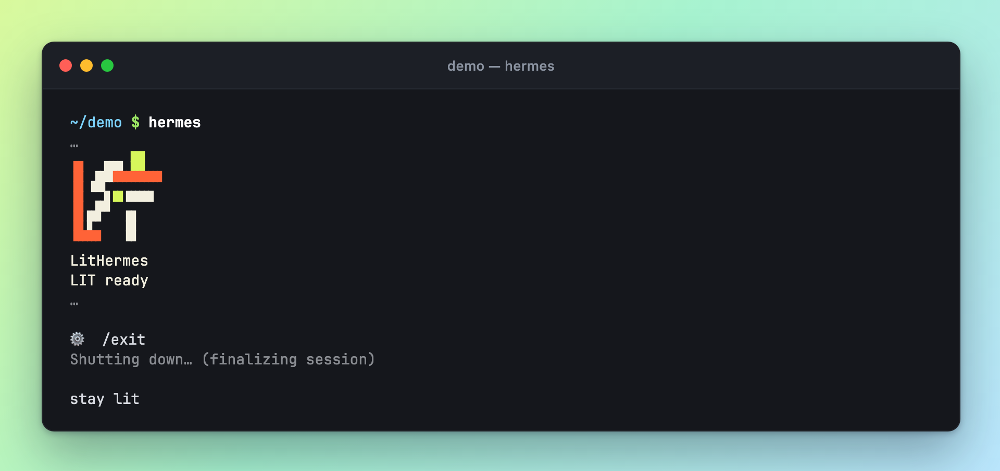
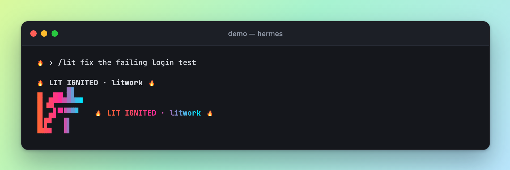
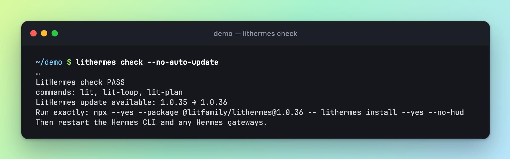
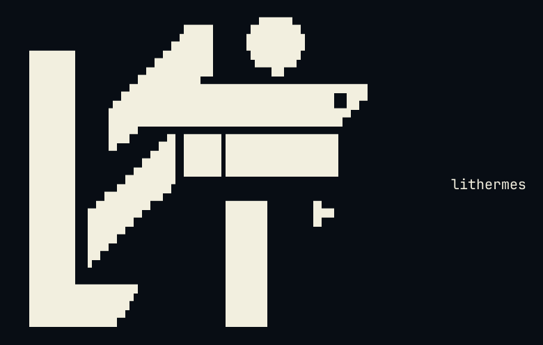

# A tour of LitHermes

[← Back to the README](../README.md) · [한국어](./tour.ko.md)

Pictures of LitHermes at work, the short film, the Ignition skin for the Hermes CLI, and the LIT marks.

## What you will see on your first run

Here is what LitHermes puts on your screen, from the install to your first task. The text in the pictures is what the product prints. Each caption says whether the picture was captured from a real command or built from the exact strings the plugin produces. Every picture is drawn as a dark terminal card on a mint-to-sky background, in the style of carbon.now.sh, and looks the same on a light or a dark page.

**The install.** The installer copies the plugin into your Hermes home, writes the default model routes for a fresh home and saves a backup of your configuration first. It ends with the reminder to restart any running gateway, and one line about whether the film tools were fetched.

<p align="center"><picture><source media="(prefers-color-scheme: dark)" srcset="./assets/screens/install-dark.webp" /></picture></p>

*Captured from the real installer in a scratch Hermes home, run with two extra flags so that nothing left the machine and no Hermes installation was touched: offline, which also keeps the automatic update off, and no compatibility patch. The scratch home held copies of the Hermes source files the installer and doctor read to check the host, and the Hermes version came from the Hermes installed on the same machine. The picture keeps the main receipt lines. The banner, the install steps and the model route lines are cut ("…"), long lines wrap at the edge of the card, and the scratch folder is written as ~/.hermes.*

**The check.** Run doctor after installing, or any time something looks off. It reads what is installed against what shipped and gives every area a short tag. With the offline switch it stays on your machine, and the one thing it cannot see that way, whether Hermes has loaded the plugin, shows as PARTIAL.

<p align="center"><picture><source media="(prefers-color-scheme: dark)" srcset="./assets/screens/doctor-dark.webp" /></picture></p>

*Captured from the real doctor command in the same scratch home. The picture keeps the payload checks, the host limits and two dispatch checks. The banner and the other lines are cut ("…"); they cover the bytecode cache, the skill shadow and status-bar checks, the model routes, updates and the film tools.*

**Start and stop.** With the Ignition skin selected, Hermes greets you with the small LIT mark and the words LIT ready, and says stay lit when you leave. It is a quick way to see that the skin is on.

<p align="center"><picture><source media="(prefers-color-scheme: dark)" srcset="./assets/screens/welcome-dark.webp" /></picture></p>

*Captured from a real Hermes session with the Ignition skin selected. The Hermes banner, tip and warnings between the pictured lines are cut.*

**The first line of a task.** When a request starts with lit or /lit, the reply opens with one line on its own, and the small LIT mark follows with the same words beside it. Once you see them, the request has been routed and the work has started; the result is yours to check. The name after the dot tells you which route took it, for example litwork for a plain lit and lit-plan for a plan.

<p align="center"><picture><source media="(prefers-color-scheme: dark)" srcset="./assets/screens/lit-ack-dark.webp" /></picture></p>

*Illustration built from LitHermes's own strings. The mark and the line beside it are the real output of the acknowledgement code, run on its own. The opening line is the one the plugin tells the model to write, and the prompt line is sample text. No model was involved.*

**The update notice.** When a newer release is known and automatic updates are switched off, check, doctor and install end with a three-line notice: the two versions, the exact command to run, and a reminder to restart Hermes. The notice only tells you; nothing is installed until you run that command.

<p align="center"><picture><source media="(prefers-color-scheme: dark)" srcset="./assets/screens/update-notice-dark.webp" /></picture></p>

*Captured from the real check command in the scratch home. To make the notice appear, a saved update file naming 1.0.36 was placed there, so that release number is a stand-in. The banner above the result lines is cut.*

## Watch it in motion

A short film walks through one full round: one word starts a task, the work is checked, a note is left in HANDOFF.md, and a new session picks it up. The picture below is a silent preview that loops. The MP4 carries a generated music bed.

<p align="center"><a href="./assets/promo/promo.mp4"><picture><source media="(prefers-reduced-motion: reduce)" srcset="./assets/promo/promo-reduced-motion.webp" /></picture></a></p>

[Watch the film with sound (MP4, 3.0 MiB)](./assets/promo/promo.mp4)

*The request and the sample replies in the film are examples. The LIT IGNITED line, the LIT ready welcome, the stay lit goodbye and the mark colors are what LitHermes prints.*

## The Ignition skin

LitHermes also gives the Hermes CLI a new look. Type `/skin` in the CLI to see which skin is active and which ones you can pick. Choose `/skin lithermes-ignition` and restart Hermes, and the startup banner appears in orange, lime, ivory and navy. In the compact layout the welcome still shows the five-row MICRO mark, although the host may leave out the full `banner_logo` there. The ten numbered accent presets are all still there too.

If you install for the first time with `--yes` in an interactive terminal that shows color, Ignition is selected for you, but only when `display.skin` is not in your configuration at all. A skin you already chose, and any skin files you already have, stay as they are.

On a light terminal, pick `/skin lithermes-tokyonight-day`; on a dark one, `/skin lithermes-tokyonight`. Restart Hermes after switching. Both keep body text, status lines and the completion menu readable, recolor the MICRO mark and banner art, and leave your other skin choices and files alone. What you type keeps your terminal's default color. When a Lit reply comes in through a natural route, the MICRO acknowledgement appears once, at the end.

The skin and the output style are separate things: the skin changes how the CLI looks, and the output style changes how replies are worded. Gateway conversations never show the CLI skin. How it looks depends on your host and terminal, so after a restart, check it on screen.

LitHermes won't overwrite a named skin file you already have. To get a fresh copy of one that is a regular file, move it somewhere safe as a backup, run the installer again so it recreates the missing file, then copy your own edits back in. Symlinks and anything unexpected in that spot are left untouched. On macOS, one detail may stay in ANSI-256 color: the `prompt_toolkit` divider when CPR is turned off, even though the rest of the Rich output keeps the approved colors.

## The LIT marks

The LitHermes banner, the same one `lithermes --help` prints, as an image and as copyable text, with the display wordmark and the clay mark.

<p align="center"></p>

<details>
<summary>Copy ASCII logo</summary>

```
                             ▄▄▄▄
                   ▗███▌   ▗██████▖
 ▗▄▄▄▄▄          ▗▟████▌   ▝██████▘
 ▐█████        ▗▟██████▌    ▝▀▜█▀▘
 ▐█████      ▗▟███████▄▄▄▄▄▄▄▄▄▄▄▄▄▄▄▄▄▄▄▄
 ▐█████    ▗▟█████████████████████████ ▐█▀
 ▐█████    ████████████████████████████▀
 ▐█████    ██▛▘   ▄ ▄▄▄▄▖▄▄▄▄▄▄▄▄▄▄▄▄▄▖
 ▐█████    ▀    ▄██ ████▌█████████████▌
 ▐█████       ▄████ ████▌█████████████▌
 ▐█████     ▄█████▛                                 lithermes
 ▐█████  ▗▟█████▀▘       ▄▄▄▄▄     ▗▖
 ▐█████ ▐█████▀          █████     ▐▛▀
 ▐█████ ▐███▀            █████
 ▐█████ ▐█▀              █████
 ▐█████ ▝                █████
 ▐█████▄▄▄▄▄▄▄▖          █████
 ▐███████████▛           █████
 ▐██████████▀            █████

```

</details>

<p align="center"></p>
<p align="center"></p>
